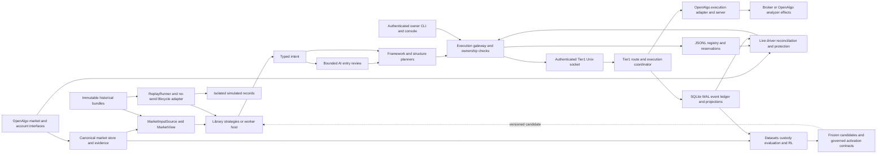
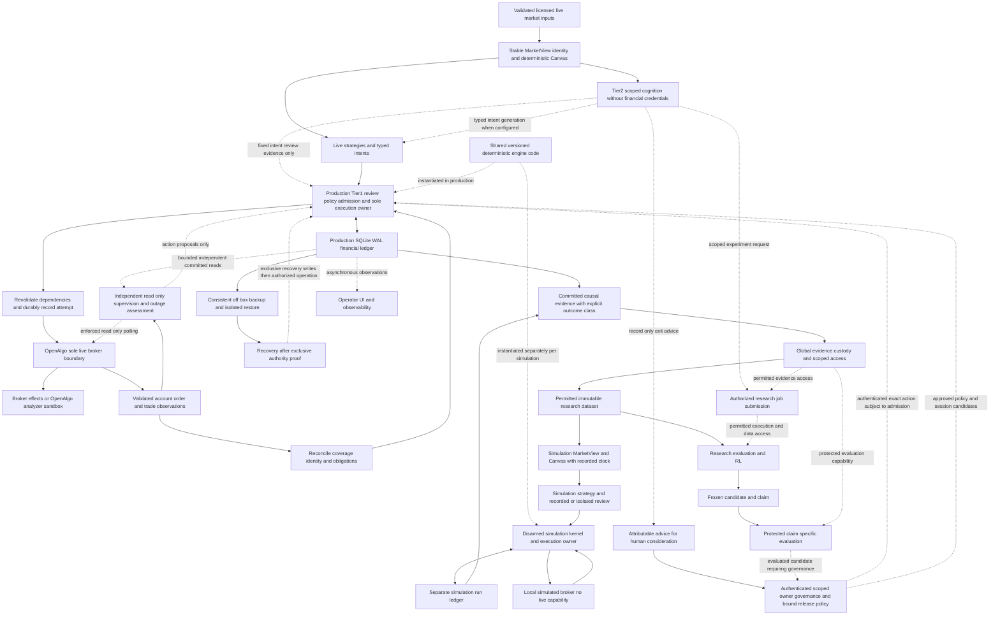

# AutonomousTrading — boundary-first architecture with selective reuse

**Research date:** 24 October 2026 UTC. **Inspected revision:** `445eb116514d97c2574c44d4d5374f938dec57a3`, branch `claude/openalgo-trading-architecture-uu1bxn`. **Status:** original research baseline; D01–D10 and the later requirements/transaction refinements D11–D16 were accepted on 25 October 2026 UTC. A01–A03 decisions were also accepted on 25 October; A04 recovery design was accepted on 26 October; A05 design is now accepted; A06 design is accepted; A07-F1–F4 and revised A08-F1–F5 and A09-F1–F4 and A10-F1–F3 are accepted; reviewed audit scopes are complete and implementation proof remains pending. Acceptance authorizes this design update, not implementation, deployment or financial-policy changes.

## Recommendation

**Accepted design principle — 25 October 2026 UTC:** Design around the best justified boundaries, then reuse code only where it fits. Preserve approved money policies and useful contracts—not accidental directory layouts, coupling, or implementation limitations. These are recommended improvements; implementation tests and measurements must establish their correctness and practical benefit.

The existing project is evidence and a source of reusable implementations, not the template that fixes the target's boundaries. Evaluate retention, extraction, replacement and new implementation against correctness, delivery cost, operational simplicity and acceptance evidence. Reuse is a means to a better system, not a requirement to reproduce its defects. The clean Python layout in §6 remains the target; compatibility adapters must not become competing owners. Retire obsolete live routes by their consumers and obligations; retain or replace verified readers required to interpret retained history under A10-F3.

Recompose the existing system into one installable Python application around its deterministic financial kernel. Reuse the existing Tier-1 ledger/coordinator, causal market contracts, strategy/planning/protection logic, bounded AI review, research custody, candidate evaluation and offline RL implementations where they satisfy the accepted boundaries and proof obligations. Correct persistence/projection behavior in isolated target slices before production acceptance; source repairs are not a prerequisite for extraction. Add Market Canvas through the current market-data seam. A wholesale engine replacement is not justified by the current evidence; reconsider a component when a better-supported implementation demonstrably fits the target.

The highest-value architectural change is **one canonical financial history and one execution owner**. Make the current JSONL ownership registry a verified compatibility projection of Tier-1. Today SQLite and JSONL participate in execution/recovery without one transaction; cleaner folders alone would retain that failure boundary.

Evidence labels: **C** source-verified current implementation; **O** runtime observation; **H** historical attached claim; **P** user-proposed direction; **R** external reference; **D** this report's recommendation; **U** unverified. “Implemented” means executable source was inspected, not that its tests passed. Proposed invariants require future code/deployment enforcement. OpenAlgo's actual analyze/live effects are enforced by OpenAlgo; its deployed mode was not queried.

**24 October audit scope:** only the original Markdown was created, outside the live checkout. No source, tracked document, test, service, configuration, financial record, policy or broker state was changed. No broker request was sent; no protected locked-OOS payload was opened. No application modules were imported or tests executed. Public research used public names/URLs; private code was not uploaded.

## Required behavior before source parity

**Reading guide — 25 October 2026 UTC:** First describe what the target needs to do, then choose code that fits. “Source parity” means matching the existing project's behavior; it is useful evidence of compatibility, not the definition of correctness. The examples below explain the target's existing direction in everyday language. Reuse choices are recommendations awaiting implementation evidence, not claims that the source code or its tests already pass these checks. D11 accepts this requirements-first approach; D12–D16 below record the separately agreed ownership and transaction refinements. No row changes money policy.

**D11 baseline rule:** For each meaningful behavior, identify its reason, accountable owner and independent acceptance proof before choosing reusable code. Classify it as approved money policy, useful compatibility promise, architectural choice, historical behavior or unresolved decision. Preserve approved policies and supported compatibility promises; historical behavior is not automatically required. Record intentional corrections and migrations, and ask the owner about unclear user-facing consequences or owner-controlled policy—not low-level implementation details. The table gives examples rather than an exhaustive catalogue.

**Required behavior → reason → responsible module → acceptance proof → reuse decision**

| Required behavior | Reason | Responsible module | Acceptance proof | Reuse decision: choices and recommendation |
|---|---|---|---|---|
| **Requirement:** An installed application can load its default settings from any working directory. | **Reason:** Starting it from another folder should not break it. | **Owner:** Packaging and settings (`resources/`, `settings.loader`). | **Proof:** Install it in a clean environment, start it outside the checkout, and verify the expected settings load. | **A — Recommended:** Adapt useful loading code to packaged resources; modest migration work removes checkout dependence. **B:** Reuse unchanged if it already passes this proof. **C:** Replace the loader if adapting it is more complex than a small replacement. |
| **Requirement:** Each component receives valid settings with the same meaning wherever it runs. | **Reason:** A service file and a worker should not disagree about a setting or its default. | **Owner:** `settings.schema` defines the contract; deployment and runtime consume it. | **Proof:** Give the service renderer and worker the same valid and invalid examples; verify consistent values and clear rejection of invalid input. | **A — Recommended:** Consolidate useful validators behind one settings contract; some caller changes prevent duplicated rules. **B:** Keep a temporary compatibility reader for old names. **C:** Replace validation code only if it cannot express the target contract simply. |
| **Requirement:** A component can be used through a clear interface without loading unrelated services. | **Reason:** A calculation should be understandable and testable without starting the whole application. | **Owner:** Each domain module owns its behavior; `contracts/` owns shared types; `bootstrap.py` connects implementations. | **Proof:** Run a calculation with explicit sample inputs and verify that it neither starts services nor writes files or makes network calls. | **A — Recommended:** Extract or refactor useful functions behind the target interface; preserve their justified outputs. **B:** Wrap a self-contained component when its internals already fit. **C:** Rebuild only when hidden dependencies make extraction riskier. |
| **Requirement:** Isolated development and research can run while production is operating. | **Reason:** Unrelated production readiness or market hours should not stop safe independent work. | **Owner:** `operations.isolation` defines isolation checks; research and development processes use separate resources. | **Proof:** Run a permitted sample job with separate writable storage, scoped credentials and resource limits; verify it cannot modify production or access protected evidence. | **A — Recommended:** Reuse suitable isolation mechanisms and replace blanket schedule restrictions with checks tied to actual effects. **B:** Move demanding workloads to another host if isolation is insufficient; this costs more. **C:** Defer only the workload whose isolation cannot be established. |
| **Requirement:** Users and integrations can keep using explicitly supported interfaces during migration. | **Reason:** Cleaner internal code should not unexpectedly break a supported command or data reader. | **Owner:** `interfaces/` owns public behavior; `adapters.compatibility` translates supported legacy formats. | **Proof:** Run representative supported requests against the target and compare the promised outputs, errors and permissions. | **A — Recommended:** Use thin compatibility adapters that delegate to one implementation; this adds temporary maintenance. **B:** Retain an interface unchanged when it already fits. **C:** Make an explicit versioned migration when continued compatibility is too costly or unsafe. |
| **Requirement:** Tests show that the target meets its requirements, including failure behavior. | **Reason:** Matching an old test can still preserve an old mistake. | **Owner:** Each module owns its contract checks; target `tests/` also covers integration and failure scenarios. | **Proof:** Derive expected results from the requirement, then deliberately break the promised behavior and confirm the check fails. Check inputs and expected results independently of the implementation being tested. | **A — Accepted under A08:** Write fresh requirement-based target tests; selectively reuse inspected fixtures, scenarios or helpers. Derive expected outcomes independently, without a legacy checkout or exhaustive legacy-test classification prerequisite. **B:** Use entirely new supporting fixtures when reuse adds more verification cost than value. Legacy comparisons prove only explicitly retained behavior. |
| **Requirement:** Useful diagnostics remain available without making the application depend on a telemetry backend. | **Reason:** A monitoring outage should not become an unrelated application outage. | **Owner:** `operations.telemetry`; canonical financial evidence remains owned by the kernel ledger. | **Proof:** Make the telemetry destination unavailable; verify bounded resource use and continued application behavior, while required canonical evidence still follows its own persistence rules. | **A — Recommended:** Wrap suitable logging/export code behind the existing bounded asynchronous seam; small integration cost keeps the backend replaceable. **B:** Keep a simpler local diagnostic sink if sufficient. **C:** Adopt a larger observability stack only after a measured operational need. |

**How to choose:** Keep approved policies and useful compatibility promises. Evaluate internal code, directory layouts and historical workarounds against the target requirement. Reuse unchanged when it fits; adapt or wrap when that is simpler; replace or rebuild only when the benefit justifies the cost. Record intentional behavior changes and their proof. An old/new comparison is one check, not the sole correctness oracle.

These are focused examples, not a complete requirement catalogue or a new approval step for every function. Add rows when a meaningful boundary needs clarification. Independent isolated work can continue while unrelated acceptance evidence is pending. Existing owner-controlled money decisions retain their separate approval rules.

## Contents

1. [Sources and precedence](#1-sources-and-precedence)
2. [Verified current architecture and coverage](#2-verified-current-architecture-and-coverage)
3. [Audit findings](#3-audit-findings)
4. [Open-source reference research](#4-open-source-reference-research)
5. [Target architecture and contracts](#5-target-architecture-and-contracts)
6. [Fully commented target repository](#6-fully-commented-target-repository)
7. [Reuse mapping and migration](#7-reuse-mapping-and-migration)
8. [Constraints and independent work](#8-constraints-and-independent-work)
9. [Unresolved decisions and continuation](#9-unresolved-decisions-and-continuation)

## 1. Sources and precedence

### Attachment inventory

| Source | Date/provenance | Contribution | Limit/classification |
|---|---|---|---|
| `1-source_north_star_architecture_evidence_review_research_2026-10-10.md` | User attachment; review 10 October, expansion/scope revision 11 October 2026; 675 lines, 121,126 characters | C01–C29 authority, replay, ambiguous effects, OpenAlgo basket/status cautions, evaluation criticism; 32 public references and private-source provenance | Read in full. H/R/interpretation, not current implementation or deployment proof. Its own record excludes private code audit and live fault testing. |
| Current assignment | User, this turn | P: Cognitive Fabric, Canvas, shared engine, Tier-1, custody/RL, independent development and concrete outputs | Goals to challenge, not a prescribed package tree or permission to implement. |
| Earlier README/transcript/recovered conversation, attachment U01–U03 | Historical sources described by the attachment | H: intended boundaries and reported implementation gaps | Originals were not separately attached. Earlier transcript review was sampled. This session cannot claim original conversations were reviewed. |
| Historical/current architecture images, detailed prior Mermaid, repository-tree proposals, standalone Canvas/Sketchpad image | Mentioned in the request but not separately present | Potential H/P | Only one file is present in the supplied attachment directory. These originals are inaccessible here; no visual review or reconstruction is claimed. |
| Linked [arXiv taxonomy figure](https://arxiv.org/html/2608.31041v1/figures/agentic.png) | Public URL in attachment | R/H: organization, coordination and adaptation vocabulary | Access did not yield a renderable image in this session. Prior interpretation remains historical; this is not a Canvas image. |

Attachment SHA-256: `cda0d9dc901c523a8e41b4366743417ac62b4704f6f58ab92e57f98570490cad`. Supplied path: `/tmp/codex-remote-attachments/01a16d3e-4db1-7981-a8f2-121c373e4d65/14452b9d-0071-4b66-a9d2-8074fbecb2e1/1-source_north_star_architecture_evidence_review_research_2026-10-10.md`.

### Evidence precedence

Executable code and actual wiring establish current implementation. Runtime observations establish only their observed properties. Comments, names, diagrams and old reports are hypotheses. Fresh validated OpenAlgo observations remain external truth; no financial endpoints were called. External upstream code establishes that revision, not the installed OpenAlgo server.

The original 24 October audit asked codegraph/Graphify first, then opened source. Graph results are leads, not evidence. Excluded docs/tests surfaced incidentally in graph navigation were not used as proof. The latest user restriction superseded the normal repository knowledge-map/document-first procedure: in-repository Markdown, changelogs and tests were excluded, with root README used only for boundaries/diagrams. External READMEs and the attachment were allowed context. No protected evidence or effective secret configuration was loaded. The separately authorized 26 October revised A08 review expanded scope to static test inventory and selected test/source inspection; its findings and limits are recorded under the accepted A08 decisions.

### Contradictions and qualifications

| Tension | Resolution |
|---|---|
| Attachment says Tier-1/shared replay/model paths were unproved | Historical status, not current absence. Current source contains these implementations; production effectiveness is still U. |
| Attachment says kill blocks all writes; new direction expects protection to continue | Current sender permits a narrow authenticated-owner cancel/close exception. Automatic protection writes remain subject to kill. Preserve behavior; do not choose broader emergency permissions. |
| “Paper” could mean local simulation or OpenAlgo analyze | Different boundaries. Local simulation must have no live transport. OpenAlgo analyze uses the public API and is externally selected; it is not structural local disarmament. |
| Agent taxonomy implies mandatory councils/hierarchy | It supplies vocabulary, not measured benefit. Begin with existing bounded review; compare more agents experimentally. |
| Hash chain implies complete immutable truth | It detects changes within scope, not completeness, source truth, all side-table integrity, retention or remote uniqueness. |
| Earlier workflow implies research waits for close | Current research eligibility omits calendar; isolated test checkouts are exempt. Correct specific isolation/guard problems rather than reinstate a global schedule lock. |
| OpenAlgo historical/current/local identities differ | Attachment pin `12e1114657981a3e50dde8c8ce04eb778ae1cf2f`, local mirror `b9d155ff6a22ce60337ac6f9a3bd6fe709e95838`, public research pin `91ced6f…` are separate. None proves deployed server identity. |

## 2. Verified current architecture and coverage

Inventory found **528 Python files under `src/`**: analysis 120, runtime 106, interfaces 106, core 77, data 52, Tier-1 33, contract 13, authoring 9, strategies 5, config 2, knowledge 2, plus three root modules. This is a coverage denominator, not 528 deeply reviewed files.

### Capability and authority map

| Owner/capability | Verified implementation evidence | Status and limits |
|---|---|---|
| Market providers and causal views | `src/runtime/input_source.py:34`, `:47`, `:78`; `src/runtime/market_view.py:185`, `:239`, `:401` | C implemented: shared live/bundle port, availability indexes, as-of reads. Constructor defaults `as_known=False`, `max_age=None`; common classes do not prove identical causality settings in every caller. |
| Worker strategies | `src/runtime/worker_host/__init__.py:452`; `src/runtime/worker_sdk/__init__.py:543` | C implemented: non-abstained decision → intent; intent does not mint broker/financial identity. All strategy-kind behavior/economic value not proved. |
| Planning/financial semantics | `src/core/framework/runtime/orchestrator.py:90`; `src/core/framework/structures/planner.py:195`, `:211`, `:227` | C implemented: ordered gates, concrete legs, payoff/loss budget, selection/sizing/protection. One-leg compatibility and structure planner coexist; cannot merge by deleting one path without parity. |
| Execution gateway/ownership | `src/runtime/execution_gateway/__init__.py:389`, `:879`, `:1002`; `src/core/framework/execution/registry.py:186` | C implemented: shape/authority/holds/checkpoint checks, ownership formation, durable SENT, exact command submission. JSONL overlaps financial lifecycle with Tier-1. |
| Canonical transport authority | `src/runtime/tier1_authority/channel.py:215`; `service.py:270`, `:304`; `src/tier1/gateway_route.py:617`; `coordinator.py:94` | C implemented: authenticated Unix request, proposal binding, send-intent-before-one-call and outcomes. Financial semantics still span gateway/live driver/registry/Tier-1; one service does not prove fully centralized admission. |
| Ledger/projections | `src/tier1/runtime.py:67`, `:97`; `ledger.py:109`, `:164`, `:192`, `:299`; `projections/base.py:132` | C implemented: safe loaded SQLite, WAL/FULL readback, writer lock, transactions/hash chain and verified projections. Runtime fault tests not inspected/executed. |
| Ambiguity/recovery | `src/tier1/coordinator.py:94`, `:139`; `gateway_route.py:715`; `recovery.py:117` | C implemented: interrupted intent becomes ambiguous; observation-based resolution; recovery fence. No remote exactly-once guarantee. Local epoch cannot revoke another host's key. |
| Shared replay | `src/data/replay_engine/runner.py:237`, `:359`; `guard.py:71`; `producer.py:253` | C implemented/partial parity: same view/worker seam, broker-denying guard and no-send lifecycle adapter. Exact AI application replay differs from fresh inference; full parity not tested. |
| Advisors/teams | `src/runtime/advisor/__init__.py:353`; `backends/http.py:231`; `agent_team/__init__.py:176`, `:193`, `:811` | C implemented: failure-to-abstention, whitelisted output, scoped inputs/bounded children and broker-key removal. Environment stripping alone is not universal OS/tool isolation. |
| AI management | `src/runtime/ai_management/contracts.py:359`; `service.py:275`, `:384`, `:430` | C implemented: typed review, identity/expiry checks, existing ALLOW/BLOCK/PAUSE/unavailable semantics. Not a replacement risk authority. |
| Exit advice | `ai_management/advice_orchestration.py:263`; `advice.py:899` | C implemented: generation records advice; application requires authenticated human, fresh identity/position/config checks. Human application may create deterministic commands. |
| Research custody/evaluation | `src/analysis/core/custody.py:184`, `:1183`; `trials.py:121`, `:300`; `datasets/__init__.py:203`, `:815`; `evaluation/candidate.py:912` | C implemented: hash/claim/freeze/partition checks. Historical cleanliness and restored consumed-state behavior not certified. Protected bytes not opened. |
| Offline RL | `src/analysis/rl/{environment,lab,gym_env,reward}.py`; `analysis/candidates/research_policy.py:121`, `:328`; `runtime/advisor/backends/research_policy.py:200` | C implemented: optional RL lab and digest-verified CPU inference/abstention. Research candidates, not autonomous live training/promotion or calibrated full exchange simulation. |
| Operations/interfaces/config | `src/interfaces/mcp/gateway.py:43`, `:131`; `console/api/security.py:45`, `:77`; `src/config/__init__.py:398`; deployment/backup code below | C implemented: composed MCP, human reachability/CSRF, config layering, supervision/release/recovery machinery. Not a full security or deployment certification. |
| Full Market Canvas | No Canvas implementation found in inspected source/search | P: new capability. Existing view/provider/quantitative code is foundation, not proof full scratchpad exists. |

### Existing AI entry policy

`src/runtime/ai_management/service.py:117` and `:430` establish:

| Review outcome | Observe mode | Enforce mode |
|---|---|---|
| ALLOW | Continue/record | Continue to deterministic planning/admission |
| BLOCK | Continue/record | Refuse current entry |
| PAUSE | Continue/record | Fixed-expiry bounded hold; refuse entry |
| AI_UNAVAILABLE, invalid/corrupt/expired result, capacity/timeout failure | Record/alert; continue | Record/alert; continue deterministic planning |

Required-role failure produces unavailable; optional absence remains in artifacts (`team.py:1003`, `:1376`, `:1433`). Advisor backend failures abstain. Preserve these different contracts during extraction; changing the financial consequence requires owner review. ALLOW never overrides deterministic admission.

### Current-state Mermaid — source-grounded



Canvas/workflow products are not drawn as current infrastructure. The external server selects analyzer/live; the diagram does not certify either mode.

### Runtime observations, not runtime acceptance

Read-only `systemctl show` at approximately **09:41–09:44 UTC, 24 October 2026** returned:

| Observation | Result | What it establishes/does not |
|---|---|---|
| Tier-1 authority | Loaded active/running; PID `3051534`, user `admin`, working directory `/home/admin/AutonomousTrading` | O: service manager reports a process. Not release/ledger/candidate/account attestation. |
| Strategy and old monitor units | `at-strategy.service` and `at-monitor.service` inactive/dead, PID 0 | O: those units inactive then. Other processes/monitor units not fully enumerated; no outage conclusion. |
| Research worker | Loaded active/running; PID `3051681`, user `admin`, `Slice=at-research.slice` | O: process exists, not job progress/eligibility. |
| Effective research sandbox | PrivateNetwork=yes, ProtectSystem=strict, NoNewPrivileges=yes, RestrictAddressFamilies=AF_UNIX; scoped inaccessible/RW paths | O: isolation properties configured. Installed ProtectControlGroups=yes differs from tracked `private`; actual per-attempt cgroup creation remains U. |
| Aggregate research slice | CPU quota 250ms; MemoryHigh 805306368, MemoryMax 1258291200, TasksMax 64 | O: aggregate limits configured. Child MemoryMax=infinity does not defeat parent slice limit; actual use not measured. |
| Authority sandbox | PrivateTmp=yes, NoNewPrivileges=yes, ProtectSystem=no, no explicit inaccessible/RW paths | O: broad trusted filesystem access and common user; not strong OS separation among every service. |
| Local upstream mirror identities | OpenAlgo `b9d155ff6a22ce60337ac6f9a3bd6fe709e95838`; QuantDinger `22a3da5c82e721feb8c068798f35fdc69321b7db` | C: `git submodule status`, not installed external server revision. Mirrors untouched. |

No environment values, effective secrets/config, ledger/financial payloads, private model calls or account endpoints were read. Current deployment acceptance remains U.

### Audit coverage record

“Inspected” includes targeted executable ranges/codegraph-returned source, not every line of every file. No historic test result became fresh evidence.

| Area | Paths inspected | Remaining limits |
|---|---|---|
| Tier-1 | `src/tier1/{schema,runtime,epoch,ledger,envelope,events,coordinator,openalgo_adapter,gateway_route,recovery,ports,proposal_contract,compare,activation,release}.py`; projections `{base,orders,positions,reservations,epochs}.py` | Core append/send/recovery; not every importer/event handler. |
| Financial callers | Runtime authority `{channel,service}` and execution gateway `{__init__,structures}`; framework execution `{orders,sender,registry,reconcile,recovery,reservations,loss_latch,structure_fsm,killswitch}`; structures `{planner,types,payoff}`; policy schema; runtime orchestrator; protection structures | Exact binding/ACK/lifecycle/refusal traces; not all policy combinations/formulas. |
| Market/replay | Runtime `{input_source,market_view,research_policy_view}`, worker SDK/host/providers; selected marketdata `{store,evidence,journal}`; replay `{producer,runner,guard,engine,loader}` | No measured tick completeness or all provider quality paths. |
| Cognition | Advisor core and selected `{http,team,research_policy,replay,rule,local_model,mcp}` backends; agent team parent/child; AI management `{contracts,service,team,blueprint,context,pause,advice,advice_orchestration,applications,config}` | Not all tools/egress/memory/promotion paths. |
| Research | Core `{custody,trials,promotion_evidence}`; datasets; candidate evaluation/research-policy bundles; RL environment/lab/gym/reward; jobs policy/worker/registry/containment | No protected bytes or historical outcomes; source controls, not forensic certification. |
| Ops/config/interfaces | pyproject; config loader/defaults/profiles selected settings; safe_pytest/pytest_storage; research installer/service templates; selected deploy/release/recovery/backup; selected live driver integration; MCP/client and owner API security | Live driver 8,486 lines, sampled; dataset module 3,054 and management team 1,526 lines, targeted ranges. Full frontend/proxy/tool/security/deploy review U. |
| Excluded | Repository Markdown except root boundaries/diagrams, tests, `.env`, `run/`, protected OOS, financial payloads, mirror internals | Deliberate assignment scope; not a recommendation to skip future authorized acceptance. |

## 3. Audit findings

No critical exploit, actual duplicate broker order or current financial loss was established. Severity applies to demonstrated contracts, not invented incidents.

| ID/severity | Evidence/root cause | Impact | Correction |
|---|---|---|---|
| **F1 High — ACK success despite local persistence failure** | `src/core/framework/execution/registry.py:139` catches write/fsync error; `:414` records persisted=false and emits lifecycle. `src/runtime/execution_gateway/__init__.py:1151` ignores `mark_ack` result and returns ok=true. | Tier-1 retains canonical ACK but local ownership can stay SENT while caller sees success. Recovery waits for writer-gone (`reconcile.py:276`). No duplicate send/canonical history loss proved. | Return explicit broker-accepted/projection-unresolved, sent=true and broker/canonical IDs; check persistence and qualify emission. Later replace overlapping authoritative writes with verified projections. |
| **F2 Medium — cancel/modify intents never settle locally** | Gateway reserves intents at `execution_gateway/__init__.py:691`, `:1237`, `:1403`; success paths at `:1267`/`:1457` update other rows; only close calls intent updater at `:1580`. Recovery hardcodes close (`tier1_authority/service.py:622`). | JSONL retains reserved intent after canonical outcome; monitoring/recovery view stale. Canonical scope still constrains resend. | Settle every verb on submitted/rejected/ambiguous/never-reached results; generic exact-identity reconciliation. |
| **F3 Medium — mutable authority indexes outside chain validation** | Epoch/command/broker tables at `tier1/schema.py:51`, `:63`, `:71`; `ledger.py:299` verifies event rows only; route `:398` repeats chain-only check after external DB change. Writer epoch/dedupe trust tables (`ledger.py:150`, `:263`). | Same-UID tamper, qualifying corruption or future writer bug can disagree with chain while chain stays green. Normal writers are transactional; no current incident observed. | Rebuild/compare indexes/epoch against event-derived truth at startup/recovery/external changes. Preserve existing release-binding event/digest check and lazy projection checkpoint verification. |
| **F4 Medium — wheel omits required packages** | Explicit package list `pyproject.toml:112`–167 omits regular packages `src.config`, `src.core.governance`, `src.runtime.ai_management`, `src.tier1`, authority/worker host and nested packages. Included consumers import them (`src/runtime/session_state.py:14`; `src/data/replay_engine/proposal_receipt.py:11`). | Checkout masks incomplete installed artifact. Wheel compatibility unsupported as configured; build failure not executed here. | Deliberate discovery/data inclusion; installed wheel entrypoint tests from empty directory. Keep temporary checkout-only MCP exception explicit. |
| **F5 Medium — service environment conflicts with research guard** | Template `deploy/systemd/at-research-worker.service:13` injects AT_RUN_DIR; `_SERVICE_ENV_KEYS` at `src/analysis/jobs/policy.py:33` omits it; `:95` rejects any unexpected variable. Eligibility `:199`, worker `:516` before claim; fixed entrypoint `:765` does not sanitize. | Newly rendered matching workers can remain active but leave jobs queued. Source blocker confirmed; installed environment/queue progress not inspected. | Permit the intentional nonsecret path setting or pass validated explicit argument; one service-environment contract. Keep credential exclusion/resource/custody controls. |
| **F6 Low — informational mode auth mismatch** | REST honors header/custom body auth (`src/interfaces/mcp/core/openalgo.py:164`); `analyze_mode` hardcodes apikey body (`:576`). | Header/custom-field deployment may report unknown while execution works. Does not gate sends. | Reuse auth builder; preserve live/unknown distinction and informational-only status. |
| **F7 Low — legacy replay marker missing** | Multi-leg formation uses replay=true (`src/data/replay_engine/producer.py:266`); legacy at `:282` omits it; registry accepts extras (`registry.py:186`). | Inconsistent provenance metadata, no send risk due disarmed adapter. | Check exact-shape compatibility; add marker if not intentionally excluded. |
| **F8 Low/dormant — duplicate checkpoint API hazard** | `tier1/projections/base.py:174` assumes new events; `ledger.py:217` skips duplicates but stores supplied checkpoint `:253`. No production caller found. | Future use can commit a nonreplayable digest and fail closed. Not a current runtime failure. | Compute from actual appended events or remove unused hook before adoption. |
| **F9 Known boundary — cross-host fencing is operational** | Local flock/epoch (`tier1/ledger.py:83`, `:150`); recovery fence (`recovery.py:117`). | Local epoch/restore cannot disable old host's credential. | Keep external old-host incapability/revocation and reconciliation before activation; no network WAL/active-active shortcut. |

### Policy limitations, not automatic fixes

- **Gross economics:** `src/core/framework/structures/planner.py:211` supplies costs=0, used for risk/loss budget at `:227`–263. Record gross/modeled-net/reconciled-net separately. Whether costs/slippage affect admission is an owner decision; no numeric policy selected.
- **Planned protection:** gateway builds entry and protective basket from plan values (`execution_gateway/__init__.py:1012`; `execution/orders.py:188`–214). Actual fill can differ. Measure protection drift/partial fills/sibling cancellation; repricing or staging changes money behavior and needs approval. Basket is not atomic or automatically OCO.
- **Emergency permissions:** current sender permits narrow human cancel/close under kill; automatic writes remain constrained. Preserve source behavior; owner chooses any changed daily-loss/kill/recovery/risk-reduction matrix.

### Findings narrowed after cross-check

Global idempotency should survive epoch/principal rotation; scoping keys to new epochs can permit resend. Current coordinator checks prior execution outcomes and namespaced IDs. Treat inconsistent identity fields as verification work, not an instruction to reset dedupe. Release bindings already compare receipt digest with a RELEASE_BOUND event (`gateway_route.py:360`); they are not included in F3. Projection checkpoints self-verify (`projections/base.py:159`). Missing test inspection is an evidence gap, not evidence tests are missing.

### 25 October follow-up audit and accepted target decisions

**Provenance:** follow-up source audit dated 25 October 2026 UTC; `AutonomousTrading/claude/openalgo-trading-architecture-uu1bxn` at `445eb116514d97c2574c44d4d5374f938dec57a3`; design workspace `AutonomousTradingArchitect/main` at pre-update baseline `a4c6308641d12b1a15898c05ce2bbd022cd46822`. Scope: module boundaries, transaction readiness, packaging, deployment and isolation; 528 source files parsed for import relationships plus targeted executable traces. No application tests, live broker calls or protected evidence reads. F1–F5 remain open; design acceptance does not close them. The original audit and external research retain their 24 October dates.

The owner accepted all ten recommendations together for README/ROADMAP updates. **D01–D10 are stable decision IDs in the discussion's order**, not ten additional defects or a serial implementation schedule. F-identities retain their original meanings. These are accepted target requirements awaiting implementation proof; they are not assertions of current enforcement.

| Decision | Accepted target behavior and owner | Evidence and why this improves the target |
|---|---|---|
| **D01 — truthful outcomes** | `contracts.execution` separates broker effect, canonical persistence and projection freshness; callers retain identities and never infer retry permission from local projection failure. | F1 remains at `src/runtime/execution_gateway/__init__.py:1151`. Fix the outcome contract, not just an ignored boolean. |
| **D02 — canonical monetary admission** | `kernel.admission` commits admission, monetary reservation and command identity atomically; JSONL is a verified compatibility projection. | Current `src/tier1/gateway_route.py:540` accepts a command; capital/margin remain in `src/core/framework/execution/reservations.py:377`. Registry locking at `src/runtime/execution_gateway/structures.py:650` is real protection, not proof of canonical SQLite ownership. No overspend was established. |
| **D03 — one command lifecycle** | `kernel.lifecycle` owns shared command states and verb-specific transitions for entry, cancel, modify and close, with exact command identity and reconciliation. | F2 and `src/runtime/tier1_authority/service.py:622` show the close-specific join. Replace fragmented settlement with one contract, not four unrelated patches. |
| **D04 — complete derived-state verification** | `kernel.ledger.projections` compares authority indexes and financial read models with event-derived truth at required heads. | F3: `src/tier1/ledger.py:299` checks the chain, not all mutable authority tables. Preserve existing transactional writes and valid release/projection checks. |
| **D05 — installable, versioned application** | Packaging owns executable entrypoints and immutable resources; settings owns external state roots; operations stages versioned artifacts/environments before activation. | F4: `pyproject.toml:112` omits 34 of 87 regular source packages and declares no console scripts; `src/config/__init__.py:52` assumes checkout resources; `deploy/deploy_tier1.py:618` and `:661` mutate checkout/venv in place. Broaden the remedy beyond package discovery. |
| **D06 — one worker configuration contract** | `settings.schema` defines scoped worker settings consumed by service rendering and runtime validation. | F5 affects both `deploy/systemd/at-research-worker.service:13` and `at-research-model.service:13`; `src/analysis/jobs/policy.py:33` excludes their `AT_RUN_DIR`. Fix contract drift, not merely one variable. Installed queue failure was not established. |
| **D07 — pure planning, explicit effects** | `kernel.planner` computes versioned plans from explicit inputs; admission owns persistence/effects. Neutral contracts do not import runtime implementations. | `src/core/framework/runtime/orchestrator.py:393` defaults registry writes and `:787` performs them; `src/core/framework/execution/loss_latch.py:377` resolves runtime routing. Preserve approved semantics and proof seals while replacing coupling. |
| **D08 — causal Canvas by contract** | `market.view` and Canvas require explicit cutoff/availability/freshness policy and versioned facts; rendering stays downstream. | `src/runtime/market_view.py:185` has compatibility defaults; `src/data/replay_engine/runner.py:320` already supplies causal replay settings. Reuse the seam, not unsuitable defaults; full Canvas remains new work. |
| **D09 — enforced cognitive capabilities** | Cognition uses narrow job/tool ports; operations enforces filesystem, socket, credential, network and resource boundaries, including descendants. | `src/runtime/agent_team/__init__.py:176` strips credentials but `:824` does not itself establish OS denial; designer/job coupling appears at `src/runtime/ai_management/designer.py:869` and `src/analysis/jobs/tasks.py:374`. No leak was established. |
| **D10 — recovery proof before cutover** | Operations proves candidate-artifact crash recovery, clean-host restoration and exclusive activation before Phase 7. Phase 8 tunes recovery targets and growth. | `src/tier1/recovery.py:117` already fences restored authority. The original phase order left baseline restoration proof too late; this changes the target dependency, not current trading permissions. |

[ROADMAP.md](ROADMAP.md#accepted-decisions-and-delivery-order) records implementation order and acceptance checks. All decisions preserve unresolved money-policy choices and independently safe development.

### Accepted requirements and transaction refinements — 25 October 2026 UTC

The owner chose option A for audit item 1, option A for item 2, and option A for the connected items 3–6, then authorized both documents to be updated together. **D11–D16 map to those six items in order** and extend D01–D10 without renumbering them or F1–F9. Status changed from proposed to **accepted design; implementation and acceptance proof pending**.

This was a target-document review on `AutonomousTradingArchitect/main` at `ecf39ad731ad20b9e541b238225f9ca8d1213537`, including the subsequent local requirements-table and working-style edits. It was not a new source audit. Historical source evidence remains scoped to `AutonomousTrading/claude/openalgo-trading-architecture-uu1bxn` at `445eb116514d97c2574c44d4d5374f938dec57a3`; no new broker, runtime or test claims are made.

| Decision and requirement | Reason and responsible owner | Acceptance proof | Choice, trade-off and reuse direction |
|---|---|---|---|
| **D11 / item 1 — Requirements before parity.** Keep useful behavior while improving internal structure. | Old behavior can contain workarounds or defects. Each target module owns its requirement; composition connects modules. | Each meaningful requirement has an independent expected result; source comparisons prove named compatibility only. | **Accepted A:** classify requirements first, then keep, extract, wrap, refactor or replace code that fits. More initial clarification than blanket parity, less inherited coupling. Assess tests and fixtures by the same rule. |
| **D12 / item 2 — Kernel-owned review application.** AI supplies review evidence; the kernel applies approved rules. | Entry eligibility needs one policy owner. `cognition.review` produces reviews; `kernel.policy` interprets them and `kernel.admission` enforces the binding. | Every entry path rejects bypass or mismatched review evidence; live/replay preserve approved outcomes and timeout behavior. | **Accepted A:** move application ownership into existing kernel modules. External application plus kernel verification was the alternative; avoiding duplicated interpretation is worth the caller refactor. |
| **D13 / item 3 — Valid admission at dispatch.** Check relevant approval conditions before an attempt starts. | A pause or crash can make earlier approval stale. Coordinator and admission use the sole ledger writer for the dispatch transition. | Pause/restart across admission and dispatch; changed relevant conditions prevent stale dispatch, while uncertainty cannot expire into retry permission. | **Accepted A, shared with D14–D16:** track the affected action and its dependencies. Broader holds are simpler but can unnecessarily stop unrelated actions. No new deadlines or emergency permissions are selected. |
| **D14 / item 4 — Identity through transport.** Recover a command without blindly sending it again. | A lost response does not mean an order failed. Coordinator owns attempts; the OpenAlgo adapter exposes transport evidence and retry behavior. | Duplicate submissions, disconnects and crashes preserve identity; potentially effective requests are not silently retried. | Extend fitting identity/recovery code behind the existing boundary. Local uniqueness is not remote deduplication; endpoint-specific guarantees require proof. |
| **D15 / item 5 — Evidenced observations.** Resolve uncertainty from reliable, attributable observations. | Successful queries may still be incomplete or describe different instants. Adapter reports coverage; reconciliation interprets it. | Missing pages, late fills, conflicting snapshots and manual orders cannot create false resolution or release. | Reuse normalization only where coverage and identity contracts fit. Repeated stable polling alone is insufficient proof of completeness. |
| **D16 / item 6 — One accounting transition.** Update obligations consistently as orders fill, cancel or remain uncertain. | Command completion is not position closure. Reconciliation validates evidence, lifecycle determines transitions, reservations computes consequences, and the ledger writer commits them together. | Duplicate/reordered observations do not double-count fills or release capacity early; corrections and revaluations remain explicit. | Use the existing canonical ledger, not another journal. Explicit transitions cost more than blanket reservation holds but avoid unnecessary capacity restrictions; valuation policy stays unchanged. |

Establish D11–D12 first; specify D13–D16 together because dispatch, identity, reconciliation and accounting depend on each other. These refine the existing clean packages rather than add services. Isolated development and synthetic verification do not wait for market close or unrelated broker acceptance. [The roadmap](ROADMAP.md#accepted-decisions-and-delivery-order) owns delivery dependencies and status.

### Accepted independent-review refinements

**25 October 2026 UTC:** following independent review of snapshot `70e1e539f1dc8a890b12d68525d125df8dd14012` on `AutonomousTradingArchitect/main`, the owner accepted the corrected options below. These refine existing D01–D16 rather than renumber them. The local module-shorthand clarification is retained. No source audit, implementation proof or money-policy change is claimed.

| Review ID | Agreed direction and status | Scope and proof |
|---|---|---|
| **AUD-01** | **Accepted design refinement:** explicit entry, cancel, modify and close request types, enforced by one kernel. | Validate actual effects, target identities, quantities, relevant state and actor permissions. Mislabelled protective actions cannot bypass applicable rules; non-entry does not automatically mean risk-reducing. |
| **AUD-02** | **Accepted design refinement:** each authoritative outcome transition commits its lifecycle and applicable accounting changes atomically. | Crash proof shows either the complete transition or preceding recoverable state. No fixed transaction count per command lifetime is imposed. |
| **AUD-03** | **Accepted design refinement:** distinguish evidence links from control flow and record non-dispatch decisions in both compositions. | Compare approved decisions and causal evidence, not identical call graphs. Preserve existing PAUSE meaning without inventing hold/expiry rules. |
| **AUD-04** | **Design refined by accepted A03-F4/F5:** bounded ordinary reads, independent read-only ledger access and enforced read-only observations; A04/A06 retain recovery/security mechanism proof. | Measure isolation, progress, latency and log growth. No zero-delay promise or assumed read-only broker credential capability. |
| **AUD-05** | **Accepted audit task, migration route undecided:** compare in-place upgrades with verified import into a target database under A02/A04. | Preserve original event bytes, identities and provenance; rebuild state and expose historical gaps. Do not prescribe extra migration files or assume new contracts require new tables. |

**AUD-06 rejected as stated:** the 24 October research date is historical and correct. D11–D16 and the A01–A10 agenda were committed together in `70e1e539f1dc8a890b12d68525d125df8dd14012`, whose parent is `ecf39ad731ad20b9e541b238225f9ca8d1213537`; no intermediate commit is invented. This disposition records the review outcome, not a new architecture requirement.

### Accepted A01 time and market-data decisions

**25 October 2026 UTC — design accepted, implementation proof pending.** The owner accepted the recommended directions for A01-F1 through A01-F5 after the target-only review at `AutonomousTradingArchitect/main`, commit `b65cc821a7d34e527988dfc1277516e7467fbb9e`. These stable finding IDs now identify accepted design decisions refining D08; they do not rename D01–D16 or claim a new trading-source audit. No numerical warm-up, freshness threshold or financial permission was changed.

| Decision | Required behavior and owner | Acceptance proof | Selected approach and trade-off |
|---|---|---|---|
| **A01-F1 — Stable view per decision** | `market.view` resolves retained input revisions and policy into one view identity; related strategy and Canvas reads use that identity. | Interleave ingestion/corrections between reads; the original view remains stable and reopening it reproduces its inputs and geometry. | Retained store revision or explicit manifest, whichever proves fit at lower cost; a hash without retained inputs is insufficient. Avoid holding a database transaction open during AI work. |
| **A01-F2 — Historical/live handoff** | `market.sources` reports identity, coverage and revision evidence; ingestion deterministically resolves overlap and retains conflicts/provenance. | Overlap, duplicates, stale history responses, interrupted fetch/retry and missing intervals cannot invent earlier application knowledge or silently replace a newer revision. | Narrow provider-specific merge contracts, with buffering or continuous ingestion chosen from evidence; no new bootstrap service or assumed universal sequence guarantee. |
| **A01-F3 — Consumer-owned input requirements** | Strategies and Canvas algorithms declare their inputs; `market.view` assembles them and `market.quality` reports coverage, freshness and unmet requirements. | Missing/duplicate/cross-session inputs and optional fields affect only dependent consumers under approved rules. | Small typed requirement/result contract instead of a global readiness manager; preserve approved values and consequences. |
| **A01-F4 — Explicit window semantics** | Market contracts/view define shared calendar/window meaning and expose partiality, closure, completeness and correction revision separately. | Mid-window startup, exact boundaries, breaks, shortened sessions, missing constituents and delayed finalization yield consistent window meaning. | Normalize vendor bars where suitable; build bars locally only where justified. Usability remains consumer-specific, not a universal final-bar restriction. |
| **A01-F5 — Reproducible correction propagation** | View resolves base revisions; algorithms identify effective inputs; Canvas history preserves prior facts and supersession. | Old views remain reproducible; new derived results match independent expectations; restart, recomputation and any incremental path agree for the same inputs. | Start with deterministic recomputation over required inputs; add checkpoints or targeted invalidation only when measured benefit justifies complexity. |

A01 is complete for this reviewed design scope. Its acceptance checks remain future implementation work; the subsequent A02 decisions below build on these contracts. Keep the existing packages and one ingestion seam. These data contracts do not grant financial authority or create market-hours gates for independent work.

### Accepted A02 compatibility and configuration decisions

**25 October 2026 UTC — accepted design, implementation proof pending.** The owner selected the precise formulations below after the A02 target review of `AutonomousTradingArchitect/main` at `b65cc821a7d34e527988dfc1277516e7467fbb9e` plus the local accepted A01 edits. A02-F1–F5 retain their finding IDs. They refine D05/D06, D11–D16 and AUD-05; no new source inspection, financial default or live permission is implied.

| Decision | Accepted behavior and owner | Acceptance proof and trade-off |
|---|---|---|
| **A02-F1 — Exact internal contract versions** | Domain owners define contract meanings; local same-release boundaries validate exact versions. `adapters.compatibility` converts only supported persisted ledger/JSONL history, frozen candidate bundles and external operator/MCP surfaces. | Mixed internal versions and unknown required variants fail explicitly for the affected operation. Supported conversions preserve meaning. Simpler internal protocol handling trades rolling-version flexibility for a tested same-release composition. |
| **A02-F2 — Same settings resolver per process** | `settings.loader` resolves packaged defaults → selected profile → scoped environment; `settings.schema` owns types and meanings. Compare relevant shared effective digests at boundary calls. | Conflicting deprecated/replacement keys fail rather than select a winner; omission/null, unknown keys and defaults changes have explicit tested meaning. Service-specific settings may legitimately differ. No settings distributor is introduced. |
| **A02-F3 — Immutable process settings** | Resolved settings remain immutable for each service-process lifetime; configuration changes use restart/session boundaries under existing approval. Bootstrap/operations owns activation. | Changed files cannot silently alter running operations; activation/restart proves applicable revision identity. Runtime safety actions and governed candidate transitions remain explicit state operations, not settings reloads. Restart cost is accepted over general hot reload complexity. |
| **A02-F4 — Exact tested release bundle** | Operations manifests bind actual artifacts/dependencies/resources and exact supported event/candidate/Canvas schemas plus SQLite migration revision; domain owners validate interpretation. | Resource substitution, missing artifacts and incompatible current state reject dependent activation or rollback. Schema/migration revision and stored event formats determine compatibility, not ledger event-sequence height. Exact bundles reduce combinatorial compatibility work. |
| **A02-F5 — Bounded migration with complete accounting** | Ledger migration/recovery and compatibility code pin source heads/digests, converter identity and every source record's disposition. | All records are transferred or explicitly rejected/quarantined with original evidence preserved; no silent drops. Unknown authoritative records block dependent financial activation even if quarantined. Upgrade versus import remains an A04 choice based on evidence. |

These decisions complete A02's reviewed design scope. A03 and A04 are now design accepted; evidence-based migration-route selection and operational recovery proof remain pending implementation. No new package, global configuration service or independent financial authority is introduced.

### Accepted runtime and outage contracts — A03, 25 October 2026 UTC

**Status: design accepted; implementation and production proof pending.** A03-F1–F5 retain their original identities and include the owner-approved failure re-audit corrections. Architecture baseline: `AutonomousTradingArchitect/main` at `b65cc821a7d34e527988dfc1277516e7467fbb9e`, plus local accepted A01/A02 edits. Read-only source review: `AutonomousTrading/claude/openalgo-trading-architecture-uu1bxn` at `445eb116514d97c2574c44d4d5374f938dec57a3`; OpenAlgo mirror at `b9d155ff6a22ce60337ac6f9a3bd6fe709e95838`. Date precision is UTC day; no deployed broker calls, fault injection or production readiness proof occurred. These source implementations are reuse evidence, not mandatory target structure.

| Decision | Required behavior and reason | Responsible modules | Acceptance proof and reuse decision |
|---|---|---|---|
| **A03-F1** | Slow external I/O leaves eligible state processing responsive; initially one outbound broker request in flight per account. A timeout preserves uncertain effects, not permission for conflicting dispatch. | `kernel.coordinator`, `adapters.openalgo`, `kernel.safety` | Stall HTTP separately from the whole kernel; check progress, hold acknowledgement and identified late results. Refactor coordination around existing identity/lifecycle contracts; do not copy the source's lock across HTTP. |
| **A03-F2** | The canonical ledger is the sole durable queue for admitted financial commands; memory triggers are reconstructible wake-ups. Unaccepted overload fails explicitly; ingestion loss is reported. | `kernel.admission/coordinator`, `kernel.ledger`, `market.ingest` | Saturate queues and restart; account for every accepted command, preserve retry identity, bound memory and expose coverage gaps. Reuse ledger transitions, not a second durable command queue. |
| **A03-F3** | Caller disconnect, job cancellation and financial cancellation have distinct meanings. Explicit detached research jobs survive status-caller disconnect; entry reviews remain deadline-bound. | `research.jobs`, `cognition.runtime`, `kernel.coordinator` | Disconnect at each acceptance/send boundary; terminate cancelled descendants, retain resource accounting and reject late result reuse. Assess existing leases/containment for reuse rather than assume correctness. |
| **A03-F4** | Independent supervision reads committed financial evidence and fresh broker observations, records discrepancies and preserves uncertainty without becoming a financial authority. | `operations.supervisor`, `kernel.ledger`, `kernel.reconciliation`, observation adapters | Freeze kernel after a new attempt but before export; inspect current committed state independently, test partial/conflicting broker reads and denied write capability. Reuse bounded ledger readers and pure reconciliation functions; snapshots alone are insufficient. |
| **A03-F5** | Demand-aware monitoring detects stalled work; controlled recovery preserves one execution owner and reports which protections remain operational. | `operations.supervisor/isolation`, `kernel.recovery/protection` | Distinguish healthy idle from stalled demand; fail during protection placement/local trailing; prove exclusive recovery and retained uncertainty. Recovery mechanics are reuse candidates; A04 must specify restart eligibility and prove activation. |

**Source evidence and limits:** `src/tier1/gateway_route.py:621–650` holds the route lock around synchronous coordinator dispatch; `src/tier1/coordinator.py:94–155` persists send intent, calls the adapter and marks interrupted attempts ambiguous. `src/tier1/ledger.py:110–119` supports independent readers; `src/tier1/recovery.py:138–193` uses SQLite backup and verifies the captured ledger, not subsequent commits. `scripts/run_framework_live.py:286–303` reads books separately and `:8060–8066` invokes structure supervision from the framework loop. In the pinned OpenAlgo mirror, `services/orderbook_service.py:147–178` and `services/positionbook_service.py:122–143` fetch/transform separate books; `broker/zerodha/api/order_api.py:90–99` illustrates separate upstream endpoints, not the deployed broker's proved coverage. Order-book routing at `services/orderbook_service.py:127` can select analyzer data; authentication at `:207` and `services/place_order_service.py:5` does not establish a distinct read-only permission. `deploy/systemd/at-tier1-authority.service` specifies restart-on-failure and `src/runtime/tier1_authority/service.py:836` recovers interrupted attempts; neither establishes safe automatic activation. Target boundaries below correct these limitations without changing money policies.

### Accepted combined A01–A03 corrections

**26 October 2026 UTC — ✅ combined audit complete; ✅ accepted corrections recorded in README and ROADMAP. Implementation and production proof remain pending.** Target-only combined review at `AutonomousTradingArchitect/main`, `842fe1f007b9ef5ccfdcb9e90223597dced56ff9`, included an independent reviewer. It found no reason to reverse accepted A01–A03 choices; the three corrections below close cross-contract gaps. No new trading-source or broker verification occurred. The existing AGENTS goal update preserves the owner's requirement to prevent unproved assumptions from becoming misleading premises for later architecture work.

| Decision | Accepted correction and owner | Trade-off and acceptance proof |
|---|---|---|
| **Combined-F1** | `contracts.clock` defines shared timestamp, ordering, elapsed-time and uncertainty semantics; `adapters.clocks` implements them. Kernel/cognition retain approved timing rules; A04 defines restart handling. | Modest clock plumbing avoids depending only on adjustable wall time. Inject forward/backward clock changes, skew, tied timestamps and restart; verify consistent expiry, replay and retained broker uncertainty without changing deadline values. |
| **Combined-F2** | Market/outage evidence owners durably publish external evidence before `kernel.ledger` commits its reference; explicit ownership covers retention, handoff and cleanup. Small normalized evidence may be inline. | External storage keeps large inputs outside the financial DB but needs publication/retention rules. Crash before/after publication, reference commit and cleanup; committed required references remain readable, retries do not duplicate financial effects. |
| **Combined-F3** | Shared contracts keep exact live internal versions; `adapters.compatibility` reads supported historical worker evidence, not older live worker exchanges. | No rolling-version compatibility matrix is introduced. Reject incompatible live workers for the affected operation while preserving supported historical evidence identity and meaning. |

These are clarifications of accepted A01–A03, not new money policies, framework dependencies or production authority. A04 subsequently accepted recovery/release contracts; A05 design is now accepted; A06 design is accepted; A07 is next when resumed and A08 carries combined failure tests through implementation.

### Accepted A04 recovery and release decisions

**26 October 2026 UTC — ✅ audit complete; ✅ README/ROADMAP updated; implementation and production proof pending.** Target review with independent cross-check at `AutonomousTradingArchitect/main`, `c4bf1040228c8cb4437dd224262e0f1e5ee7f17e`. No new source/runtime/broker verification supports these decisions. The owner selected A for all five directions, preserving A01–A03, Combined-F1–F3 and approved money policies.

| Decision | Accepted behavior and owner | Trade-off and acceptance proof |
|---|---|---|
| **A04-F1** | `kernel.recovery/authority` separates read-only inspection, exclusive recovery writing and authorized operation; admission checks action-specific dependencies. | More explicit stages than one ready flag. Interrupt each stage; repair/reconciliation writes cannot dispatch, and unrelated warm-up cannot block independent work. |
| **A04-F2** | Recovery/authority proves old-owner exclusion separately from coordinator resolution of previously initiated effects. | Requires distinct termination/fencing and uncertainty evidence. Freeze the owner, delay external completion and attempt replacement; preserve identity and prevent duplicate/conflicting dispatch. |
| **A04-F3** | `operations.deployment` and bootstrap record staged release transitions, actual participant compatibility and observation coverage; recovery controls financial activation. | Recorded sequencing adds bookkeeping but makes partial failure resumable. Fail each participant/schema transition; software rollback must support current history, never restore an older financial database. |
| **A04-F4** | Schema/recovery, compatibility and migration-script owners define pinned capture, resumable conversion and final handoff before choosing upgrade versus import. | No unconditional route selected. Compare actual mappings and recovery evidence; interrupt/repeat batches, vary source heads and inject unknown authoritative records without silent loss or invented history. |
| **A04-F5** | Backup/restore coordinates existing evidence owners through a verified recovery manifest covering ledger boundary, required objects, compatible artifacts and custody continuity. | Manifest references avoid requiring one large archive but require availability checks. Clean-host restore with missing objects, older snapshots and stale custody exposes scoped gaps and preserves uncertain effects/consumed evidence. |

Automatic restart policy, financial activation permissions, migration route, RPO/RTO values and concrete fencing/security mechanisms are not implicitly selected. A05 design is now accepted and A06 design is accepted; A07 is next when resumed; implementation must prove the accepted recovery contracts.

### Accepted A05 strategy and cognition decisions

**26 October 2026 UTC — ✅ audit complete; ✅ README/ROADMAP updated; implementation and production proof pending.** Owner accepted the recommended options for A05-F1–F5 together. Target review with independent cross-check used architecture `main`, `c4bf1040228c8cb4437dd224262e0f1e5ee7f17e`, plus local accepted A04 updates. No new source/runtime/broker verification. Existing A01–A04, Combined-F1–F3 and financial policies remain intact; A06 design is accepted; A07 is next when resumed.

| Decision | Accepted behavior and owner | Trade-off and acceptance proof |
|---|---|---|
| **A05-F1** | Explicit declarative registry separates extension identity, decision method, hosting, state and requested capabilities. Registry/bootstrap validates before host loading; requests do not grant authority. | Simpler to audit than dynamic discovery initially. Register supported deterministic/model combinations; reject invalid descriptors without executing rejected code or granting privilege. |
| **A05-F2** | Strategy worker owns invocation/input/prior-state/result identity and recoverable state/output handoff; kernel owns financial acceptance and deduplication. | Stateful extensions need checkpoint/handoff proof; stateless reconstruction remains valid. Crash at state/output/acceptance boundaries and session reset; no lost output, doubled state or fresh identity caused by retry. |
| **A05-F3** | Model intent generation and review of a fixed intent use distinct typed purposes over shared runtime infrastructure; kernel policy alone applies existing review requirements. | Shared providers/runtime avoid duplication, explicit roles prevent circular or wrong-role evidence. Mutate/swap reviewed intents and exercise differing approved review requirements without mandatory extra AI review. |
| **A05-F4** | Runtime/records distinguish contribution, abstention, unavailable/error, invalid, timeout and cancellation; pinned blueprints define eligible assembly and attributable omissions. | Small shared result validation with team-specific synthesis; single-specialist teams remain valid. Vary required/optional failures, duplicates, late results and malformed synthesis without changing financial consequences or deadlines. |
| **A05-F5** | Provider/run records retain requested and reported effective execution identity, prompt/context/tool evidence, attempts and typed output under existing retention/access rules. | Evidence storage cost buys attributable replay; unknown remote revisions stay unknown. Simulate substitution and already-permitted fallback; replay recorded evidence without fresh inference or invented determinism. |

### Accepted A06 security and operator decisions

**26 October 2026 UTC — ✅ audit complete; ✅ README/ROADMAP updated; implementation and production proof pending.** Owner accepted recommended A06-F1–F5 together. Target-only review with independent cross-check used architecture `main`, `c4bf1040228c8cb4437dd224262e0f1e5ee7f17e`, plus local accepted A04/A05 updates. No new source/runtime/broker verification. A01–A05, Combined-F1–F3 and approved money policies remain intact. Work pauses after this documentation update; A07 is next when resumed.

| Decision | Accepted behavior and owner | Trade-off and acceptance proof |
|---|---|---|
| **A06-F1** | Interfaces establish authenticated actor/delegation; kernel authority independently validates scoped grants, relevant expiry/revocation and delegation limits. | Explicit identity/grant records instead of implicit relay trust; no general policy engine. Forge attribution, expand scope, cross accounts and revoke before dispatch; already initiated effects remain attributable and uncertain. |
| **A06-F2** | Verify native read-only OpenAlgo credentials first; otherwise an isolated typed observation process mediates reads and denies callers direct bypass/secret access. | Native grants reduce trusted code; restricted mediation adds an operational component and trusted credential holder. Reads survive kernel failure; alternate write routes, destination/account substitution and bypass fail. |
| **A06-F3** | `settings.secrets` resolves protected service-specific references; explicit supported process transitions replace credentials and record identifiers, never secret bytes. | Restart/process-transition replacement initially; live refresh deferred pending need/proof. Revoke/replace during reads and attempted effects, retire old use at the defined boundary and preserve uncertainty without leaking secrets. |
| **A06-F4** | Interface authorization binds privileged requests and any policy-required confirmation to exact actor, operation, target/account, argument digest and validity; owners revalidate independently. | Server-side session records initially; portable signed receipts are not required. Test CSRF, substitution, replay and stale/cross-principal confirmations without adding blanket confirmation requirements. |
| **A06-F5** | Tools/interfaces/custody/isolation enforce account/partition/field scope separately from permitted disclosure destinations, including caches and telemetry. | Fixed typed projections and explicit destinations initially, not a general data-label framework. Test cross-account/cache/holdout access and unauthorized export through an otherwise allowed provider. |

### Accepted combined A01–A06 clarifications

**26 October 2026 UTC — ✅ combined audit complete for the reviewed scope; ✅ accepted README/ROADMAP updates complete; implementation and production proof pending.** Target-only independent review, including two separate reviewers, used architecture `main` at `ea9caedde201c65e6481cd430c1c30bfe273dcd1`. No new trading-source, runtime or broker verification. The owner selected option A for both clarifications below. They refine missing cross-contract details, not observed implementation defects, and preserve A01–A06, Combined-F1–F3, approved money policies and the clean package structure. A07 remains next only when resumed.

| Decision | Accepted behavior and owner | Alternative, trade-off and acceptance proof |
|---|---|---|
| **Combined-F4** | `interfaces.authorization` and `kernel.authority` establish current authorization; `operations.backup/restore` coordinates its recovery continuity. Verify against the authoritative security-state source; if continuity cannot be established, invalidate affected restored authorization and use the existing authorized re-establishment path. | Retains provably valid access; unavailable continuity may interrupt dependent access. Blanket invalidation of all restored grants/sessions is simpler but more disruptive and is not selected. Restore a snapshot taken before grant revocation, session invalidation or confirmation consumption; neither old grants nor consumed receipts regain authority, including for reads/disclosure. Independently authorized reconciliation remains possible. |
| **Combined-F5** | `strategies.worker` declares mutable state scope and initially serializes dependent invocations within that scope, validating the predecessor before recoverable successor/output publication. Independent scopes and stateless work may remain parallel. | Simple state lineage and replay at the cost of concurrency within one mutable scope. Optimistic concurrent computation with conditional commit is deferred until measured need and conflict/recovery proof. Overlap distinct invocations from one predecessor, reverse completion order, introduce corrections/session reset and crash; retain one explainable lineage and attributable outputs with matching replay. |

These contracts are detailed in §5 at the existing recovery, invocation and authorization owners. No new service, financial journal or general authorization framework is introduced. Documentation acceptance does not establish production readiness.

### Accepted A07 research and governed improvement decisions

**26 October 2026 UTC — ✅ reviewed A07 scope complete; ✅ README/ROADMAP updated; implementation and production proof pending.** Target-only review at architecture `main`, `4b23abc9081d492e217938f50354f8a411e714cb`. No new trading-source/runtime/broker verification or protected-data access. Owner accepted the recommended directions. **Scope correction:** the review proposed A07-F1–F4 only; the acceptance message mentioned F5, but no A07-F5 was proposed or is recorded as accepted. Earlier choices, money policies and the clean package structure remain intact. Work pauses here; A08 verification consolidation is next when resumed.

| Decision | Accepted behavior and owner | Trade-off and acceptance proof |
|---|---|---|
| **A07-F1** | `research.datasets` records permitted fitting population, learned transformation identity and application population; custody enforces access. Evaluation applies frozen fitted artifacts. | Change evaluation data without changing training-fitted artifacts; reject unauthorized fitting. More provenance than fit-free transforms, without restricting useful research to them. |
| **A07-F2** | `research.trials` owns experiment specification, attempts, statuses and selection history; `research.jobs` owns execution leases/resources. Register attempts before execution and link compatible checkpoint resumes. | Interrupt metrics/checkpoint publication and duplicate job delivery; no omitted attempts or conflicting accepted results. Resume checks cost complexity; restarting from scratch remains possible with retained history. |
| **A07-F3** | `research.rl.environment` retains proposed action, admission decision, simulated execution and resulting state; `reward` derives the versioned objective from that transition with separate economic and shaping components. | Rejections, delayed/partial fills and open exposure at episode end reconcile independently to state and reward. Shared-engine evaluation costs compute; abstract exploration has explicitly limited claims. |
| **A07-F4** | Evaluation produces claim-bound evidence; promotion records approval of exact candidate, relevant inference configuration, evidence and deployment/session scope; Tier-1 verifies applicable authorized binding. | Substitute artifact/configuration/session scope between approval and activation; reject dependent activation while preserving obligations. Record storage may be bundle-contained or separate; no new store is mandated. |

Approvers, economic acceptance thresholds and revocation consequences remain explicit owner choices. No new live self-training, financial permission or infrastructure is selected. These are target contracts, not implementation findings or production acceptance.

### Accepted revised A08 verification decisions

**26 October 2026 UTC — ✅ reviewed A08 scope complete; ✅ README/ROADMAP updated; implementation and production proof pending.** Owner selected option A for each revised A08-F1–F5 and authorized documentation without commit/push, then pause. These five findings supersede the earlier four unaccepted A08 proposals; useful independent-oracle, failure-ordering and evidence-scope techniques remain supporting methods, not an additional accepted framework. Target baseline: `AutonomousTradingArchitect/main`, `4b23abc9081d492e217938f50354f8a411e714cb`, plus accepted local A07 updates. Source remeasurement: read-only `AutonomousTrading/claude/openalgo-trading-architecture-uu1bxn`, `445eb116514d97c2574c44d4d5374f938dec57a3`.

Static AST inventory found **410 tracked Python files under tests/, 397 containing test definitions, and 6,875 test_* function definitions**; 191 files use parameterization. This is not a collected-case count or an obsolete-test count. No collection/execution, protected-data access or runtime/broker verification occurred. Selected test bodies and corresponding production code were inspected; the entire suite was not semantically classified.

Source evidence distinguishes legacy constraints from useful scenarios: `tests/test_packaging.py:119` preserves MCP packaging exclusion and exact wording; `:135` requires checkout-local imports, unlike target D05. `tests/test_pattern_centralisation.py:209` checks documentation counts; `tests/test_temporary_changes.py:15` constrains policy wording/line count. These are not automatically target acceptance requirements. `tests/test_trials.py:217` and `src/analysis/core/trials.py:319` enforce particular parameter-workflow conventions, not universal custody semantics. Conversely, `tests/test_tier1_crash_matrix.py:100` exercises no-resend recovery, `tests/test_tier1_durability.py:117` kills a real writer process, and `tests/test_trials.py:151` with `src/analysis/core/trials.py:666` preserves failed-attempt accounting. Retain justified scenarios, not their incidental implementation. Old/new scorer parity at `tests/test_framework_score_parity.py:174` proves only named compatibility. No legacy files are deleted or changed by this target decision.

| Decision | Accepted behavior and owner | Trade-off and acceptance proof |
|---|---|---|
| **A08-F1** | Target module owners write requirement-based tests fresh; selectively reuse inspected fixtures, scenarios or helpers. | A legacy checkout is unnecessary for the core suite. No bulk migration or prerequisite classification of every legacy test. Fresh tests cost effort but avoid inherited requirements. |
| **A08-F2** | Existing unit/contract/isolation groups test observable behavior and only justified structural safety/ownership boundaries. | A private-helper refactor preserves passing behavior tests; a forbidden broker-access dependency fails its boundary check. Broad layout/prose guards are not inherited. |
| **A08-F3** | Strategy, policy, admission and lifecycle owners specify independent expected outcomes; legacy comparisons cover explicitly retained behavior only. | Detect a wrong outcome even when old and new implementations agree; approved corrections have explicit expected differences. No duplicate financial engine or money-policy change. |
| **A08-F4** | Bootstrap/settings and test infrastructure provide explicit configuration, temporary stores and small synthetic fixtures; permitted versioned captures add realism where needed. | Core tests run on a clean machine without legacy checkout, credentials or trading history; installed artifacts work outside checkout. Retain effective resource/filesystem protection. |
| **A08-F5** | Existing test groups and release/recovery tooling separate fast rule tests, focused integration and recovery/isolation campaigns; choose checks by affected risks. | Consolidation retains important fault detection; measure runtime, flakiness and distinct risk coverage. Required production acceptance remains; no arbitrary test-count cap or blanket full-campaign gate for ordinary edits. |

All approved business rules, financial policies, A01–A07 and Combined-F1–F5 remain intact. A fresh test suite does not require rewriting reusable production functionality. A09 deployment simplicity and measured optimization is next when resumed.

### Accepted A09 deployment and optimization decisions

**26 October 2026 UTC — ✅ reviewed A09 scope complete; ✅ README/ROADMAP updated; implementation and production proof pending.** Owner accepted recommended A09-F1–F4 and authorized documentation without commit/push, then pause. Target-only review at architecture `main`, `5ff225c0d0868ff266a3814dd278e82327040a6d`; no source/runtime/broker inspection or capacity benchmark in this audit. These clarify deployment contracts, not measured production defects. A01–A08, Combined-F1–F5, approved policies and the clean package structure remain intact. A10 is next when resumed.

| Decision | Accepted behavior and owner | Trade-off and acceptance proof |
|---|---|---|
| **A09-F1** | Settings/bootstrap/deployment define supported compositions and required participants; optional workers run when needed. | An unrelated research outage does not block trading; missing required capability follows approved scoped consequences. Full-service deployment is simpler to configure but costs idle resources. No new AI fallback or all-services-ready gate. |
| **A09-F2** | Isolation/deployment define aggregate host resource envelopes and admission for optional background work, including descendants. | Exercise concurrent research/tests/builds/backups and measure kernel, ingestion and supervisor progress. Derive limits/headroom from measurements; another host offers stronger separation at greater cost. No market-hours ban or new financial priority. |
| **A09-F3** | Storage owners classify authoritative state, required evidence, reproducible artifacts and disposable scratch; deployment/isolation enforce capacity separation or quotas. | Fill isolated scratch allocation, then inject critical-store failure separately; no false success, unsafe resend or deletion of required evidence. Separate physical storage is an alternative, not mandated; directories alone are insufficient isolation. |
| **A09-F4** | Verification/telemetry records pinned workload, artifact/configuration and host/storage environment; compare measured improvements within existing operations boundaries. | Reproduce the bottleneck and compare correctness, tail behavior, recovery, resource interference and cost. Separate local processing from external delay. No invented capacity/latency/RPO/RTO values or infrastructure without demonstrated need. |

No new service, distributed writer, automatic failover, emergency permission or numerical operating objective is selected. Implementation must prove the supported composition and measured limits before making corresponding production claims.

### Accepted A10 coherence and delivery decisions

**26 October 2026 UTC — ✅ reviewed A10 scope complete; ✅ README/ROADMAP updated; implementation and production proof pending.** Owner selected option A for A10-F1–F3 and authorized these updates, preserving local A09 edits, without commit/push, then pause. Target-only review at architecture `main`, `5ff225c0d0868ff266a3814dd278e82327040a6d`, plus accepted local A09. No new source/runtime/broker verification. These clarify presentation and delivery contracts without reversing accepted financial boundaries.

| Decision | Accepted behavior and owner | Trade-off and acceptance proof |
|---|---|---|
| **A10-F1** | Both target diagrams explicitly distinguish strategy hosting, typed review evidence, record-only advice, scoped research submission and custody-controlled access. | Trace entry review, advice application and research requests through diagrams and prose; owners/checks agree. A legend-only alternative is more compact but leaves critical boundaries implicit. No new process/package mandated. |
| **A10-F2** | Settings/bootstrap/deployment define one first-release composition with required, optional and deferred capabilities, preserving the full target. | Run with deferred services absent; required decision/execution/protection/evidence/recovery paths remain complete, including executable continuity for outstanding obligations under Combined-F6. Implementing every capability first offers breadth but delays integration. Selected strategy and unresolved owner policies are not silently chosen. |
| **A10-F3** | Compatibility and migration owners identify each surface's purpose, consumers and retirement obligations. Retire obsolete live routes while retaining or replacing verified required historical readers. | Remove a candidate route in isolation and exercise supported callers, replay, restore and Combined-F6 outstanding-obligation continuity. Indefinite compatibility costs maintenance; retirement cannot make required evidence unreadable or authorize deletion. |

A01–A10 reviewed scopes are now recorded as design decisions, not a certification of the system. Concrete first-release selection, implementation planning and all dependent proofs remain outstanding; no implementation or production action is authorized by this update.

### Accepted combined A01–A10 continuity clarification

**26 October 2026 UTC — ✅ combined review complete; ✅ documentation updated; implementation and production proof pending.** Owner accepted option A and authorized both documents and publication. Reviewed the actual ten-commit range `a4c6308641d12b1a15898c05ce2bbd022cd46822` → `2f051ddaae8b77c99712251d203efb307ebac85c` on `AutonomousTradingArchitect/main`, including an independent reviewer pass. This is target-contract evidence only; the trading source, runtime and broker were not reverified. Accepted A01–A10 and approved money policies remain intact.

| Decision | Accepted behavior and owner | Trade-off and acceptance proof |
|---|---|---|
| **Combined-F6** | Existing kernel lifecycle/protection owners retain the applicable approved behavior, state and executable dependencies of outstanding obligations separately from new-entry bindings. Recovery verifies continuity before dependent activation; deployment supplies one compatible current bundle. | Retaining only required behavior adds compatibility work but permits justified release/session transitions. If support is unavailable, defer the affected transition and retain the existing authorized composition only where safe; no automatic flattening, second writer or permanent retention of all old code. Test partial fills, uncertain cancellation, active protection, late observations and crashes across release/session change and rollback; a historical reader alone cannot pass. |

Combined-F6 connects A02-F4, A04-F3, A05-F2, A07-F4 and A09-F1/A10-F2/F3. Current authorization and safety controls still apply; earlier bindings never revive revoked permissions. Any explicit migration that changes approved financial behavior requires its own owner decision. The introductory test recommendation now matches accepted A08: fresh target tests with conditional reuse of inspected supporting material, not legacy-test migration by default.

## 4. Open-source reference research

Checked **24 October 2026**, cutoff approximately **09:38:37 UTC**, window **24 September–24 October**. Resolve default-branch SHA, request `https://api.github.com/repos/{owner}/{repo}/git/trees/{sha}?recursive=true`, inspect implementation/license and in-window relevant source commits. All listed recursive responses returned **truncated=false**; subtree traversal unnecessary. No repository was installed/executed. Nine qualify as maintained implementation references, not nine recommended dependencies.

| Project, immutable pin and complete tree | Relevant source/maintenance evidence | License, fit, trade-off and decision |
|---|---|---|
| **Nautilus Trader** [`fe3e48024713204f2b804bcd19f4ea52bcb8344e`](https://github.com/nautechsystems/nautilus_trader/tree/fe3e48024713204f2b804bcd19f4ea52bcb8344e), 24 Oct; [tree 6,195](https://api.github.com/repos/nautechsystems/nautilus_trader/git/trees/fe3e48024713204f2b804bcd19f4ea52bcb8344e?recursive=true) | [24 Oct `c212a67…`](https://github.com/nautechsystems/nautilus_trader/commit/c212a67a03d62fa6fe09ac7bb74ebf0b1003462c) fixes timer/data starvation. Inspected [`crates/live/src/node/mod.rs`](https://github.com/nautechsystems/nautilus_trader/blob/fe3e48024713204f2b804bcd19f4ea52bcb8344e/crates/live/src/node/mod.rs), [`crates/backtest/src/engine.rs`](https://github.com/nautechsystems/nautilus_trader/blob/fe3e48024713204f2b804bcd19f4ea52bcb8344e/crates/backtest/src/engine.rs). | [LGPL-3.0](https://github.com/nautechsystems/nautilus_trader/blob/fe3e48024713204f2b804bcd19f4ea52bcb8344e/LICENSE). Strong shared-engine/scheduling reference. Full Rust/Python framework migration duplicates domain/authority and costs high. **Reference patterns; retain engine.** |
| **vn.py** [`c6e231caf32b7fc97e6459817fff66458cf7e7c4`](https://github.com/vnpy/vnpy/tree/c6e231caf32b7fc97e6459817fff66458cf7e7c4), 6 Oct; [tree 259](https://api.github.com/repos/vnpy/vnpy/git/trees/c6e231caf32b7fc97e6459817fff66458cf7e7c4?recursive=true) | [4 Oct `ed893b7…`](https://github.com/vnpy/vnpy/commit/ed893b7acd67f134ba661f64c7393cbf8efcb7a3) tick/bar high-low correction. Inspected [`vnpy/trader/utility.py`](https://github.com/vnpy/vnpy/blob/c6e231caf32b7fc97e6459817fff66458cf7e7c4/vnpy/trader/utility.py), [`vnpy/event/engine.py`](https://github.com/vnpy/vnpy/blob/c6e231caf32b7fc97e6459817fff66458cf7e7c4/vnpy/event/engine.py) and RPC heartbeat change. | [MIT](https://github.com/vnpy/vnpy/blob/c6e231caf32b7fc97e6459817fff66458cf7e7c4/LICENSE). Readable queues/bar handling. Gateway/app ecosystem migration high; individual patterns medium. **Reference, not replacement.** |
| **OpenAlgo** [`91ced6f7772a5f4a2bf8d0d0613522240a6fa636`](https://github.com/marketcalls/openalgo/tree/91ced6f7772a5f4a2bf8d0d0613522240a6fa636), 22 Oct; [tree 4,097](https://api.github.com/repos/marketcalls/openalgo/git/trees/91ced6f7772a5f4a2bf8d0d0613522240a6fa636?recursive=true) | [22 Oct `0e18e8a…`](https://github.com/marketcalls/openalgo/commit/0e18e8a7be4ebea95095416f0760efbb64475c3f), [`sandbox/order_manager.py`](https://github.com/marketcalls/openalgo/blob/91ced6f7772a5f4a2bf8d0d0613522240a6fa636/sandbox/order_manager.py): atomic margin/order. [18 Oct `2b2d73b…`](https://github.com/marketcalls/openalgo/commit/2b2d73b5c93749dede09cff9289900d392c7d490), [`services/strike_profile_service.py`](https://github.com/marketcalls/openalgo/blob/91ced6f7772a5f4a2bf8d0d0613522240a6fa636/services/strike_profile_service.py): multi-expiry GEX/DEX. Basket/status/schemas inspected too. | [AGPL-3.0](https://github.com/marketcalls/openalgo/blob/91ced6f7772a5f4a2bf8d0d0613522240a6fa636/LICENSE). **Retain external API boundary**, verify consumed contract. Low incremental integration, ongoing version work. Do not copy internals/relicense; broker/regulatory internals remain OpenAlgo infra. |
| **Lightweight Charts** [`c9ec1cec25583a0200f3c85ad9019d19c1d65f97`](https://github.com/tradingview/lightweight-charts/tree/c9ec1cec25583a0200f3c85ad9019d19c1d65f97), 22 Oct; [tree 2,613](https://api.github.com/repos/tradingview/lightweight-charts/git/trees/c9ec1cec25583a0200f3c85ad9019d19c1d65f97?recursive=true) | [`d2e49db…`](https://github.com/tradingview/lightweight-charts/commit/d2e49db0b65a8f32c35b5868edf793ba5a37727f), authored 1 Oct/merged 9 Oct: logical-range fix. Inspected [`src/model/time-scale.ts`](https://github.com/tradingview/lightweight-charts/blob/c9ec1cec25583a0200f3c85ad9019d19c1d65f97/src/model/time-scale.ts), [`data-layer.ts`](https://github.com/tradingview/lightweight-charts/blob/c9ec1cec25583a0200f3c85ad9019d19c1d65f97/src/model/data-layer.ts). | [Apache-2.0](https://github.com/tradingview/lightweight-charts/blob/c9ec1cec25583a0200f3c85ad9019d19c1d65f97/LICENSE). **Adopt when Canvas UI is built**, honor notices/attribution. Low–medium frontend cost; renderer is not causal geometry or pixel identity proof. |
| **Pydantic AI** [`e3aba7adf6b9e4b952fc664c4ba9ae5ef1858a38`](https://github.com/pydantic/pydantic-ai/tree/e3aba7adf6b9e4b952fc664c4ba9ae5ef1858a38), 24 Oct; [tree 5,566](https://api.github.com/repos/pydantic/pydantic-ai/git/trees/e3aba7adf6b9e4b952fc664c4ba9ae5ef1858a38?recursive=true) | [23 Oct `877d8a6…`](https://github.com/pydantic/pydantic-ai/commit/877d8a62dd3c9fd972dee15838cc628635604774) durable operations/context. Inspected [`durable_exec/_operation_backend.py`](https://github.com/pydantic/pydantic-ai/blob/e3aba7adf6b9e4b952fc664c4ba9ae5ef1858a38/pydantic_ai_slim/pydantic_ai/durable_exec/_operation_backend.py), [`_run_context.py`](https://github.com/pydantic/pydantic-ai/blob/e3aba7adf6b9e4b952fc664c4ba9ae5ef1858a38/pydantic_ai_slim/pydantic_ai/durable_exec/_run_context.py). | [MIT](https://github.com/pydantic/pydantic-ai/blob/e3aba7adf6b9e4b952fc664c4ba9ae5ef1858a38/LICENSE). Typed model/tool/provider layer; rapid evolution, existing contracts make wholesale migration medium–high. **Optional adapter experiment**, preserve sandbox/review behavior. |
| **Temporal Python** [`df8caecda503be16cdf54b136fcd1d40811df2dd`](https://github.com/temporalio/sdk-python/tree/df8caecda503be16cdf54b136fcd1d40811df2dd), 23 Oct; [tree 915](https://api.github.com/repos/temporalio/sdk-python/git/trees/df8caecda503be16cdf54b136fcd1d40811df2dd?recursive=true) | [15 Oct `c1b63bf…`](https://github.com/temporalio/sdk-python/commit/c1b63bf5c9e6ec88a07cb94fda3583e7deaf802d) fixes cancellation/backoff nondeterminism. Inspected [`worker/_workflow_instance.py`](https://github.com/temporalio/sdk-python/blob/df8caecda503be16cdf54b136fcd1d40811df2dd/temporalio/worker/_workflow_instance.py), [`_replayer.py`](https://github.com/temporalio/sdk-python/blob/df8caecda503be16cdf54b136fcd1d40811df2dd/temporalio/worker/_replayer.py). | [SDK MIT](https://github.com/temporalio/sdk-python/blob/df8caecda503be16cdf54b136fcd1d40811df2dd/LICENSE). Mature durable replay; needs separate service operations, retries do not grant remote uniqueness. **Interface now/adopt later outside Tier-1.** High cost. |
| **Restate Python** [`37953b6f6fe50554aaea98b9d72f34e4da4d6256`](https://github.com/restatedev/sdk-python/tree/37953b6f6fe50554aaea98b9d72f34e4da4d6256), 21 Oct; [tree 133](https://api.github.com/repos/restatedev/sdk-python/git/trees/37953b6f6fe50554aaea98b9d72f34e4da4d6256?recursive=true) | [21 Oct `121490a…`](https://github.com/restatedev/sdk-python/commit/121490a69bca35d9ab38162f7a5f70554aeea492) explicit recovery. Inspected [`python/restate/_preview.py`](https://github.com/restatedev/sdk-python/blob/37953b6f6fe50554aaea98b9d72f34e4da4d6256/python/restate/_preview.py), [`context.py`](https://github.com/restatedev/sdk-python/blob/37953b6f6fe50554aaea98b9d72f34e4da4d6256/python/restate/context.py). | [SDK MIT](https://github.com/restatedev/sdk-python/blob/37953b6f6fe50554aaea98b9d72f34e4da4d6256/LICENSE); server grant/version separate evaluation. Preview retry can repeat calls. **Alternative to Temporal later, not both**, medium–high operations. |
| **Gymnasium** [`5b6c5280e1e23a6f41b3cdfb297a26e349f6ef73`](https://github.com/Farama-Foundation/Gymnasium/tree/5b6c5280e1e23a6f41b3cdfb297a26e349f6ef73), 23 Oct; [tree 817](https://api.github.com/repos/Farama-Foundation/Gymnasium/git/trees/5b6c5280e1e23a6f41b3cdfb297a26e349f6ef73?recursive=true) | [22 Oct `8e14761…`](https://github.com/Farama-Foundation/Gymnasium/commit/8e147615be5e864f46e9159edb5bd80f2dbc1a1b) autoreset/final observations. Inspected [`gymnasium/wrappers/common.py`](https://github.com/Farama-Foundation/Gymnasium/blob/5b6c5280e1e23a6f41b3cdfb297a26e349f6ef73/gymnasium/wrappers/common.py), [`vector/vector_env.py`](https://github.com/Farama-Foundation/Gymnasium/blob/5b6c5280e1e23a6f41b3cdfb297a26e349f6ef73/gymnasium/vector/vector_env.py). | [MIT](https://github.com/Farama-Foundation/Gymnasium/blob/5b6c5280e1e23a6f41b3cdfb297a26e349f6ef73/LICENSE). **Retain optional integration.** Clear episode semantics; no financial simulation guarantees. Low incremental cost. |
| **Litestream** [`f282d0ef6815570235ca09ecbb53e81568acc5e7`](https://github.com/benbjohnson/litestream/tree/f282d0ef6815570235ca09ecbb53e81568acc5e7), 20 Oct; [tree 386](https://api.github.com/repos/benbjohnson/litestream/git/trees/f282d0ef6815570235ca09ecbb53e81568acc5e7?recursive=true) | [19 Oct `716acc5…`](https://github.com/benbjohnson/litestream/commit/716acc52ee804b2b198309d126f1315fae3c94b7) stalled read fix; [8 Oct recovery change](https://github.com/benbjohnson/litestream/commit/899a804f180104736f16034ed41c34ad4e83e7bc). Inspected [`internal/resumable_reader.go`](https://github.com/benbjohnson/litestream/blob/f282d0ef6815570235ca09ecbb53e81568acc5e7/internal/resumable_reader.go), [`db.go`](https://github.com/benbjohnson/litestream/blob/f282d0ef6815570235ca09ecbb53e81568acc5e7/db.go). | [Apache-2.0](https://github.com/benbjohnson/litestream/blob/f282d0ef6815570235ca09ecbb53e81568acc5e7/LICENSE). **Evaluate if backup RPO inadequate**; Go binary/object-store/SQLite compatibility cost medium. Replication is not authority/failover or custody. |

### Ultron: inspect first, copy neither code nor authority model

Requested `@AbuZar-Ansarii/Ultron/files/README.md` resolved to root [README](https://github.com/AbuZar-Ansarii/Ultron/blob/c4f2db8966ed6683ae9f503444880ba2974e3aee/README.md); literal `files/README.md` was not established separately. Pin [`c4f2db8966ed6683ae9f503444880ba2974e3aee`](https://github.com/AbuZar-Ansarii/Ultron/tree/c4f2db8966ed6683ae9f503444880ba2974e3aee), 22 October, [complete tree 107](https://api.github.com/repos/AbuZar-Ansarii/Ultron/git/trees/c4f2db8966ed6683ae9f503444880ba2974e3aee?recursive=true). [19 October source commit](https://github.com/AbuZar-Ansarii/Ultron/commit/1b85b7369cdf71ab2b9faf19314f46747497542a) adds action/plugin loading, graph memory and self-evolution.

Its readable action/coordination/memory/operator organization is useful inspiration. Inspected `main.py`, `memory/cerebro_graph.py`, action/plugin loaders, confirmation and self-evolution. [`actions/self_evolution.py:135`](https://github.com/AbuZar-Ansarii/Ultron/blob/c4f2db8966ed6683ae9f503444880ba2974e3aee/actions/self_evolution.py#L135) parses, line 152 writes, line 170 executes generated code; four destructive-command regexes are not a sandbox. [`main.py:648`](https://github.com/AbuZar-Ansarii/Ultron/blob/c4f2db8966ed6683ae9f503444880ba2974e3aee/main.py#L648) connects it to live registries. [`core/action_loader.py:197`](https://github.com/AbuZar-Ansarii/Ultron/blob/c4f2db8966ed6683ae9f503444880ba2974e3aee/core/action_loader.py#L197) imports before validation; plugin loading has the same problem. Confirmation applies only when explicitly requested, not complete mediation.

README has MIT badge, but tree has no license file and GitHub license field is null. **No code donation/adoption without a grant.** Fresh source does not overcome license/domain/authority problems. Graph memory is not a financial ledger or protected evidence service.

### Nonqualifying references and category gaps

**Stable-Baselines3:** pin [`b2878f4b83e21f16a53c54a62def628e05fd2e96`](https://github.com/DLR-RM/stable-baselines3/tree/b2878f4b83e21f16a53c54a62def628e05fd2e96), 13 October, [complete tree 208](https://api.github.com/repos/DLR-RM/stable-baselines3/git/trees/b2878f4b83e21f16a53c54a62def628e05fd2e96?recursive=true), [MIT](https://github.com/DLR-RM/stable-baselines3/blob/b2878f4b83e21f16a53c54a62def628e05fd2e96/LICENSE). Only in-window commit changes CONTRIBUTING.md; **fails recent-source criterion**. Still inspected [`common/on_policy_algorithm.py:162`](https://github.com/DLR-RM/stable-baselines3/blob/b2878f4b83e21f16a53c54a62def628e05fd2e96/stable_baselines3/common/on_policy_algorithm.py#L162), [`off_policy_algorithm.py:512`](https://github.com/DLR-RM/stable-baselines3/blob/b2878f4b83e21f16a53c54a62def628e05fd2e96/stable_baselines3/common/off_policy_algorithm.py#L512), [`policies.py:331`](https://github.com/DLR-RM/stable-baselines3/blob/b2878f4b83e21f16a53c54a62def628e05fd2e96/stable_baselines3/common/policies.py#L331). Keep existing optional training/inference integration; a quiet month is not evidence it is unusable.

`pyeventsourcing/eventsourcing` maintenance lead [`5cbf654…`](https://github.com/pyeventsourcing/eventsourcing/commit/5cbf654586db6e05d131da12f194bef1fabc7708) concerns PostgreSQL notification shutdown, not compelling SQLite financial recovery. Not shortlisted/adopted. `eventsourcing/eventsourcing` returned 404; corrected owner recorded.

No recently source-qualified reference here supplies a drop-in OpenAlgo intraday-options Canvas plus governed financial kernel, or a financial event ledger matching this project's custody/identity semantics. No dedicated trading agent-team repository was source/freshness-qualified; the attachment's TradingAgents paper remains historical research. Use maintained component libraries; compose project-specific semantics.

### Fresh OpenAlgo contract scope

At the public pin, [`basket_order_service.py:335`](https://github.com/marketcalls/openalgo/blob/91ced6f7772a5f4a2bf8d0d0613522240a6fa636/services/basket_order_service.py#L335) sorts BUY before SELL but dispatches concurrent live batches, collecting completion order. Failed legs can coexist with wrapper success. Inspect per-leg results, roles and actual quantities; BUY sorting is no filled-hedge barrier. [`orderstatus_service.py:253`](https://github.com/marketcalls/openalgo/blob/91ced6f7772a5f4a2bf8d0d0613522240a6fa636/services/orderstatus_service.py#L253) separately derives completed-order average price; zero is not reliable partial-fill price evidence. The attachment's main cautions persist at this pin, not necessarily this deployment.

Basket/status files last changed before the 30-day window; OpenAlgo qualifies through identified sandbox/options implementation changes. A recent upstream project and a verified installed contract are different claims.

## 5. Target architecture and contracts

### Alternatives and selection

| Approach | Benefit | Cost/risk | Judgment |
|---|---|---|---|
| Continue in-place refactoring indefinitely | Least initial movement | Packaging exceptions/oversized driver/dual history easily persist | First correctness repairs useful; insufficient final boundary. |
| **Boundary-first installable target with selective reuse** | Justified ownership, selective reuse, isolated parity and incremental transfer | Explicit compatibility readers and exclusive cutover required | **Recommended engineering choice.** Clean project by recomposition. |
| Replace engine with broad trading/agent/workflow framework | Ready-made machinery | Highest semantic migration, duplicate ownership, operational stack | Reject initially; adopt selected libraries for measured gains. |

The owner accepted D01–D16 as target design direction on 25 October; D11–D16 refine requirements, review ownership and transaction contracts. Implementation choices still require evidence of fit; this approval does not authorize production rollout or decide unresolved money policy.

### Primary TARGET diagram 1 — higher-level architecture



Production and simulation share **code and contracts**, not running authority, ledgers, credentials or mutable state. Both export their complete committed decision/lifecycle histories with explicit outcome class. Supervisors propose; they do not send independently. The production kernel is sole internal authority; validated OpenAlgo observations remain external truth.

### Primary TARGET diagram 2 — detailed end-to-end architecture

```mermaid
flowchart TB
  subgraph M[Production market and deterministic Canvas]
    INPUT[Live and historical OHLCV ticks quotes chain and optional depth] --> INGEST[Validate identity coverage and historical live overlap]
    INGEST --> STORE[Retained record revisions and availability provenance]
    STORE --> VIEW[Stable view identity with cutoff window policy and quality]
    REQUIRE[Consumer input and session requirements] --> VIEW
    VIEW --> CANVAS[Canvas reproducible facts over pinned input revisions]
    CANVAS --> TOOLS[Bounded overlays and timeframe tools on one view identity]
    CANVAS --> RENDER[Charts render facts and attributable annotations]
  end
  subgraph C[Tier2 cognition without financial credentials]
    BLUEPRINT[Pinned roles budgets dependencies and deadlines] --> COG[CognitiveAgentRuntime]
    TOOLS --> COG
    MEMORY[Partitioned working outcome and research memory] <--> COG
    WF[Optional CognitiveWorkflowPort] -. schedules bounded cognition .-> COG
    COG --> REVIEW[Purpose typed fixed intent review exit advice or research proposal]
  end
  subgraph STRATEGIES[Strategy hosting under declared capabilities outside financial authority]
    VIEW --> STRAT[Identified invocation ordered within state scope and typed Intent]
    REG[Validated declarative strategy descriptor] -. host and input contract .-> STRAT
    COG -. typed intent generation result when configured .-> STRAT
    STRAT -. fixed intent for review when required .-> COG
  end
  subgraph OPERATOR[Authenticated operator interface outside financial authority]
    HUMAN[Authenticated owner commands] --> AUTH[Current verified grant and exact action binding]
    REVIEW -. record only exit advice .-> HUMAN
  end
  subgraph F[Production Tier1 kernel and live financial state]
    STRAT --> APPLY[Kernel policy applies bound review evidence]
    REVIEW -. typed review evidence only .-> APPLY
    APPLY -. review binding evidence .-> ADMIT
    APPLY -->|eligible under approved policy| PLAN[Pure versioned planning within kernel authority]
    APPLY -->|non dispatch decision| NODISPATCH[Record decision and reason without send authority]
    SESSION[Bound release settings policy candidate and live clock] --> PLAN
    SESSION --> APPLY
    PLAN --> ADMIT[Tier1 exact plan admission and safety checks]
    ACCOUNT[Reconciled account and pending obligations] --> ADMIT
    AUTH -. typed request revalidated by kernel .-> ADMIT
    ADMIT -->|admitted| RESERVE[Atomic reservation identity and command commit]
    ADMIT -->|refused| NODISPATCH
    RESERVE -->|durable work with reconstructible wakeup| COORD[Sole live ExecutionCoordinator]
    COORD --> CHECK[Revalidate relevant admission dependencies]
    CHECK --> ATTEMPT[Atomic dispatch claim and durable attempt identity]
    ATTEMPT --> IO[Bounded I O one outbound request per account]
    IO --> OA[OpenAlgo adapter without hidden effect retries]
    OA --> EFFECT[Broker or OpenAlgo analyzer effects]
    OA --> RESULT[Classified transport evidence]
    RESULT --> LIFE[Lifecycle command order and position obligations]
    OA --> BOBS[Observations with identity timing and coverage evidence]
    BOBS --> RECON[Reconciliation validates coverage and matching]
    RECON --> LIFE
    LIFE --> OBLIG[Reservation changes under approved valuation]
    OBLIG --> COMMIT[Atomic outcome lifecycle and accounting commit]
    COMMIT --> ACCOUNT
    COMMIT --> RECEIPT[Committed outcome and projection freshness receipt]
    LEDGER[Production hash chained ledger and verified projections] <--> RESERVE
    NODISPATCH --> LEDGER
    LEDGER <--> COMMIT
    LEDGER <--> ATTEMPT
    LEDGER --> CHECK
    LEDGER --> COMPAT[Verified compatibility projections with freshness status]
  end
  CODE[Shared versioned strategy planning admission and lifecycle code] -. production instance .-> PLAN
  CODE -. separate simulation instance .-> SPLAN
  subgraph S[Disarmed paper replay and backtest composition]
    HIST[Permitted immutable causal bundle] --> SVIEW[Same pinned view and window semantics with recorded clock]
    SVIEW --> SSTRAT[Same state scope ordering and typed Intent]
    SSTRAT --> SREVIEW[Same kernel review policy over recorded or research evidence]
    SREVIEW -. review binding evidence .-> SADMIT
    SREVIEW -->|eligible under approved policy| SPLAN[Same planning port and versioned implementations]
    SREVIEW -->|non dispatch decision| SNO[Same decision evidence without send authority]
    SBIND[Frozen simulation policy candidate and assumptions] --> SPLAN
    SPLAN --> SADMIT[Same admission and reservation transitions]
    SADMIT -->|admitted| SCOORD[Same dispatch and attempt rules without live capability]
    SADMIT -->|refused| SNO
    SCOORD --> SBROKER[Local broker model orders fills costs and uncertainty]
    SBROKER --> SLIFE[Same evidence lifecycle and accounting transitions]
    SLIFE --> SADMIT
    SLEDGER[Separate simulation run ledger and projections] <--> SADMIT
    SLEDGER <--> SCOORD
    SLEDGER <--> SLIFE
    SNO --> SLEDGER
  end
  subgraph R[Research evidence and promotion]
    LEDGER --> EXPORT[Complete committed histories with outcome class]
    SLEDGER --> EXPORT
    EXPORT --> BUNDLE[Licensed immutable bundles and content hashes]
    BUNDLE --> CUSTODY[Global custody roles purge embargo and all trials]
    CUSTODY --> DEV[Development and validation datasets]
    DEV --> HIST
    DEV --> LAB[Recorded attempts and RL simulated transitions and rewards]
    LAB -. runs disarmed simulation composition .-> SBIND
    REVIEW -. experiment proposal only .-> JOBS[Scoped research submission and lease owned execution]
    CUSTODY -. permitted evidence access .-> JOBS
    JOBS -. authorized experiment execution .-> LAB
    LAB --> FREEZE[Freeze code data fitted transforms model and claim]
    FREEZE --> EXAM[Protected one use locked evaluation]
    CUSTODY --> EXAM
    EXAM --> GOVERN[Exact candidate evidence and scoped owner approval]
    GOVERN --> BIND[Next session binding and Tier1 approval identity verification]
    BIND --> SESSION
  end
  subgraph O[Operations and recovery]
    READOBS[Verified native read grants or isolated typed observation mediation] --> BOBS
    LEDGER -. bounded independent committed reads .-> SUP
    SUP -. independent polling .-> READOBS
    BOBS --> SUP[Independent supervisor and non authoritative outage assessment]
    SUP --> OUTAGE[Retained attributable outage evidence]
    OUTAGE -. validate and deduplicate after recovery .-> RECON
    SUP -. typed action proposals only .-> ADMIT
    LEDGER --> BACKUP[Consistent WAL aware off box backup]
    BACKUP --> RESTORE[Verify recovery set custody and authorization continuity]
    RESTORE --> FENCE[Prove old host incapable and reconcile recovery gap]
    FENCE --> RWRITE[Exclusive recovery writes with dispatch disabled]
    RWRITE -. authorized operation after relevant checks .-> COORD
    SUP -. progress protection status and escalation .-> OBS
    LEDGER -. asynchronous telemetry .-> OBS[UI metrics traces and alerts]
    ISOLATE[OS enforced paths sockets credentials egress and quotas] --> LAB
    ISOLATE --> COG
  end
```



These are exactly two primary target diagrams plus the separate current-state diagram. **A10-F1:** subgraphs distinguish responsibility/authority, not a mandatory process per box. Strategy hosting follows its validated descriptor and granted capabilities; extension discovery does not execute arbitrary code in the financial kernel. Cross-boundary arrows are typed contracts, not unrestricted sockets or credentials. Advice is recorded for human consideration; any resulting action is independently authorized and admitted. Research submissions use the bounded job port and custody-scoped data, never direct ordinary access to locked evaluation. Separate production/simulation ledgers are explicit: no runtime broker-mode toggle and no shared financial state. All simulation decisions, applications, reservations and lifecycle events enter its own history before export. The same code serves both compositions. The cognition/strategy edges are distinct typed invocations: optional intent generation precedes a fixed-intent review only where approved policy requires it; they are not a recursive generation/review loop. `CognitiveWorkflowPort` remains a conceptual seam, not a required service/package. Locked evaluation uses its custody-scoped evaluator and disarmed engine with protected access, never the ordinary development dataset path.

### Financial authority and executable contracts

**Proposed code/deployment enforcement:** one effective authority per broker-account scope across its strategies. Strategy/portfolio policies may be narrower but cannot create independent senders. Preserve existing account identities until actual authority scope is confirmed. Every broker-changing verb—including human cancel/close, protective replacement, structure recovery and compensating actions—passes through one execution owner. Independent supervisors are independently scheduled readers/proposers with no write credential; independence is not a second sender.

Extract or implement pure selection/sizing/payoff/protection functions within that boundary after comparing existing code against the required contracts. One authoritative planning port initially retains the versioned one-leg compatibility and structure implementations, selected deterministically by the existing contract. This is one ownership/interface boundary, not an instruction to replace both algorithms. Compare approved financial outputs and supported contracts before consolidating algorithms; record explicit regression expectations for correctness fixes and obtain separate approval for owner-controlled financial changes. D11 does not require matching accidental source gate order or internal structure. Strategies emit intent; kernel policy applies AI review evidence according to approved policy; preview planning remains non-authoritative. **D07:** the planning function reads explicit immutable inputs and returns a plan or refusal without registry, ledger, socket or configuration writes. The application passes resulting effect requests to admission. Move neutral market/identity/activation-verification contracts out of runtime dependency cycles; preserve the security meaning of private proof seals rather than replacing them with freely forgeable serialized flags. Final admission validates the fully specified executable object against current canonical state.

| Contract | Bound meaning |
|---|---|
| Intent | Strategy/family/version, session/candidate, causal view, direction/abstention and evidence; no autonomous order identity or limit override. |
| Review application | Kernel-produced interpretation bound to intent digest, strategy/candidate/session, review evidence or explicit unavailable/timeout cause, policy version and deadline. Admission verifies this binding; caller-supplied ALLOW is not approval. |
| Plan | Exact instruments/leg roles/quantity/units/prices/rounding, policy/candidate/view digest, structure identity, expected residual exposure and lifecycle/protection policy. |
| Action request | Explicit entry, cancel, modify or close variant with exact arguments, target identities and applicable evidence. Entry binds intent, plan and kernel review application where required; other variants bind their operation-specific targets and checks. A caller label never establishes the actual effect or permission. |
| Admission | Exact action-request digest and entry plan digest where applicable, account and relevant state head, epoch, applicable policy/candidate, freshness/deadline and actor/capability. Bind the relevant dependency versions and applicable dispatch deadline; revalidate them at dispatch without treating every unrelated ledger append as invalidation. |
| Command | Global logical command/execution identity, immutable request digest, causation/plan/admission identity, endpoint/args and linked attempt identities/states. Duplicate key with changed content refuses; the same key and content returns existing state. Command, attempt, broker order and position identities have distinct lifetimes. |
| Observation | Account and OpenAlgo source, endpoint/query interval/as-of/arrival, coverage evidence including pagination and source watermark where available, normalized order/trade/position identity, raw evidence reference and unresolved conflicts. Query success alone is not completeness. |
| Outcome | Typed effect classification (not-sent/rejected/acknowledged/ambiguous), canonical persistence status and projection freshness; stable command/execution/broker IDs and explicit simulator/analyzer/live attribution. Transport ACK is distinct from fill/cancel/settlement. |

Execution sequence:

1. Validate the typed action, actual requested effect, actor capability and operation-specific identities/state. For entry, validate intent/candidate/session and causal inputs; kernel policy applies the bound review or approved unavailable/timeout rule and admission verifies its applicability. Non-dispatch decisions are recorded without entering the send path. Preserve approved financial semantics and supported refusal contracts, not incidental source call order (D11–D12).
2. For an eligible entry, compute the exact plan; final risk covers resulting quantity/instrument/legs, not merely earlier directional approval. Cancel, modify and close use their exact typed action and approved checks without fabricated strategy intents or unrelated entry-review prerequisites.
3. Serialize account-wide admission against reconciled observations **plus pending reservations and uncertain effects**. Detect observation skew/incomplete snapshots; no empty-query-as-flat shortcut.
4. Commit admission, monetary reservation, command identity and required authoritative projection changes in one SQLite transaction, binding exact plan/policy/account identity and reconciliation/state heads. This is D02; current `COMMAND_ACCEPTED` alone does not provide it. Keep transactions short; never hold SQLite transaction across HTTP.
5. Under the sole writer, revalidate relevant admission dependencies and atomically claim dispatch with a durable attempt/send-intent record (D13–D14). Invoke the adapter outside the database transaction without hidden retries, then pass classified transport evidence through the lifecycle/accounting transition and commit its authoritative outcome and applicable state changes atomically (AUD-02). ACK is not fill/protection. Unknown retains obligations; no blind retry.
6. For later observations, reconciliation validates coverage and matching; lifecycle determines the transition and reservations computes its consequences under approved valuation. Both transport-triggered and observation-triggered transitions use the same atomic commit rule. Commit evidence references, lifecycle and accounting changes atomically in the existing ledger (D15–D16). Include partial fills, cancel/fill races, foreign activity and fees under current policy; release only demonstrated unused obligations. Compensation is another admitted effect, not rollback.

**D01/D03:** use one command lifecycle with explicit verb-specific completion rules, not one generic success boolean. Cancel ACK is not cancellation or proof that no fill occurred; modify ACK is not a verified protective state. Every accepted, rejected, not-sent, ambiguous and reconciled attempt updates the same exact command identity. A compatibility projection failure after canonical ACK returns “broker accepted; projection unresolved” with `sent=True` and retained IDs, schedules projection repair and cannot authorize resend. If transport may have succeeded but the canonical outcome could not be committed, retain the durable send intent and reconcile uncertainty. Do not disguise that distinct failure as a mere stale projection. Projection repair uses committed events and verified heads, never another financial sender.

**D12 — one review-policy owner:** `cognition.review` produces typed reviews, not authoritative eligibility. `kernel.policy` interprets ALLOW/BLOCK/PAUSE, abstention and unavailable/timeout outcomes under the approved policy; `kernel.admission` verifies the frozen application against the exact intent, candidate, session and policy. All entry paths use this contract. Human cancel/close and record-only exit advice retain their action-specific rules; this does not impose entry-review prerequisites on unrelated operations. Replay uses the same policy function and recorded evidence, not fresh model inference masquerading as the old decision.

**AUD-01 — action-specific admission:** `contracts.execution` defines entry, cancel, modify and close request variants. `kernel.admission` checks required fields, actual effects, exact order/position targets, quantities and relevant current state; `kernel.authority`, policy and safety enforce actor scope and approved permissions. Interface checks supplement, never replace, kernel validation. Human-applied exit advice becomes an authenticated typed action request; advice itself carries no send authority. Cancelling protection can increase risk, and a modify label does not prove a reduction. Reject malformed or mislabelled requests and unauthorized effects using approved semantics; do not introduce a blanket rule that all non-entry actions are risk-reducing or universally allowed.

**AUD-03 — evidence versus control flow:** the dashed review-to-admission edge supplies binding evidence; it is not a plan bypass. Entry planning proceeds only when approved review policy permits it. BLOCK, PAUSE and other non-dispatch outcomes are recorded with their policy, cause and causal input identities through kernel-owned decision recording, without creating send authority. Admission refusals are recorded likewise. PAUSE retains its approved meaning; no new persistent hold, automatic resume or expiry is inferred. Simulation uses the same policy and records equivalent decisions and evidence. Identical internal call graphs are not required, and a pure planner may return a refusal without owning stateful holds.

**D13 — dispatch boundary:** distinguish admitted-but-unattempted commands from durable send intent and possibly sent attempts. Revalidate relevant account/obligation, policy/review, deadline, release and authority dependencies at the serialized dispatch transition. Unrelated ledger events must not invalidate a command by themselves. A failed check records why dispatch did not proceed; only demonstrably unsent obligations may be released or re-admitted under the approved rules. A durable send intent without a proven outcome remains potentially effective across restart, even if its deadline later expires. Define and test the ordering of a hold against dispatch and already-started transport; a local transaction cannot retract an in-flight request. Exact deadline values, permission semantics and emergency treatment remain owner-policy questions. No database transaction or writer lock spans HTTP.

**D14 — command and transport identity:** caller retries retain the same logical command key; the coordinator records distinct attempts beneath it and never resets identity on process, release or epoch change. Disable automatic effect retries in the adapter and underlying client. Further dispatch requires durable proof of retry eligibility and fresh validation; missing responses after possible transport are ambiguous. Only a verified endpoint contract may justify remote deduplication, using its stable remote key. Payload similarity, local uniqueness or an operator retry button cannot manufacture that guarantee. Explicitly governed recovery or compensation remains attributable to the unresolved original command.

**D15 — observation evidence:** the adapter reports what was observed, including coverage limits; reconciliation decides what it establishes. Track account/source, endpoint, query interval, pages/cursors and source sequence or watermark where available, raw evidence and matching-rule version. Unknown coverage remains unknown. Match by verified identities; instrument/quantity similarity alone cannot settle a command. Absence is usable only when the endpoint coverage contract or corroborating authoritative evidence supports the claim. Conflicting snapshots and foreign activity remain attributable and unresolved where necessary; repeated successful polling alone is not proof of completeness. Missing broker evidence blocks broker-specific acceptance, not isolated synthetic work.

**D16 — obligation accounting:** use the existing event ledger and verified projections, not a second financial journal. Reconciliation validates evidence; lifecycle owns command/order/position transitions; reservations owns their accounting calculation; the sole writer commits the combined transition. **AUD-02:** for each authoritative transition, classified outcome/evidence, lifecycle changes and applicable reservation/projection changes share one transaction, whether triggered by transport or reconciliation. A classification alone is not a separate authoritative settlement. Optional raw transport diagnostics cannot settle a command or release capacity. On commit failure retain preceding durable state and send uncertainty for recovery; report persistence failure truthfully. Each later fill or reconciliation may cause another transaction, so there is no fixed transaction count per command lifetime. Completing a cancel command does not close a position or remove its protection obligation. Specify each capacity measure's meaning, including whether broker-reported available capacity already deducts working orders, to avoid subtracting a commitment twice. At each committed head, quantities and obligations must reconcile without duplicate fills, unexplained releases or omitted uncertain exposure. Revaluations, fees and corrections are explicit events under approved formulas—not an assumption that monetary value stays constant. Delayed observations may change present knowledge, but cannot rewrite the evidence available to an earlier admission. Broad reservation holds, new cost buffers or automatic protection changes are not selected by this decision.

Proposed safety precedence separates non-negotiable capability integrity from owner-selected action policy:

| Condition | Deterministic treatment | Policy boundary |
|---|---|---|
| Invalid identity, unavailable exclusive writer, corrupt canonical state or incompatible release | No financial send; preserve evidence and observation/escalation | Never repaired by model/workflow approval. Recovery must restore a verified authority. |
| Prior uncertain effect or unresolved order/leg obligation | Retain identity/reservation and reconcile before conflicting action | Approved recovery actions still need exact scope; do not blanket-block unrelated analysis. |
| Kill, daily-loss latch or explicit operator hold | Evaluate named action/actor against the bound permission matrix | Preserve current semantics until owner chooses changes; do not infer all risk-reducing writes are allowed. |
| Stale/incomplete market or account evidence | Require inputs specific to the proposed operation | New entry, selective cancel and reconciliation have different real dependencies; owner-approved emergency treatment remains explicit. |
| Optional cognition unavailable | Apply existing unavailable behavior, then all deterministic checks | Do not silently turn optional AI availability into new financial safety policy. |

Global idempotency survives release/process/epoch rotation. Strategy/structure/leg IDs, command/execution IDs and broker IDs remain distinct. Stable payload similarity is not remote uniqueness. Reserve worst permitted intermediate obligations under existing owner policy; do not assume completed spread payoff while legs are incomplete. New treatment of costs/intermediate exposure is an explicit policy change where behavior differs.

### Ledger, SQLite and recovery

Reuse APSW ledger/runtime where acceptance proves fit. **D04:** rebuild and compare epoch, command and broker identity indexes plus financial projections against event-derived state at startup, recovery and detected external modification. A valid event hash chain alone does not prove these tables agree. Refuse financial authority on mismatch; repair from verified history under the exclusive writer, preserving existing release-binding and checkpoint checks. Use local durable block storage, WAL/FULL, explicit schema versions/migrations, readback of actual settings and loaded SQLite identity. Quantity and money units/rounding are explicit; avoid silently changing existing numeric semantics during extraction.

[SQLite WAL guidance](https://sqlite.org/wal.html) requires same-host access and identifies the WAL-reset fix in 3.51.3/backports. Current safe-version enforcement is justified. [WAL file-format guidance](https://sqlite.org/walformat.html) explains the committed state may include the WAL; copying an active `.db` alone is insufficient. FULL sync depends on actual filesystem/storage guarantees. Use consistent backup API/snapshots and restoration proof, not network-shared WAL or package-version assertions.

Event envelopes retain sequence/schema, event/observed/append times, actor/principal/epoch, causal/correlation IDs, release/policy/candidate identity, command/broker IDs, source evidence and canonical payload/predecessor/hash. Independently anchor head digests/off-box checkpoints to detect rollback/truncation; hashes alone cannot establish truth or completeness. Export only committed evidence with licensing/redaction.

**Combined-F1 — shared time semantics:** `contracts.clock` distinguishes durable event/observation/append timestamps from local elapsed-time measurements and identifies their clock domain and applicable uncertainty. `adapters.clocks` supplies live and replay implementations; operations supplies relevant clock/boot provenance. Do not infer total causal ordering from wall timestamps alone: retain the available sequence, view and causal identities. Use elapsed-clock semantics for local waiting without treating process-local readings as durable timestamps comparable across restart. Persist enough deadline origin/domain and timing evidence to interpret the approved rule after recovery; A04 specifies reconstruction rather than resetting a deadline or extending its original budget. Forward/backward clock changes, inter-process skew and uncertain clock quality must have explicit scoped handling. Preserve all approved duration values, expiry consequences and broker uncertainty; no new clock-health financial gate is selected here. Replay reproduces recorded clock advances and policy application, not the replay host's current wall clock.

Materialized financial state is transactional or reproducible and checked at a required head. JSONL becomes an export/compatibility view with versioned serializers. Large market data, model artifacts, research custody and analytics stay outside the latency-critical financial DB. Custody is a separate evidence authority, never a second financial authority.

**Combined-F2 — evidence publication and retention:** before an authoritative transaction commits an external evidence reference, the relevant market/outage evidence owner must durably publish the immutable content and establish its identity and retention ownership. `kernel.ledger` verifies the reference/publication contract before committing; a successful send to the kernel is not a durable handoff receipt. Retain required evidence for the claimed replay/retention period and explicitly transfer responsibility before staging cleanup. Cleanup cannot remove content still required by committed references. Publication followed by a failed financial commit may leave an attributable orphan; it does not create financial authority. Retried publication/ingestion preserves identity and cannot duplicate financial effects. Small normalized evidence may instead be committed inline with the transition; large market/model artifacts remain outside the financial database. Missing evidence is an explicit limitation, never repaired by inventing content from its digest. No distributed transaction, new evidence authority or second financial journal is required.

**A04-F1 — recovery capability stages:** begin with read-only inspection of storage, chain, projections, release compatibility and evidence. After establishing exclusive ownership and applicable authorization, the same kernel may enter a recovery-writing stage to rebuild verified projections and commit validated reconciliation/recovery records; this stage cannot dispatch broker commands. Authorized operation is a separate transition, enforced by `kernel.authority` and action-specific admission checks. Process liveness, repair access and financial permission are different facts. Preserve reservations, unknown commands and Combined-F1 deadline meaning across every interruption; never reset deadlines merely because a process restarted. Missing unrelated market warm-up or an independent ambiguity is not a universal recovery gate; actual shared account/risk dependencies and approved permissions still apply.

**A04-F2 — ownership versus outstanding effects:** prove the former owner and relevant execution descendants cannot initiate new sends, separately from resolving effects already initiated through OpenAlgo. Same-host recovery requires demonstrated termination/exclusion and exclusive ownership; cross-host recovery requires credential/network/host fencing that actually prevents new old-owner effects. A local epoch cannot enforce a remote fence, and no fence retracts an already accepted request. Retain command/attempt identities, ingest late evidence attributably and apply D13–D16 before conflicting dispatch. An unsuccessful ownership proof leaves the replacement without send authority. Automatic process restart and financial activation are separate decisions; no blanket automatic activation or new emergency permission is granted. Restoring backup cannot restore permission to reuse consumed OOS or erase later trades.

**A04-F5 — verified recovery set:** `operations.backup/restore` coordinates existing owners around a manifest identifying the captured ledger head/schema, required external evidence, release/configuration/candidate identities, custody continuity dependencies and known post-capture gaps. Apply Combined-F2 publication/retention to referenced material; a hash without accessible content is not a complete restore. Verify the recovered set on a clean host, including compatible readers and the authority needed to establish monotonic custody consumption. Keep evidence custody separate from financial authority. Missing material limits the dependent operation or claim; optional analytics do not create a blanket activation gate. Account for post-snapshot effects and preserve unresolved obligations. Combined-F4 adds security-state source/continuity evidence and affected gaps to this recovery coordination; a recovered snapshot alone cannot establish current grants, sessions or confirmation status. The manifest and a successful restore grant no financial activation permission; tolerated loss/outage remain owner decisions. A single archive is optional packaging, not a consistency guarantee.

### Shared live, paper, replay and backtest

A05-F2 invocation/state semantics also apply in live and replay. Same intent/planner/admission/reservation/lifecycle/protection functions, explicit injected clock/input/advice/broker/cost assumptions/store. A simulated composition receives no live adapter, authority socket, broker key or writable production store. OS network/filesystem restrictions supplement Python ports.

Keep outcome classes **simulated**, **OpenAlgo analyzer**, **live acknowledged**, **live broker-reconciled**. Existing `execution.live=False` dry run is not itself a complete paper engine. OpenAlgo analyzer uses the same public API as live and is externally selected/informational; never gate production sends on analyzer mode.

Exact replay uses retained ordered inputs and A01 view identities, pinned window/quality/algorithm semantics, compatible code/state, clock advances and recorded AI applications. Fresh historical model inference is a new evaluation. Counterfactual policy/fill assumptions receive new run identity. Parity claims separately name decision, review application, plan, admission, lifecycle and economic scope.

### Deterministic Canvas and full market scratchpad

Build through the canonical market-source/provider/view boundary, reusing existing `MarketInputSource` and `MarketView` code where suitable. **D08:** new Canvas APIs require an explicit view policy covering cutoff clock, arrival/event-time semantics and freshness. Exact live replay uses the shared Combined-F1 clock semantics and knowledge available at the cutoff; event-time research views are labeled separately. Legacy compatibility factories preserve old behavior during migration, without silently inheriting those defaults in new APIs. Initial useful functions: causal as-of slice, multi-timeframe bars, deterministic confirmed swings, levels/zones, trends/ranges, algorithm explanations, annotations/history. Add patterns/depth/Greeks only with valid available inputs and defensible algorithms. Missing depth/bid-ask stays unavailable, never an LLM guess.

| Layer | Required representation/behavior |
|---|---|
| Market record | Instrument/venue/expiry/strike identity, units/source/license, source identity/revision evidence, event/vendor/app arrival/available times, retained revision, correction links, raw-content reference and coverage/gaps. Distinguish demonstrated vendor availability from when the application could use the data. |
| Input requirement and assessment | Consumer/version, required and optional fields, lookback, session/reset semantics, permitted partial inputs and approved freshness/join rules; quality reports actual coverage, duplicates, gaps, age and unmet requirements without choosing new financial consequences. |
| Window | Versioned calendar/timezone/session, interval boundaries and expected constituents; partiality, time closure, source finalization, coverage completeness and correction revision are distinct. Consumer policy determines usability. |
| Causal view | Stable view identity binding cutoff/availability policy, retained input revisions or manifest, versioned calendar/window conventions, freshness/join skew and quality assessment. Related reads stay on that identity; later data or corrections cannot silently alter it. |
| Computed fact | Stable ID, named algorithm/version/parameters, inputs/digest, anchor/confirmation/availability timestamps, coordinates/units, quality and supersession. “Support” describes algorithm output, not guaranteed price response. |
| Tools | `view(as_of)` resolves a stable view identity used by `compute_overlay`, `compare_timeframes`, `inspect_fact`, `annotate` and `history`; typed allowlisted algorithms with row/timeframe/CPU/bytes budgets. |
| Annotation | Agent/human/run/role identity, creation time, referenced facts/view, subjective claim/confidence, version/supersession; separate from computed facts. Cannot edit financial state or prior facts. |
| Renderer | Consume structured facts/geometry, label version/view, provide evidence drill-down. Geometry determinism is required; cross-browser pixel identity is a separate optional test. |

A pivot requiring k right-hand bars is unavailable until those bars are final and received. Store both anchor and confirmation/availability. At the anchor it is provisional, not a historical confirmed signal. Perturb later bars and prove earlier views unchanged. Revisions append new versions; no silent repainting. Multi-timeframe joins honor availability, not just equal minute labels. Cache by resolved input/view identity and algorithm/parameters/semantic dependencies; a cache hit must retain the same quality and window meaning.

**A01-F1 — consistent knowledge boundary:** a decision resolves one view identity and uses it across related strategy, specialist and Canvas reads. Its cutoff and retained revision boundary or manifest identify the actual input population even when arrivals share timestamps or publication is delayed. A separately resolved view may include newer information. Under Combined-F2 publication/retention ownership, keep the referenced inputs and semantic versions available for the claimed replay period; a digest alone cannot reconstruct them. Do not hold a storage transaction open across model calls. The stable view does not waive later dispatch freshness checks or require different consumers to accept the same data policy.

**A01-F2 — startup and reconnect:** sources expose historical request scope, coverage, identities and any verified source revision/ordering information. Ingestion merges history/live overlap using that contract, deduplicates proven duplicates and preserves conflicts where precedence is unknown; last arrival is not automatically the newest source revision. Data loaded at 11:20 may be usable for the next current decision without claiming the application knew it at 11:00. Historical hydration reconstructs data/state, not authority to dispatch past signals. An interrupted fetch/reconnect must preserve attributable coverage and merge progress. Buffering versus continuous merge remains an implementation choice with bounded resources and provider-specific proof; this does not block unrelated work or independent protection/reconciliation.

**A01-F3 — readiness belongs to an operation:** the consuming strategy or Canvas algorithm declares its existing input requirements, optional fields, lookback, session/reset and partial-data rules. `market.view` assembles the view; `market.quality` reports the observations against those requirements. Missing, stale, unavailable and zero-valued inputs are different states. A row count alone cannot prove warm-up when rows are duplicated, intervals missing or session scope wrong. Account for join skew across spot, option and other inputs where consumed. Approved policy determines the financial consequence; a quality assessment cannot invent thresholds, silently fill missing values or create a global startup/readiness gate.

**A01-F4 — bars and calendars:** use one versioned definition of timezone/session, interval start/end inclusion, breaks and expected coverage throughout market views, aggregation, Canvas and replay. A time interval ending does not prove its constituent data arrived or that the provider finalized it. Expose those facts separately, including partial-window and correction status. Normalize vendor-provided candles when their contract fits; local aggregation is not mandatory. Consumers may legitimately differ on partial-data usability under their declared rules. Calendar/window changes produce explicit new semantic identity rather than silently changing an old view.

**A01-F5 — corrections and derived state:** retain corrected base observations as revisions and resolve them against the requested view identity. Recompute affected aggregates and facts from that resolved input range, retaining prior facts for old views and linking supersession. Start with straightforward deterministic recomputation; incremental state/checkpoints require identity binding and comparison against that reference before adoption. A new view must not mix corrected raw bars with old dependent aggregates or swing state. Verify actual new results as well as unchanged old views; no general dependency framework is required without measured need.

Canvas facts initially support inspection/research. Adding geometry to entry rules creates a new frozen candidate and governed policy evaluation, not a packaging cleanup.

### Strategy extension and invocation contracts

**A05-F1 — declarative registration:** initially use an explicit registry, not automatic installed-plugin discovery. Each descriptor declares implementation/version, input requirements, output contract/purpose, hosting requirements, requested capabilities and state compatibility. Decision method, process placement and granted authority are independent axes; do not infer privilege or model behavior from historical kind names. `strategies.registry` and bootstrap validate descriptors before the host loads approved code inside its assigned boundary. Discovery must not execute arbitrary extension code in the financial kernel. Metadata is not a sandbox or a capability grant; existing D09 and kernel validation remain in force. Retain useful family identities and supported external contracts without making old enum layouts the target architecture.

**A05-F2 — invocation and state:** `strategies.worker` owns invocation identity, pinned input/view, applicable prior-state revision, result identity, completion and recoverable output handoff. Define session reset and supported state restoration for each extension; preserve the state needed by outstanding obligations under Combined-F6 independently of new-entry state resets. **Combined-F5:** declare each mutable state scope and initially serialize dependent invocations within it; validate the predecessor before recoverably publishing its successor and output. Distinct invocation IDs do not permit silent last-writer-wins state updates. Market corrections and session resets participate in the declared ordering; independent state scopes and stateless work can run concurrently. Recovery/replay must retain one attributable state lineage. This does not cancel previously admitted commands or change financial acceptance. A state transition and its intent/abstention cannot silently separate across crash: use a proved recoverable publication protocol or deterministic reconstruction where appropriate. Completed invocation results retain identity through retry; conflicting results cannot silently overwrite them. A lost handoff acknowledgement resolves the original output rather than generating a new decision/command merely to retry. Strategy state/checkpoints do not establish financial acceptance, positions or execution outcomes; the kernel retains canonical command identity and deduplication. Stateless recomputation and stateful checkpoints are both supported when their recovery cost and correctness are proved; no workflow engine or second financial queue is required.

**A05-F3 — generation versus review:** `model_strategy` converts model output into an intent or explicit abstention/no-proposal outcome; `cognition.review` consumes a fixed intent and returns review evidence, never an implicit replacement intent. Shared model/provider/runtime infrastructure is permitted, but discriminated request/result purposes prevent proposal output from masquerading as review. A changed intent needs its own applicable binding/evidence. Kernel policy retains approved review applicability and ALLOW/BLOCK/PAUSE/unavailable semantics; neither model-driven status nor this contract mandates an additional AI review, independent reviewer or self-review loop.

### Cognitive Fabric

Retain AdvisorContext, bounded team supervision, proposal/review identity, RecordStore and human-applied exit advice. Wrap one **CognitiveAgentRuntime** around existing contracts. Tools are role-scoped reads over market/Canvas/outcomes/research and permitted external content. **D09:** enforce capabilities through service identities or equivalent namespaces/mounts, denied financial sockets and protected paths, scoped credentials, controlled egress and descendant-wide resource limits. Environment stripping and typed tools supplement this boundary; they do not prove it. Use a narrow research-job submission port instead of mutual cognition/research implementation imports; custody requirements follow the requested data and operation, and locked evaluation retains a distinct protected capability. No financial writer/socket/command tool, broker-changing credential, live policy write or ordinary locked-OOS retrieval.

Blueprints pin roles/model/provider/prompts, capabilities/context fields, required/optional dependency DAG, concurrency, token/tool budgets, absolute deadline, lead/output schema. Reject cycles. Required missing roles/expired synthesis produce explicit unavailable evidence; kernel policy applies the approved consequence (D12). Bound descendants and tool outputs; every result identifies as-of/source/partition. More reasoning cannot silently extend a financial deadline.

**A05-F4 — typed assembly:** `cognition.runtime/records` represents valid contributions, deliberate abstention, unavailable/error, invalid output, timeout and cancellation distinctly. The pinned blueprint determines eligible contributors and records omissions, duplicates, late results and synthesis identity. A small shared validator checks required-role/deadline/result contracts independently of model narrative; team-specific synthesis remains flexible. Technical completion is not financial permission. Preserve approved optional/required-role and fallback consequences; do not invent voting thresholds, default ALLOW/BLOCK or extra time. A single specialist is a valid initial team.

**A05-F5 — actual execution evidence:** `cognition.providers/records` retains requested and reported effective provider/model identity, resolved prompt/template identity, supplied context/view and tool-result references, relevant settings, per-attempt/retry lineage and final typed result with parsing/assembly identity. Record unknown provider revisions explicitly; a requested alias is not proof of immutable remote execution. Attribute already-permitted fallback without authorizing new fallback behavior. Apply Combined-F2 publication/retention, scope/redaction and access rules. Exact replay consumes recorded responses and applications; a fresh provider invocation is a new evaluation. Retain evidence needed for the declared claim rather than indiscriminately storing every sensitive payload.

Begin with simple fan-out/synthesis. Hierarchies/debate/selectors/reflection/regime teams are variants evaluated for incremental benefit, latency tails, costs and correlated errors. ALLOW is advisory policy input; financial admission still decides.

Memory partitions: working state; immutable versioned outcome episodes; research/design/proposal memory; protected evaluation outside ordinary retrieval. Enforce purpose/session/as-of/license/strategy/account filters. A model narrative is an attributed interpretation, not faithful causal proof. Reflection creates experiment/candidate proposals, never live code/prompt/weight/limit edits or self-promotion.

**CognitiveWorkflowPort** conceptually submits/cancels/observes/recovers bounded cognitive runs and returns typed artifacts. Add a concrete interface only at an actual consumer seam, no placeholder package. Temporal/Restate may own scheduling history, never financial admission/reservations or broker activities. Pydantic AI may implement model/tool calls while preserving authority/isolation/application contracts. Choose a backend only after measured interruption/recovery cost; require version replay, sandbox equivalence, latency/cost comparison and reversible adapter migration.

### Security boundaries and operator control

**A06-F1 — authenticated identity and grants:** `interfaces.authorization` and `contracts.identity` distinguish the authenticated service principal, verified human delegation where applicable, effective grant identity/version, allowed actions/resources/accounts, validity and delegation limits. Human names in payloads are claims until authenticated; a trusted relay cannot expand caller scope. `kernel.authority` independently enforces financial authorization and rechecks relevant grants at dispatch alongside D13. Grant expiry/revocation has explicit effect on queued, unattempted work; it cannot retract initiated external effects or erase reconciliation obligations. Identity/grant lifecycle is security state, not permission to hot-reload strategy settings or silently change money policy. No new emergency permissions or general authorization framework are selected. **Combined-F4:** identify the authoritative source and continuity evidence for grants, invalidated sessions and consumed confirmations across recovery. Verify current authorization against that source; if continuity is unavailable, invalidate the affected restored authorization and require the existing authorized re-establishment path. Do not treat a backup snapshot as evidence that permission is still current. Apply this to dependent reads/disclosure and privileged actions as well as dispatch; independently authorized reconciliation continues. No blanket invalidation of unaffected access or new confirmation policy is selected.

**A06-F2 — observation enforcement:** prefer native read-only OpenAlgo credentials only after endpoint-level proof. Otherwise use a separately isolated observation process exposing typed, allowlisted book queries through existing adapter/operations boundaries. Its callers cannot access its broker secret, select arbitrary destinations/actions or bypass it directly to OpenAlgo; it remains available independently of the financial kernel. This is not a generic HTTP/URL forwarder and makes no financial decisions. A broad credential holder remains trusted and must itself be isolated; mediation does not turn that credential into a native read-only grant. Validate account/broker/domain and response coverage. The deployment selects and proves the actual native-or-mediated mechanism; no speculative package or unconditional extra service is added to the tree.

**A06-F3 — credential lifecycle:** `settings.secrets` resolves protected service-specific references, with provisioning/replacement owned by the authorized deployment and isolation path. Record safe credential identifiers/versions rather than values. Initially replace credentials through explicit supported process transitions under the existing release/recovery rules; define when old use ends, and classify outstanding reads/effects truthfully. Restoring artifacts or a backup cannot restore revoked credential validity. No general settings hot reload or automatic credential refresh is implied. Verify secrets do not propagate to unauthorized descendants, diagnostics, model evidence or backups; handle secret provisioning separately from ordinary evidence capture. Replacement does not resolve already initiated broker effects or grant permission to retry them.

**A06-F4 — exact operator intent:** `interfaces.authorization/api/cli/mcp` binds authorization evidence and any already-required confirmation to the authenticated principal, exact operation, account/target, argument digest and applicable validity. Prefer server-side session/confirmation records initially. The kernel independently checks financial actions; configuration, deployment and recovery requests go to their existing owners. Browser request protections, replay handling and compatibility routes cannot weaken the same contract. Confirmation is required only where approved operation policy requires it, not for every read, development task or routine check. Retries retain logical command identity, and a receipt for one action cannot authorize another. Combined-F4 preserves confirmation consumption and session invalidation through recovery: neither the same request nor a new request identity may resurrect a consumed confirmation.

**A06-F5 — read versus disclose:** permitted retrieval does not automatically permit external disclosure. `cognition.tools`, interfaces, research custody/bundles and isolation enforce account, partition and field scope plus permitted destinations for tool responses, caches, model context, retained evidence, exports and telemetry. Begin with fixed typed projections and explicit destination permissions. Prevent cache reuse from bypassing the current caller's scope. An allowed provider/network destination is not permission to send every readable field there. Preserve licensed-data/holdout restrictions and Combined-F2 evidence retention without copying secrets into retained artifacts. A general data-label system is deferred until complexity justifies it.

### Research, RL and promotion

Retain custody/trial/freeze/dataset/evaluation code; financial authority, evidence-access authority and artifact storage remain separate. Ledger references custody receipts but cannot allocate another OOS claim.

Lifecycle: licensed acquisition → immutable bundle → global role/identity custody → causal dataset → all trial attempts → exact candidate freeze → claim-specific protected evaluation → economic/robustness/shadow evidence → owner governance → next-session binding → Tier-1 identity verification. Alias/copy/source interval/transform overlap matters; filenames do not establish independent evidence. Purge/embargo derive from labels/horizon/overlap, not a universal invented number.

Locked evaluation reserves/consumes before disclosure, binds exact candidate/code/model/prompt/environment/claim, records failures and metric disclosures, and cannot reset via backup/new search ID. Restore must reconcile consumed evidence with authoritative monotonic custody state. Historical experiments without complete attempts/provenance remain limited; new hashes do not retroactively establish pristine OOS or eliminate model-pretraining contamination.

Reuse current RL environment/reward/Gym/SB3/artifact verification. Specify observation availability/normalization, action meaning/mask, cost/reward accounting, terminated/truncated/session reset, seeds and all artifacts. Apply shared admissibility functions with simulated broker; version latency/spread/fees/slippage/volume/rejection/partial-fill assumptions. Action constraints do not grant live permission.

Start with existing direction/abstention candidate boundary, not unconstrained order actions. Compare deterministic baselines, costs, seed variation, delays/missing data, time/regime splits and every attempt. Freeze weights/normalizers/dependencies/code/data/environment. Mutable registry alias never suffices identity. Shadow/paper and broker-reconciled outcomes are distinct. Promotion is governed and session-bound; no live self-training.

**A07-F1 — fitting versus application:** `research.datasets` records the permitted population used to fit each learned transformation (including normalization and feature selection), its algorithm/configuration and fitted artifact identity, and the population to which it is applied. `research.custody` enforces permitted evidence access. Evaluation applies the frozen transformation, not a refit on evaluation data. Alternative research variants receive explicit identities and claims; point-in-time rows alone do not prove fitting was causal. Existing A01 view provenance and purge/embargo rules remain in force; no universal pipeline framework is required.

**A07-F2 — experiments, attempts and execution:** `research.trials` owns experiment specification, attempt identities/status and selection history; `research.jobs` owns leases, execution and resource accounting. Record an attempt before execution, retain interrupted/failed attempts and intermediate evidence relevant to the claim, and link resumed execution to compatible checkpoint provenance. Changed parameters or assumptions create an attributable new attempt; duplicate delivery cannot silently overwrite a result. Checkpoint compatibility includes the applicable specification, input/artifact identities and execution state needed for the claimed continuation. A completed job is not proof of scientific validity. Ordinary exploration remains permitted; incomplete records limit claims rather than prohibit unrelated experimentation. No second financial queue or mandatory experiment framework is introduced.

**A07-F3 — simulated transition and reward:** `research.rl.environment` retains the proposed action, admitted/refused decision, simulated fills/effects and resulting state. `research.rl.reward` computes the versioned objective from that transition and exposes economic components separately from shaping terms. A rejected action cannot imply an executed position; partial/delayed fills and episode-end open exposure must remain explicit under the experiment's declared rules. Validate consequential claims through the shared engine; a simpler abstract simulator may support exploration with limited claims. This does not change approved live gross admission economics, cost policy, thresholds or protection behavior.

**A07-F4 — evidence, approval and activation:** `research.evaluation` produces claim-bound evidence; `research.promotion` records the applicable authorized approval binding exact candidate artifacts, relevant inference configuration, evidence/claim and permitted deployment/session scope. Tier-1 verifies that binding before use under A02 compatibility and session rules. Successful evaluation alone grants no activation authority. Approval records may be included in the exact tested release bundle or stored separately; no new store or service is mandated. Substitution or scope mismatch refuses dependent activation without erasing existing obligations. Approver identity, economic acceptance rules and revocation consequences remain owner decisions; A06/Combined-F4 authorization continuity still applies. Ordinary isolated work requires no promotion approval.

### Low-cost deployment and optional growth

**D05:** build one installable application with declared operator, kernel, market, supervisor, cognition and research entrypoints, including recovery commands through the operator CLI. Package immutable defaults, schemas and migrations and load them through package-resource APIs; configure mutable roots externally. Runtime discovery must not require a source checkout or `.git`. An explicit shipping manifest identifies any separately deployed UI assets. Stage the wheel and locked environment in a versioned release directory; validate disarmed before switching supervised service targets at an exclusive activation boundary. Attest artifact/dependency/config/schema digests, retaining Git SHA as provenance. A staging failure leaves the prior release intact; rollback after effects changes compatible software over current financial history, never rewinds state.

**A04-F3 — staged release transitions:** operations/bootstrap records the intended bundle, actual participating process identities, schema state, completed transition steps and failure position. Establish compatible independent observation before changing schema or enabling the writer; a surviving old observer is not assumed compatible. Report any observation gap explicitly and apply existing operation dependencies, not a fabricated all-services-ready rule. Partial activation resumes or rolls forward from recorded facts; it does not infer success from a switched path or running process. Software rollback uses the current financial history only when its schema/event capability supports that state and Combined-F6 verifies executable continuity for outstanding obligations. Financial activation remains kernel recovery/authority's responsibility. These operational receipts are not a second financial journal or authority. Keep exact live internal versions; rolling mixed-version operation is not selected.

**D06:** one typed worker configuration contract feeds both unit rendering and worker validation, including intentional nonsecret path settings. Preserve role-specific credential exclusions; test the actual rendered environment rather than independently invented fixtures. This contract belongs to `settings.schema`, not two competing lists in deployment and jobs.

**A02-F1 — boundary compatibility:** exact internal contract versions apply to the initial same-release process composition, including authenticated local transport and permitted cognition review-evidence exchanges. Deploying services together does not prove that running processes have converged: validate the relevant contract identity at connection/request boundaries. A cognition review exchange grants no financial socket or command capability. Unsupported variants cannot be guessed into valid actions. Combined-F3 restricts historical worker readers to retained evidence, never older live internal exchanges. Conversion adapters are limited to supported history, frozen bundles and external operator/MCP interfaces; they delegate to one current domain implementation. This does not remove ordinary normalization in market/broker adapters. Historical original bytes remain evidence even when a versioned reader produces a current representation.

**A02-F2 — deterministic effective settings:** every process uses the same resolver with explicit precedence: packaged `defaults.yaml`, then its selected profile, then allowed scoped environment overrides. Supplying a deprecated alias and its replacement simultaneously is an error, including across resolution layers; do not resolve that conflict by precedence. Define omission, explicit null, unknown-key and value normalization behavior in the schema/resolver contract. Record safe value provenance and the defaults/resource version in effective configuration identity. Boundary calls verify the relevant shared settings projection and its digest semantics, not equality of whole-process digests. Secret values are excluded from ordinary snapshots, diagnostics and exchanged digests; service-specific paths and credentials do not create false shared-setting mismatches.

**A02-F3 — activation is not validation:** validated settings produce an immutable resolved revision per process lifetime. A file edit cannot silently reload a running process; a configuration change requires the applicable restart/session activation boundary and existing authorization. Operations/bootstrap verifies converged participants where a shared revision is required; failed activation retains the prior usable revision where safe and otherwise leaves the affected operation explicitly inactive. Existing kernel safety holds/kill actions and governed next-session candidate transitions are state operations, not general hot-reload exceptions. Research promotion stages a candidate; Tier-1 verifies authorized session binding. Orders, reconciliation and authorized operator commands continue as normal runtime state transitions. Session-bound settings cannot change an existing process's resolved snapshot; prepare the applicable process/configuration revision. Replay resolves the revision actually used, not current files.

**A02-F4 — bundle compatibility:** initial production uses an exact tested bundle manifest covering application and dependency artifacts, packaged resources, exact `events.schema.json`, `candidates.schema.json` and `canvas.schema.json` identities, and the supported SQLite migration revision. Verify loaded artifacts, not just intended paths or Git SHA. A bundle also identifies supported historical event readers and candidate representations; identity verification alone is not semantic compatibility. Refuse rollback when the older bundle cannot interpret the current database schema/migration revision or stored event formats. More events at a higher ledger sequence do not themselves make software incompatible. Keep current financial history; never restore an old database merely to make a software rollback pass.

**Combined-F6 — executable obligation continuity:** at the authoritative handoff boundary, kernel lifecycle/protection and recovery enumerate outstanding obligations and establish their applicable approved lifecycle/protection semantics, retained state and executable dependencies. A replacement release/session composition must prove it can continue those obligations, not merely parse their history or run the newly selected strategy. Retain required bindings in canonical financial records and their attributable state/artifact references; new-entry configuration cannot silently overwrite them. Verify the actual head at activation so a changed obligation set cannot invalidate an earlier compatibility assessment. Deployment provides one tested current bundle supporting the required behavior; no second writer or mixed live protocol is introduced. Continue enforcing current authorization, revocation and safety controls. If support is unavailable, defer only the dependent transition, retaining the existing authorized composition where safe; do not automatically flatten positions. Retire support only after affected obligations complete or an explicitly governed, validated transition establishes continuity. Financial behavior changes remain separate owner decisions. Prove release changes, session transitions and rollback with partial fills, uncertain cancellation, active protection and late fills, injecting crashes during handoff; verify applicable behavior/state, reconciled obligations, stable command identity and exclusive authority. Compatible historical readers alone are insufficient.


### Runtime progress and kernel-failure behavior

**A03-F1 — processing versus transport:** the sole coordinator serializes authoritative transitions while bounded external I/O completes outside that processing path. Initially allow one outbound broker request in flight per account, without introducing new action priorities. Identify returned evidence by command, attempt and authority; late results cannot mutate a newer attempt by accident. HTTP completion/timeout is not proof that remote processing ended. Uncertain effects remain subject to D13–D16 before conflicting dispatch. Eligible reconciliation, safety-state recording and bounded reads can progress during slow I/O; a whole-kernel hang is a different failure. A hold remains requested, not applied, until authoritatively recorded. No second sender or separate I/O process is required initially; stronger process containment needs measured justification.

**A03-F2 — acceptance and overload:** RESERVE/ATTEMPT and subsequent canonical states own durable admitted financial work. In-memory triggers only wake the coordinator; reconstruction does not authorize retrying possibly effective attempts. Unaccepted requests receive explicit BUSY/OVERLOADED backpressure before acceptance. A lost acceptance reply cannot relabel a committed command as unaccepted; identity lookup resolves retries. Each owner specifies bounded items/bytes/work and overload handling. Do not silently drop accepted commands. Ingestion overflow records attributable sequence/time coverage gaps or explicitly unknown coverage loss under A01; discarded events cannot yield a complete-data claim. Only explicitly disposable diagnostics or semantically replaceable updates may be dropped/coalesced. Budgets require measurement and A02 activation rules, not invented financial thresholds.

**A03-F3 — cancellation ownership:** a status caller disconnecting does not cancel a financial command or an explicitly detached research job. `research.jobs` retains lease, ownership and resource accounting for detached work. A broker cancel remains a distinct authorized action, not a transport timeout side effect. Entry-review cognition keeps its original deadline under Combined-F1 clock semantics; expired/cancelled runs contain and terminate descendants, retain capacity accounting until resources are actually released and cannot revive an expired intent with a late result. Report cancellation requested versus completed truthfully. Preserve approved unavailable/timeout semantics.

**A03-F4 / AUD-04 — independent outage assessment:** ordinary operator reads use bounded IPC/API read models; cognition receives only its permitted evidence surface, never financial command socket access. The independent supervisor additionally uses a narrow read-only ledger interface, independent of kernel responsiveness, to inspect one consistent committed head with verified projections, obligations, commands, attempts and relevant policy identities. Bound query execution as well as lock waits; end database transactions before broker I/O. Verify schema compatibility and attribution; inability to verify is an explicit coverage gap. A verified exported snapshot is fallback evidence with its captured head and freshness, not a substitute for newer commits. A raw database-file copy is not a WAL-consistent snapshot. Test reader impact on checkpoint progress, WAL growth and financial latency; no zero-delay promise. See [SQLite WAL isolation and checkpoint behavior](https://www.sqlite.org/wal.html).

The supervisor independently gathers attributable order/trade/position and protection observations through OpenAlgo. Enforce read-only capability outside caller conventions: use verified native permissions if available, otherwise a narrowly restricted observation interface independent of the kernel. A06-F2 selects verified native permissions or restricted typed observation mediation; actual endpoint/isolation proof remains pending; do not give a general trading credential to the observer on trust. Validate account, broker and execution domain; analyzer observations cannot silently reconcile live obligations. Scope polling ownership, intentional overlap, rate/resource budgets and missing responses; simultaneous successful calls do not establish an atomic broker snapshot. Pure shared reconciliation calculations produce an assessment of matched, conflicting, unmatched and unknown effects. Apply Combined-F2 durable publication, retention and handoff to outage observations and assessment provenance for later kernel validation, in non-authoritative evidence storage: no reservation release, canonical settlement or financial permission originates there. Kernel ingestion deduplicates observations and commits accepted transitions through D15–D16. This is complete accounting of knowledge and gaps, not a promise of instantaneous broker truth during unavailable or in-flight effects.

**A03-F5 — progress, protection and recovery:** measure progress relative to actual demand: oldest pending work, relevant committed-head lag, observation age, persistence failures and resource pressure. A quiet ledger is not automatically stalled; define the reference against which lag is measured. Independent supervision and resource isolation contain background work without granting money authority. Classify protection as broker-held and observed, runtime-dependent, or uncertain. Broker acknowledgement alone does not establish active protection; local trailing cannot advance while its owner is failed. The supervisor observes/escalates, never becomes an emergency sender. Controlled recovery of the same kernel must establish exclusive ownership, retain unresolved attempts and reconcile uncertainty before affected actions resume. A04-F1–F3 define recovery stages, ownership/effect separation and recorded releases; concrete restart eligibility, termination/fencing and activation still require implementation proof; no automatic restart policy or emergency permission is accepted here. Distinguish process failure from storage/host failure: a same-host supervisor cannot survive host loss, which needs separately proved alerting and off-host recovery. No shared-network SQLite or competing financial owner is introduced.


Initial deployment: one Linux host, local durable Tier-1 storage, systemd, current operator surface, bounded research slice, independently scheduled protection/reconciliation readers. Critical supervisors may use the same installed package but retain independent process/restart/resource supervision. One host is a failure domain; honest RPO/RTO and fencing beat an unproved HA label.

**A09-F1 — supported runtime compositions:** settings/bootstrap/deployment identify available entrypoints separately from the participants required by each supported workflow. Enable optional workers when needed; validate dependencies against the selected strategy and approved policy, plus outstanding obligations under Combined-F6. Preserve the sole writer, independent supervision, required protection and exact relevant contract versions. A required cognitive capability cannot be silently removed or replaced with a new fallback; approved unavailable behavior still applies. An unrelated research outage is not a universal trading gate. Use existing configuration/installation owners, not a second composition framework.

**A09-F2 — aggregate host resources:** operations isolation and deployment coordinate CPU, memory, I/O and process demand across concurrent research, tests, builds, backups and services, including descendants. Define aggregate envelopes and admission for optional background work using measured host capacity and necessary headroom; independent per-job limits do not prove combined demand fits. Measure critical progress under representative overlap. If isolation cannot support a workload, defer only that workload or move it to separately scoped compute. Preserve isolated market-hours work, A02 activation rules and A03 overload contracts; no new financial action priority, threshold or blanket calendar restriction is selected.

**A09-F3 — storage capacity and failure:** storage owners distinguish authoritative state, retained evidence, reproducible artifacts and disposable scratch. Deployment/isolation enforce suitable capacity separation or quotas and observe growth; separate directories alone do not prevent exhaustion of a shared filesystem. Cleanup remains subject to Combined-F2 publication/retention and custody requirements, never emergency deletion of referenced evidence. Define truthful disk-full behavior at each persistence boundary, preserving D01/D13–D16 uncertain-effect and retry semantics. Test scratch exhaustion separately from critical-store write failure. Separate physical storage may be justified by capacity/performance evidence but is not mandatory. This grants no liquidation, evidence-deletion or new emergency authority.

**A09-F4 — measurement before optimization:** existing verification/telemetry tooling records workload, artifact/configuration identities, host/storage environment and relevant results. Separate queue, processing and persistence delays from external-provider delay; examine representative bursts, concurrent work, tail behavior, recovery and storage growth. Compare tuning the current deployment, moving optional compute and adopting infrastructure against the same claim/workload, including operating cost and correctness/isolation effects. Measurements remain bounded and non-authoritative; routine edits do not require a full capacity campaign. Capacity/latency objectives and RPO/RTO remain explicitly unselected until justified or owner-decided as applicable. Financial-writer relocation/failover still requires separately proved exclusive authority; replication cannot grant it.

| Timing | Capability | Adoption trigger and proof |
|---|---|---|
| **Reuse/build now** | Ledger/projections, OpenAlgo, existing teams, providers, custody/RL, independent readers | Fit reused code to accepted target contracts and prove named behavior under A08; enable only required runtime participants. No source-repair prerequisite or distributed runtime needed. |
| **Build incrementally now** | Canvas facts/tools/history and existing UI renderer | Valid inputs, causal reproducibility, no changed financial policy. Adopt chart library rather than invent rendering. |
| **Interface now/adopt later** | Cognitive workflow/provider backend | Meaningful interruption/human-wait/remote recovery cost. Compare existing runtime vs Temporal/Restate/Pydantic AI; one backend, sandbox/version proof, server/license/operations cost. |
| **Interface now/adopt later** | Artifacts/export/optional MLflow and observability | Measured artifact discovery/retention/debugging cost. MLflow is metadata; OTel/Logfire/OpenLLMetry bounded async/drop-capable, never blocks/authorizes money. |
| **Adopt later if needed** | Litestream/object retention | Backup lag/RPO inadequate. Prove SQLite/VFS compatibility, restoration, chain/custody continuity and exclusive activation. Replication cannot elect writer. |
| **Adopt later if needed** | Remote research/accelerators | Local quotas inadequate. Export licensed dev/validation inputs and scoped model credentials, never broker keys/ordinary locked access. |
| **Defer entirely initially** | Kafka, Kubernetes, package explosion, active-active Tier-1, distributed WAL, broad councils | No current measured need. Reopen only with capacity/availability evidence and exclusive-authority design. |

## 6. Fully commented target repository

This is a proposed layout, not scaffolding created here. Large existing implementations can move intact as subpackages; names identify owners rather than demanding premature compression. Module names such as `kernel.*`, `contracts.*` and `settings.*` in this README and ROADMAP.md are shorthand relative to the single `autonomous_trading` package; for example, `kernel.ledger.projections` means `autonomous_trading.kernel.ledger.projections`. All shown entries have one short end-of-line comment. Root is a regular package; unmarked subdirectories may be namespace packages validated by discovery. No speculative optional backend folders are included.

```text
AutonomousTrading/                         # Recompose existing behavior into one application
├── pyproject.toml                         # Discover packages and declare optional extras
├── requirements.lock                      # Pin tested deployment dependencies
├── README.md                              # Explain boundaries and operator entrypoints
├── LICENSE                                # State owner-selected licensing terms
├── .gitignore                             # Exclude secrets state and generated files
├── .pre-commit-config.yaml                # Preserve secret and source hygiene guards
├── .github/                               # Repository automation
│   └── workflows/                         # Isolated verification workflows
│       └── verify.yml                     # Check artifacts contracts and secret hygiene
├── config/                                # Nonsecret operator configuration examples
│   ├── live.example.yaml                  # Show live composition without credentials
│   ├── simulation.yaml                    # Select structurally disarmed composition
│   ├── research.yaml                      # Set isolated stores and resource quotas
│   ├── teams.yaml                         # Pin blueprints capabilities and budgets
│   └── policies.example.yaml              # Illustrate owner-managed policy schema
├── src/                                   # Installable source root
│   └── autonomous_trading/                # Single unambiguous Python namespace
│       ├── __init__.py                    # Export version and public contracts
│       ├── __main__.py                    # Invoke operator CLI
│       ├── bootstrap.py                   # Compose supported workflows and required capabilities
│       ├── contracts/                     # Shared types without authority or I/O
│       │   ├── __init__.py                # Export stable contract types
│       │   ├── identity.py                # Define account session candidate and command IDs
│       │   ├── market.py                  # Define pinned views input requirements and windows
│       │   ├── decisions.py               # Define intent review and advice envelopes
│       │   ├── execution.py               # Define typed actions plans observations and outcomes
│       │   ├── evidence.py                # Define causal references and durable publication identities
│       │   └── clock.py                   # Define timestamp elapsed-time and replay clock semantics
│       ├── resources/                     # Immutable assets shipped inside the wheel
│       │   ├── defaults.yaml              # Ship explicit runtime defaults
│       │   ├── events.schema.json         # Define canonical event envelope versions
│       │   ├── candidates.schema.json     # Define frozen identity manifests
│       │   ├── canvas.schema.json         # Define facts annotations and tool responses
│       │   └── migrations/                # Ordered financial database migrations
│       │       └── 001_initial.sql        # Define target schema after migration-route evaluation
│       ├── settings/                      # Single configuration owner
│       │   ├── loader.py                  # Resolve immutable defaults profile and scoped env
│       │   ├── schema.py                  # Define types aliases and shared digest semantics
│       │   └── secrets.py                 # Resolve protected references and scoped credential lifecycle
│       ├── market/                        # Canonical market ingestion and views
│       │   ├── ingest.py                  # Resolve history live overlap and retain provenance
│       │   ├── providers.py               # Preserve provider dependency contracts
│       │   ├── store.py                   # Retain published revisions coverage and evidence ownership
│       │   ├── sources.py                 # Expose source identities revisions and coverage
│       │   ├── view.py                    # Resolve stable views with shared window semantics
│       │   ├── quality.py                 # Assess consumer coverage freshness and partiality
│       │   └── canvas/                    # Deterministic scratchpad over MarketView
│       │       ├── facts.py               # Define versioned geometry and availability
│       │       ├── algorithms.py          # Recompute geometry from pinned input revisions
│       │       ├── tools.py               # Expose bounded as-of sketch operations
│       │       ├── annotations.py         # Retain attributable subjective interpretations
│       │       └── history.py             # Preserve old facts and link corrected versions
│       ├── strategies/                    # Intent-producing implementations
│       │   ├── registry.py                # Validate explicit descriptors without granting capabilities
│       │   ├── worker.py                  # Order state scoped invocations and recover output handoff
│       │   ├── buyer_edge.py              # Wrap existing score behavior unchanged
│       │   ├── ema_cross.py               # Retain deterministic example strategy
│       │   └── model_strategy.py          # Produce intents distinct from fixed-intent reviews
│       ├── cognition/                     # Tier2 analytical coordination and proposals
│       │   ├── runtime.py                 # Reuse bounded CognitiveAgentRuntime behavior
│       │   ├── blueprint.py               # Validate roles dependencies budgets and versions
│       │   ├── tools.py                   # Enforce role-scoped read capabilities
│       │   ├── providers.py               # Wrap existing model and advisor backends
│       │   ├── review.py                  # Produce typed entry review and unavailable evidence
│       │   ├── advice.py                  # Record advice with human application seam
│       │   ├── records.py                 # Retain actual run attempts typed outcomes and assembly
│       │   ├── memory.py                  # Partition causal working outcome and research memory
│       │   └── reflection.py              # Produce experiments and candidate proposals
│       ├── kernel/                        # Sole internal financial authority boundary
│       │   ├── authority.py               # Validate actors grants and exclusive writer scope
│       │   ├── policy.py                  # Apply approved policy and bound review semantics
│       │   ├── planner.py                 # Compute pure versioned plans without persistence effects
│       │   ├── selection.py               # Preserve instrument selection and sizing
│       │   ├── admission.py               # Validate action effects plans bindings and state
│       │   ├── reservations.py            # Compute obligation changes under approved valuation
│       │   ├── lifecycle.py               # Own command order and position obligation transitions
│       │   ├── protection.py              # Own protection behavior and obligation continuity
│       │   ├── safety.py                  # Apply explicit condition and action precedence
│       │   ├── coordinator.py             # Own durable dispatch scheduling and bounded I O
│       │   ├── reconciliation.py          # Validate coverage identity and resolution evidence
│       │   ├── recovery.py                # Own inspection recovery writes and scoped activation
│       │   ├── ports.py                   # Define broker observation and owner boundaries
│       │   └── ledger/                    # Financial events and verified read models
│       │       ├── runtime.py             # Verify WAL runtime and bound independent read lifetimes
│       │       ├── envelope.py            # Canonicalize events and chain digests
│       │       ├── store.py               # Atomically commit outcomes lifecycle and accounting
│       │       ├── schema.py              # Validate schema capability and owned migrations
│       │       ├── projections.py         # Rebuild and compare authoritative read models
│       │       └── export.py              # Publish committed causal evidence asynchronously
│       ├── adapters/                      # Concrete boundary implementations
│       │   ├── openalgo.py                # Expose coverage and transport without hidden retries
│       │   ├── simulated_broker.py        # Model orders fills costs and uncertainty
│       │   ├── unix_channel.py            # Authenticate local calls and exact contract versions
│       │   ├── clocks.py                  # Implement clock domains uncertainty and recorded advances
│       │   └── compatibility.py           # Own scoped compatibility and required historical readers
│       ├── research/                      # Experiments without execution authority
│       │   ├── bundles.py                 # Validate licenses and publish immutable inputs
│       │   ├── datasets.py                # Bind causal datasets and fitted transformation provenance
│       │   ├── custody.py                 # Own global evidence roles aliases and consumption
│       │   ├── trials.py                  # Track experiment attempts resumes and selection history
│       │   ├── replay.py                  # Drive shared engine with recorded inputs
│       │   ├── evaluation.py              # Measure costs robustness regimes and parity
│       │   ├── candidates.py              # Freeze exact code model prompt and data identities
│       │   ├── promotion.py               # Bind candidate evidence approval and session scope
│       │   ├── jobs.py                    # Own detached jobs leases cancellation and containment
│       │   └── rl/                        # Optional offline learning capability
│       │       ├── environment.py         # Reuse causal Gymnasium observation and action seam
│       │       ├── reward.py              # Derive reward from simulated transitions and economics
│       │       ├── training.py            # Wrap existing SB3 seeds trials and artifacts
│       │       └── policy.py              # Verify frozen inference bundles and abstention
│       ├── operations/                    # Supervision recovery and resource isolation
│       │   ├── supervisor.py              # Assess outages via independent reads without financial authority
│       │   ├── deployment.py              # Record staged release transitions and compatibility
│       │   ├── backup.py                  # Publish recovery manifest and retained off-box artifacts
│       │   ├── restore.py                 # Verify recovery set and authorization continuity gaps
│       │   ├── isolation.py               # Enforce aggregate resources and storage isolation
│       │   ├── verification.py            # Record scoped proofs and reproducible capacity measurements
│       │   └── telemetry.py               # Emit bounded asynchronous diagnostics
│       └── interfaces/                    # Human and bounded tool entrypoints
│           ├── cli.py                     # Preserve operator commands through compatibility names
│           ├── api.py                     # Serve authenticated owner operations and read models
│           ├── mcp.py                     # Expose scoped cognition and research tools
│           └── authorization.py           # Bind current grants actions and recoverable confirmations
├── operator_ui/                           # Reuse existing operator frontend
│   ├── package.json                       # Pin UI and chart dependencies
│   └── src/                               # Operational read models and governed commands
│       ├── app.tsx                        # Compose retained operational screens
│       ├── api.ts                         # Consume authenticated typed contracts
│       └── canvas.tsx                     # Render geometry annotations and evidence
├── deploy/                                # Small-host installation templates
│   ├── install.py                         # Render supported participants and pinned service identities
│   └── systemd/                           # Independently supervised services
│       ├── at-kernel.service              # Run sole writer with scoped credential
│       ├── at-market.service              # Collect canonical market inputs
│       ├── at-supervisor.service          # Propose protection and reconciliation independently
│       ├── at-cognition.service           # Run bounded proposal-only cognition
│       ├── at-research.service            # Run isolated research queue workers
│       ├── at-research.slice              # Cap aggregate research CPU memory tasks and I/O
│       ├── at-operator.service            # Serve authenticated operator interface
│       ├── at-backup.service              # Run consistent retained backup work
│       └── at-backup.timer                # Schedule backup without activation rights
├── scripts/                               # Thin development and operations launchers
│   ├── isolated_work.py                   # Start work with verified isolation
│   ├── safe_tests.py                      # Reuse resource and production-store test protection
│   ├── migrate_legacy.py                  # Account for every record at pinned source boundaries
│   ├── compare_parity.py                  # Compare explicitly retained behavior across compositions
│   ├── verify_recovery.py                 # Exercise isolated crash and restore acceptance
│   └── check_release.py                   # Observe artifact and process convergence
├── tests/                                 # Fresh requirement proofs with selectively reused evidence
│   ├── unit/                              # Pure deterministic domain checks
│   │   ├── test_planner_rules.py           # Prove approved selection sizing stops and refusals
│   │   ├── test_canvas_causality.py        # Reject future bars repainting and false availability
│   │   └── test_review_semantics.py        # Verify approved review and non-dispatch evidence
│   ├── contracts/                         # Compatibility and authority checks
│   │   ├── test_legacy_schemas.py          # Verify explicitly supported historical contracts
│   │   ├── test_installed_artifact.py      # Verify wheel outside checkout
│   │   └── test_capabilities.py            # Deny unauthorized tools credentials and writes
│   ├── integration/                       # Isolated component exercises
│   │   ├── test_shared_engine.py           # Compare live-style paper and replay transitions
│   │   ├── test_openalgo_contract.py       # Use permitted recorded interface observations
│   │   └── test_custody_promotion.py       # Preserve one-use evidence and activation identity
│   ├── recovery/                          # Durable fault campaigns
│   │   ├── test_crash_boundaries.py        # Prove atomic outcomes and recoverable uncertainty
│   │   ├── test_restore_fencing.py         # Exclude old writers and preserve unknown obligations
│   │   └── test_projection_integrity.py    # Detect altered indexes and stale views
│   ├── isolation/                         # Host and evidence independence checks
│   │   └── test_resource_storage_scope.py  # Deny native descendants production and OOS mutation
│   └── fixtures/                          # Small synthetic and permitted versioned inputs
│       └── manifests.json                 # Identify provenance licenses and hashes
└── docs/                                  # Concise durable decisions and operations knowledge
    ├── architecture.md                    # Maintain boundaries contracts and diagrams
    ├── decisions.md                       # Record owner and measured engineering choices
    ├── operations.md                      # Explain releases recovery and emergency actions
    ├── research.md                        # Explain custody evaluation and promotion claims
    ├── routine-verifications.md           # Keep observations separate from action gates
    └── migration.md                       # Track parity ownership cutover and rollback proof
```

`LICENSE` requires an owner decision; no license is invented or upstream code relicensed. Runtime financial stores, market bundles, model artifacts, secrets, protected evidence and backup payloads live outside Git with service-owned permissions/mounts. One installable project does not imply every service can import/access every capability.

No Temporal/Restate/Kafka/MLflow/cloud placeholder package is created. Adopted integrations implement existing ports. Existing well-tested multi-file implementations may remain packages instead of being compressed into a large file. This target tree is delivered incrementally; do not scaffold empty future modules as a substitute for working slices.

## 7. Reuse mapping and migration

The dispositions below are candidate reuse choices, conditional on the accepted D01–D16 boundaries. Prefer replacing a mismatched implementation over distorting the target to retain it. Compatibility preserves approved policy and useful external contracts; correcting a confirmed defect deliberately changes the defective result and needs an explicit regression expectation, not bug-for-bug parity.

Effort is relative, not a schedule estimate: low = narrow adapter/move, medium = multiple callers/parity, high = authority/schema/lifecycle migration. Exact time requires implementation planning after existing acceptance evidence is inventoried.

| Current capability | Disposition/target | Effort, compatibility and payoff |
|---|---|---|
| Tier-1 envelope/runtime/ledger/schema/projections | **Reuse/harden**, kernel ledger | Medium. Preserve IDs/hash bytes/schema/safe SQLite checks; F3 consistency proof. Avoid reimplementing transactions/history. |
| Coordinator/OpenAlgoAdapter/ports | **Extract/refactor against D13–D15** | Medium. Retain fitting identity and ambiguity machinery; prove dispatch revalidation, explicit attempts, disabled hidden retries and observation coverage. No assumed remote guarantees. |
| Authority service/channel/release/fence | **Wrap/extract** | Medium–high. Keep Linux/systemd peer attestation initially; portable alternative needs equivalent enforcement. |
| Gateway/JSONL registry/reconcile | **Refactor ownership**, compatibility projection | High. Implement D01/D03 contracts, D02 ownership and D15–D16 atomic evidence/accounting transitions in the target; retain strict identity joins/readers and transfer writes once. Source repairs require separate authorization and are not a prerequisite for target development. Highest payoff and cutover risk. |
| One-leg orchestrator/structure planner/payoff | **Reuse behind one versioned planning port** | Medium–high. Separate pure computation from effects (D07); preserve approved gate order/score/rounding/size/stop and identity contracts. Correctness fixes have explicit changed expectations; financial-policy differences need owner approval. |
| Stops/trails/structure FSM/protection replay | **Extract intact** | Medium. Preserve transitions and session boundaries; supervisor independence does not add sender. |
| BuyerEdge/EMA/worker strategies | **Keep/wrap** | Low–medium. A05-F1/F2 preserve useful family/output contracts with explicit descriptors and invocation recovery; hosting/model style do not infer authority. Never silently change registry grants to match a file. |
| Providers/MarketInputSource/MarketView/data evidence | **Extract/extend against A01-F1–F5** | Medium. Prove stable views, history/live overlap, consumer quality, shared windows and correction propagation. Reuse fitting indexes/adapters; no duplicate ingestion or assumption that existing defaults meet the target. |
| Legacy and shared worker replay | **Keep compatibility; converge selectively** | Medium–high. Isolated roots/no-send and classified outcomes; do not discard historic evidence or claim universal parity. |
| Advisor/team/AI management/records | **Reuse cognition; relocate review application** | Medium. A05-F3–F5 separate output purposes, typed team assembly and actual execution evidence. D12 keeps review generation and role evidence in cognition, applies approved entry/unavailable policy in kernel modules, and preserves record-only exit advice. No duplicated financial interpretation. |
| Custody/trials/datasets/freeze/evaluation | **Reuse with identity parity** | High sensitivity. A02-F1/F5 supported readers and complete source-record accounting; No consumption/reset/copy-induced independence; serializers cannot silently alter identity. |
| RL environment/lab/Gym/reward/policy | **Reuse optional libraries** | Low–medium. Existing Gym/SB3/Optuna seam, exact artifact verification; simulation assumptions still need evidence. |
| Legacy test suite and fixtures | **Write fresh; selectively reuse evidence** | A08-F1–F5: retain approved rule/failure scenarios, not obsolete assertions or global setup. Synthetic fixtures first; scoped compatibility and captured evidence only where justified. No full-suite port or prerequisite classification campaign. |
| Jobs/leases/cgroup containment | **Retain/simplify configuration** | Medium. A03-F3 detached ownership and deadline-bound cognition; Correct F5, preserve tree draining/capacity; safe direct experiments need not register a shipped job type. |
| CLI/MCP/console/frontend | **Retain surface; migrate imports/read models** | Medium. Preserve auth/CSRF/grants/audit/command shapes; reuse UI rather than rewrite. |
| Config/root/package scaffolding | **Replace packaging; preserve effective semantics** | Medium. F4 and A02-F2/F3: shared resolver, explicit alias conflicts, scoped effective identities and immutable process settings; no silent default or live policy change. |
| Backup/release/restore | **Reuse/prove** | Medium–high. Consistent snapshots/custody exclusions/release receipts/fencing. Current restore success not established here. |
| Canvas algorithms/history/tools | **Build on market seam** | Medium, staged. Main new capability; adopt renderer and build causal domain geometry. |
| Broad engine/framework rewrite | **Reject initially** | Very high migration risk; no evidence it is fastest route to equivalent behavior. |

### First-release composition and full-target scope

**A10-F2:** define one explicit first-release composition through existing settings/bootstrap/deployment, with each capability owner recording required, optional or deferred status and its dependencies. This is a delivery selection, not a reduced final product. The actual strategy/account scope and unresolved owner-controlled policies remain explicit selection work; this decision does not silently choose them.

| Scope | First-release treatment | Completion evidence |
|---|---|---|
| Selected trading workflow | Required: its market inputs, strategy/intent contract, policy-required review, planning/admission, execution, reconciliation/protection, evidence and operator permissions | Complete supported path under approved behavior; absent required capabilities have their existing scoped consequences. |
| Reliability and activation | Required for dependent production use: packaging/settings identity, isolation, durable state, independent supervision, recovery/backup and exclusive activation | Relevant A01–A09 proofs for the exact composition; optional services cannot substitute for a missing safeguard. |
| Canvas/cognition extensions | Required where consumed by the selected workflow; richer tools, teams or renderers may be optional/deferred | No hidden required dependency on a deferred capability and no silent removal of required review. |
| Research/RL and new candidates | Offline training/experiments may be delivered independently; custody, evidence and governed binding needed for a selected candidate remain required | Deferred training services do not block the existing supported workflow; a candidate cannot bypass its applicable promotion rules. |

Exercise the selected composition with deferred services absent. Preserve the full clean repository and future capability contracts; phases 5/6 are not blanket prerequisites for phase 7, but any capabilities actually required by the selected workflow and its proofs are prerequisites. This updates delivery scoping without authorizing cutover or choosing missing money policies.

### Roadmap and independent lanes

| Phase | Working outcome and acceptance | Dependencies |
|---|---|---|
| **0 Boundaries and characterization** | Establish D11 requirement classifications and independent proofs, then D12 review ownership with D07 pure planning. Specify D13–D16 together alongside D02 and D01/D03; assess source code/tests against those contracts. | Analysis/synthetic tests proceed isolated. Missing broker proof blocks broker-specific acceptance only. |
| **1 Target contracts and reliability** | Include A03 durable queue, bounded I/O, cancellation and independent observation contracts. Specify and implement D01/D03 lifecycle, D04 integrity and D13–D16 dispatch/evidence/accounting contracts in isolated target slices, with explicit regression expectations; D06 worker settings share one contract. Track F1–F5 mappings without requiring edits to the source project. | No scores/threshold changes. Isolated fixes/tests need no market close/release convergence. Deployment separately authorized. |
| **2 Installable target** | D05 and A02-F1–F4 exact bundle/contracts, shared resolver, immutable settings and staged release identity; extract or rebuild pure functions behind D07 contracts. Test without checkout or `.git`, with external mutable roots and temporary compatibility readers. | Independent checkout/cgroup throughout sessions; never edit executing source. |
| **3 Vertical slice/parity** | Retained strategy → intent → kernel-owned frozen review application → exact plan/admission → revalidated dispatch → simulated broker → atomic lifecycle/accounting evidence. Independent expected target outcomes and IDs; old/new comparisons only for explicitly retained behavior, with multi-day boundaries/partial fills. | Synthetic/permitted development data enough for engineering checks; no locked OOS/live key required. |
| **4 Consolidate financial ownership** | D02 atomically commits monetary reservation, admission and command identity; D03 lifecycle and D04 verified indexes drive generated JSONL projections in the disarmed target only. Prove D13–D16 partial-fill, retry and coverage rules and compare same-head books/obligations; existing live owner remains authoritative. | Offline construction and disarmed shadow only. No financial ownership or canonical-state switch before Phase 7. |
| **5 Cognition/Canvas** | D08 and A01-F1–F5 stable views, startup/window/quality/correction contracts plus D09 OS capability boundaries/job ports; approved review behavior preserved; no future leakage; compare simple vs specialists. | Parallel with extraction against frozen contracts, no broker proof or global close gate. Entry policy changes separately governed. |
| **6 Research/RL packaging** | Custody/freeze/RL preserved where compatible; A07 fitting provenance, attributable attempts/resumes, transition-based rewards and exact approval binding; synthetic alias/restore/one-use checks; all trials retained. | Independent of production release; promotion depends on its own evidence/owner governance. |
| **7 Recovery proof and exclusive cutover** | First prove A03 independent outage assessment and protection status, then pass D10 crash/restart and clean-host restore rehearsal for the exact candidate artifact/schema/backup, including custody continuity and exclusive activation. Then pin release/config, reconcile in-flight obligations, prove old writer incapable and activate one new writer with protection verified. | Production-sensitive boundary. Never auto-flatten to manufacture quiescence; independent work continues elsewhere. |
| **8 Recovery tuning/economics/growth** | Repeat recovery drills after relevant changes; tune measured RPO/RTO, tails/resources/AI economics and optional component need. Baseline restore/fencing proof was required before Phase 7 activation. | Rehearsals isolated. Live activation/exercises require own authority. Economic evidence candidate-specific, not gate to unrelated fixes. |

### Compatibility and no-dual-authority invariant

**A10-F3 — compatibility retirement:** identify each compatibility surface's purpose, supported consumers and migration obligations through the existing adapter/schema/release owners. Retire obsolete live routes when those obligations are resolved; verify Combined-F6 before retiring executable support still needed by outstanding obligations; retain or replace with a verified supported reader the ability to interpret history needed for recovery, audit and declared replay. Preserve original bytes, identity and provenance. Test supported callers, replay and restore after removal in isolation. A temporary API and a required historical reader have different lifetimes; neither indefinite duplication nor arbitrary retirement dates are mandated. This authorizes no evidence deletion or retention-policy change.


**AUD-05 / A04-F4 — migration contract accepted; route remains evidence-dependent:** compare upgrading existing databases with initializing a target schema and importing verified legacy history. Choose from compatibility, rollback/recovery and migration evidence, not the filename `001_initial.sql`. Preserve original event bytes/digests, identity and provenance; keep imported evidence distinct from newly derived target projections. Rebuild/check supported state and explicitly report missing historical information rather than synthesizing claims of past admission or observation completeness. No `002` migration or source-schema reuse is mandated before that comparison. **A02-F5:** pin the source boundary/digest for each input store and record their relationship, converter version and source-to-target identity mapping. Account for 100% of captured source records as transferred or explicitly rejected/quarantined with reasons; preserve original evidence and distinguish derived projections. An unknown authoritative event cannot be silently dropped or assigned invented meaning. Quarantine is evidence retention, not proof of a complete financial migration: unresolved authoritative meaning blocks dependent activation while unrelated inspection/development continues. Validate required derived state at the same captured boundary; A04-F4 requires a consistent pinned capture boundary across input stores, durable resumable conversion progress, deterministic duplicate handling and final delta/handoff accounting. Repeating a batch must not duplicate financial effects. Record whether each step is complete or interrupted; changed source boundaries require explicit reconciliation rather than silent continuation. Compare actual schema mappings and recovery complexity before selecting in-place upgrade or verified import, and record the reason. Isolated rehearsal remains independent; only production-dependent capture/cutover requires its justified quiescence and authorization. No clean-database preference or new migration file is mandated.

**Combined-F3:** keep supported versioned readers for retained JSONL/events, historical worker evidence, candidate bundles and policy digests. This does not permit older live internal worker protocols; live exchanges retain A02-F1 exact-version validation. Imports preserve original identity, provenance and source digest; do not pretend old observations happened anew. Schema changes require explicit converters/parity. Compatibility shims delegate to one implementation, not fork formulas/ownership/senders.

Before cutover, new kernel only shadows calculations using independent ledger, disarmed adapter and no financial credential/socket. Compare exact plan/refusal/candidate/policy identity, reservation totals, order/leg quantities, protection obligations, unknown outcomes and evidence class. Unexplained differences are defects. Approved correctness improvements have explicit expected differences and regression proofs; parity does not require retaining a known bug.

**D10:** before authorizing Phase 7 activation, restore a consistent backup with the exact candidate artifact and schema on an isolated clean host; exercise crashes, unresolved effects, identity preservation, monotonic custody and refusal before fencing. Rehearsal evidence does not replace actual cutover fencing or fresh reconciliation.

The sole production canonical-state/write-authority switch occurs in Phase 7, never Phase 4. At cutover prove old writer incapability, reconcile accepted/pending/unknown commands, transfer history with stable identities, activate one writer. Never resend an uncertain command merely because packaging/epoch changed. Rollback after effects keeps current history and uses compatible software under authorized epoch; never roll financial/custody state back to erase intervening effects/consumption. If handoff compatibility is unproved, retain the existing authorized owner and keep the replacement disarmed.

### Fresh target test suite and selective legacy evidence

**A08-F1 — requirement-owned selection:** begin the target suite from accepted product requirements and consequential failure risks. Each meaningful test group identifies its requirement, owner and independent expected outcome. Legacy fixtures, scenarios and small helpers are optional inspected reuse candidates, not a suite to port wholesale. Inspect relevant legacy coverage as each capability is built; classifying the entire legacy suite is not a prerequisite. Preserve approved business rules; historical implementation conventions do not become requirements merely because tests enforce them.

**A08-F2 — behavior and justified boundaries:** favor observable contract outcomes. Retain structural checks only for demonstrated constraints such as forbidden financial dependencies, secret access or package isolation. Do not inherit exact documentation prose, incidental helper names, historical directory depth or old packaging exclusions as product acceptance. Refactoring within a supported boundary should not require rewriting unrelated tests. This does not remove justified architectural or secret-hygiene checks.

**A08-F3 — independent expectations and bounded parity:** specify examples and invariants independently of the calculation being tested. Use legacy differential checks only for explicitly retained behavior; name their compatibility scope. A shared error must not pass merely because old and new code agree. Approved correctness changes have explicit changed expectations and regression checks; money-policy changes still require separate owner decisions. No second production planner or financial reference engine is mandated.

**A08-F4 — self-contained composition and fixtures:** use explicit target settings, temporary writable stores and small synthetic fixtures by default. Add permitted versioned captured data where realism matters, with provenance and relevant access/retention constraints. Core tests must not depend on the legacy checkout, production credentials, ambient trading history or legacy import-path/global-configuration setup. Installed-artifact checks run outside the checkout. Preserve effective filesystem, descendant and resource isolation. Missing optional evidence is reported with its coverage limit; it is not silently counted as passed proof.

**A08-F5 — lean risk coverage:** organize fast business-rule tests, focused contract/integration scenarios and separately identified recovery/isolation acceptance campaigns within the existing tree. Select verification by affected requirements and risks; required release/cutover/recovery proof remains attached to those operations. Consolidate redundant cases only while retaining distinct failure coverage, measuring runtime and flakiness rather than imposing an arbitrary case-count limit. Keep useful real-process/storage scenarios where their claims require them; a logical exception is not a process crash, and a process kill is not power-loss proof. Synthetic, captured-interface, deployed-broker and production evidence remain distinct. Unrelated broker acceptance, market-close routines and optional campaigns do not gate isolated development.

### Acceptance evidence to execute in later implementation

| Claim | Evidence required | Bound of conclusion |
|---|---|---|
| Installable artifact (D05) | Shipping manifest, packaged resources and every declared command exercised in a blank environment without checkout/`.git`; staging failure leaves prior release intact | Imports alone insufficient; no broker proof. |
| Action admission (AUD-01) | Submit mislabelled protective actions, oversized closes, wrong targets, missing required evidence and stale relevant state; verify kernel-side checks across human, supervisor and strategy routes | Non-entry does not imply risk reduction; existing permissions govern. |
| Atomic authoritative transitions (AUD-02) | Crash before/during/after commits for rejected, not-sent, acknowledged, ambiguous and reconciled outcomes; observe complete transition or preceding recoverable state, never partial authoritative accounting | No fixed transaction count; raw evidence is not settlement and commit failure cannot authorize resend. |
| Non-dispatch parity (AUD-03) | Compare approved decisions and causal records for ALLOW/BLOCK/PAUSE/unavailable and admission refusal in both compositions; blocked/paused outcomes cannot trigger a send contrary to policy | Equivalent behavior, not identical call graphs; no new PAUSE semantics. |
| Contract compatibility (A02-F1) | Mixed internal versions and unknown required variants fail explicitly; allowed historical/external conversions preserve independently specified meaning | Same deployment intent does not establish running-version convergence. |
| Effective settings and activation (A02-F2/F3) | Per-process resolution of defaults/profile/env, aliases, null/omission and unknown keys; compare scoped shared digests; change files during operations and interrupt activation; verify immutable effective revisions and redaction | No whole-process digest equality or arbitrary hot reload; safety/ordinary runtime state transitions remain available under approved policy. |
| Exact bundle and migration coverage (A02-F4/F5) | Substitute resources/dependencies; test rollback against incompatible schemas/event formats; import unknown events, duplicate/resumed chunks and changed source heads; account for every captured record and rebuild state | Event count is not schema version; quarantining authoritative unknowns does not establish activation readiness. |
| Requirement baseline (D11) | Classify meaningful behaviors, assign one owner and independent expected outcomes; compare approved outputs and supported contracts, with explicit correction expectations; assess fixture provenance and oracle independence | Source parity and passing legacy tests alone are not correctness proof. |
| Canonical admission and outcomes (D01–D04) | Concurrent strategies against insufficient combined capacity; atomic admission/reservation/identity; verb/outcome/restart matrix; failed projection repair never resends; altered indexes refuse | Chain consistency is not account completeness; no HTTP inside the transaction. |
| Dispatch and transport (D13–D14) | Pause/crash around admission, dependency validation, dispatch claim, transport acceptance and outcome commit; vary deadlines/holds/relevant state; duplicate caller requests and disconnects never silently resend potentially effective commands | Local uniqueness is not remote exactly-once; define hold ordering without claiming recall of an in-flight request. |
| Observation and accounting (D15–D16) | Missing pages, conflicting snapshots, manual orders, partial fills, one-leg success, cancel/fill races and duplicate/reordered/corrected observations; prove atomic transitions, no double counting and no unsupported release | Synthetic proof does not establish deployed endpoint completeness or live realism; valuation changes require explicit evidence/policy. |
| Recovery and exclusive authority (D10) | Candidate-artifact crash/clean-host restore rehearsal before cutover; concurrent process, paused old writer, external fence and epoch tests | Rehearsal does not grant live activation; local flock is not cross-host exclusion. |
| Worker settings (D06) | Render both worker profiles from the shared schema, claim and complete one isolated job each, reject forbidden credentials | Active service is not job progress. |
| Stable view and startup (A01-F1/F2) | Interleaved reads/ingestion, tied timestamps, delayed publication, history/live overlap, duplicates/conflicts, fetch interruption and retry; reopen retained identities and verify no retroactive knowledge | Synthetic merge proof does not establish provider completeness or revision guarantees. |
| Consumer quality and windows (A01-F3/F4) | Explicit independent expectations for missing/optional/stale fields, join skew, warm-up, session reset, breaks, exact boundaries, shortened sessions, partial and late-finalized bars | No new thresholds or universal partial-bar ban; only dependent operations use the assessment. |
| Canvas corrections (D08/A01-F5) | Correct a base bar after a fact exists; old view remains unchanged, new aggregates/facts match independent calculation; fresh, incremental and restarted computations agree for the same view | No-repainting alone is insufficient; deterministic geometry is not profitable signal. |
| Kernel review application (D12) | All entry routes reject bypass, mismatched or stale review bindings; same recorded evidence yields the same approved application in live/replay, including abstention and unavailable/timeouts | Ownership changes do not authorize changed entry policy; narrative/typing is not financial authority. |
| Custody intact | Alias/copy/transformed overlap, purge/embargo, claim-before-read, failed attempts, consumed-state restore, changed artifacts | New checks cannot certify contaminated history. |
| Isolation enforceable | Native descendants denied production/OOS mutation and financial socket/network/key, aggregate resource quotas | Separate folder/environment flag alone insufficient. |
| Runtime/outage contracts (A03-F1–F5) | Saturate queues; disconnect callers; stall HTTP and freeze kernel separately; commit after export; bound direct-reader duration; inject partial/conflicting broker observations, wrong domains and denied observer write calls; verify retained outage evidence, descendant cleanup, protection status and exclusive recovery | No deployed-broker completeness, native read-only credential or automatic-restart proof is inferred. A04/A06 must establish the selected mechanisms. |
| Combined A01–A03 contracts | Clock jumps/skew/restart; crash at evidence publication/reference commit/handoff/cleanup; repeated ingestion; reject old live worker versions while reading supported historical evidence | Preserve approved timing consequences and exact live versions. Retention and replay claims require readable evidence, not only hashes. |
| Recovery/release lifecycle (A04-F1–F5) | Interrupt inspection, exclusive repair and activation; freeze former owners and delay remote effects; fail participant/schema switches; resume repeated migration batches; restore with missing referenced objects or stale custody | Repair is not dispatch permission; termination does not resolve remote effects; migration route and automatic activation remain unselected; scope missing evidence to its actual dependency. |
| Strategy and cognition extensions (A05-F1–F5) | Reject descriptors before executing code; crash around strategy state/output handoff; enforce fixed-intent review binding; vary role failures/completion order; record effective provider attempts and replay without fresh inference | No new grants, review requirement, voting threshold or fallback policy; state checkpoints are not financial truth. |
| Security/operator contracts (A06-F1–F5) | Forge delegation/cross-account grants, revoke queued permission, substitute confirmed arguments, replay requests, attempt observer writes/bypass, rotate credentials, cross cache scopes and export to unauthorized destinations | Native read-only capability needs endpoint proof; revocation does not recall effects; no new financial permission, blanket confirmation or secret-bearing telemetry. |
| A07 research contracts (F1–F4) | Mutate evaluation-only data; interrupt/resume attempts; duplicate jobs; reject/delay/partially fill simulated actions; substitute approved artifacts/configuration/session scope | Fitting provenance, complete attempts, reconciled reward and exact approval binding; no retroactive historical cleanliness, profitability or production proof. |
| Fresh target verification (A08-F1–F5) | Run core tests without legacy checkout or ambient state; refactor helpers; inject wrong outcomes and forbidden access; consolidate duplicate cases and recheck distinct risks | No bulk suite inheritance, universal source parity, arbitrary test-count limit or claim that all legacy tests are obsolete; approved money rules remain. |
| Deployment and optimization (A09-F1–F4) | Remove unrelated/required participants separately; overlap background workloads; exhaust scratch capacity; inject critical persistence failures; repeat pinned load comparisons | Approved dependency consequences, aggregate resource protection and truthful persistence; measured gains do not grant financial authority or establish untested host-failure guarantees. |
| End-to-end coherence (A10-F1–F3) | Trace authority/data paths in diagrams and contracts; run first-release composition without deferred services; retire a candidate compatibility route and replay/restore retained history | No arbitrary strategy/policy selection, implied process-per-box, hidden optional dependency or loss of required historical interpretation. |
| Operational acceptance | Authorized fresh OpenAlgo observations, deployed identity, supervised protection and proven backup/fencing | Gaps block their dependent operation, not unrelated development. |

Build fresh tests against the [required target behavior](#required-behavior-before-source-parity) under A08-F1–F5. Legacy tests were excluded from the original production audit; the 26 October A08 review statically inventoried tests and inspected selected bodies/source without running them. No test pass, runtime benchmark, fault-campaign outcome, live proof or economic measurement is claimed. Reuse assessed scenario knowledge without requiring legacy layout, output parity or complete legacy-test classification.

## 8. Constraints and independent work

### Keep, scope, observe, replace or remove

| Control | Current evidence | Recommendation and actual protected operation |
|---|---|---|
| Tier-1/peer identity/release/exact plan/fresh state | `tier1_authority/service.py:270`; `gateway_route.py:360`, `:461`, `:617` | **Keep for financial commands.** Scope to affected account/command; pure source/Canvas/simulation need not have active production authority. |
| Kill/latch/holds/freshness | Current sender/planner controls | **Keep money controls; clarify per-action precedence.** Observe/reconcile/read research may continue. Changed emergency write permissions are owner policy. |
| Production session calendar | `deploy/systemd/at-strategy.service:48` | **Keep for session-dependent live start**, not isolated analysis. Calendar outage does not make coding unsafe. |
| Test launcher session check | `scripts/safe_pytest.py:129`, `:147`, `:249`; storage protection `:288` | **Replace scheduling dependence with verified isolation** for independent tests; keep resource lock/caps/native storage denial. `.env` absence/external calendar path is a heuristic, not full isolation proof. |
| Memory fallback without systemd | `safe_pytest.py:280` warns no hard cap | **Scope to host risk.** Heavy work on shared trading host needs enforceable alternative quota/container or remote host. Independent dev host can use explicit local policy; warning is not enforcement. |
| Research unit/environment/slice/custody health | `src/analysis/jobs/policy.py:191` omits calendar | **Keep for jobs using that service, fix F5.** Not a ban on independent experiments outside registered catalog; those prove their own isolation/custody. |
| General after-close job hook | `jobs/registry.py:111`; `policy.py:338`; worker applies per flag | **Scope individually** to shared-state/session dependency. No current named overblocked job proved; do not indiscriminately remove justified maintenance gate. |
| Protected evidence claims/custody health | Custody/dataset/trial paths in §2 | **Keep for protected use/promotion.** Synthetic namespace work does not depend on production custody; never copy its holdouts to bypass. |
| Environment allowlist | `policy.py:95` conflicts with AT_RUN_DIR template | **Correct accidental restriction F5**; retain denial of broker/protected credentials. Validate nonsecret path settings centrally. |
| Release/restore acceptance | Release/deploy/recovery code | **Keep for activation/cutover; advisory elsewhere.** Missing release proof may refuse send/release, never unrelated reading/debugging. |
| Routine startup/close/health/telemetry observations | Selected startup/release/backup surfaces; full procedure audit excluded | **Observable outside direct dependency.** Record failure/scope, no new universal readiness flag. Keep checks needed for the actual production operation. |
| Tier-2 no financial writes/locked retrieval | Existing credential scoping/authority contracts | **Keep and strengthen OS capabilities.** Restrict effects/data, not scientific inquiry; broad approved research within isolated resources is allowed. |
| Desktop hot-load/self-edit/general shell | Ultron source §4 | **Reject in production cognition.** Generated code may be proposed/frozen/tested in isolation, then governed like other candidates. |

Drift is more than folders: distinct planning compatibility paths, driver-owned account/checkpoint/protection, gateway/Tier-1 binding validation, overlapping JSONL/SQLite lifecycle, historical import roots and manual package lists. Some repeated checks are necessary defense at trust boundaries. Remove duplicate **definitions/authoritative writes**, preserve validation of untrusted requests.

8,486-line live driver, 3,054-line dataset and 1,526-line team modules are maintainability signals, not bugs because of size. Extract around state ownership/contracts/failure boundaries with behavior proof. Moving a large file without clarifying authority has low payoff.

### Activity-to-dependency/isolation matrix

This is recommended future workflow, not permission to perform these actions in this read-only assignment. Market status alone is never the decision variable.

| Activity | During open market? | Required dependency/isolation | Quiescence/approval |
|---|---|---|---|
| Source audit/design/public research | **Yes** | Avoid secrets/protected bytes, bounded host load | No production readiness/calendar dependency. |
| Edit/debug/build future change | **Yes** | Separate checkout/artifact, no executing code/config mutation, own temporary state | Normal code review before integration, no close requirement. |
| Unit/contract/package/fault tests | **Yes** | Disarmed adapters, no live socket/key, fixtures, native filesystem protection, cgroup/CPU/memory/I/O/timeout | No broker credential/proof. Defer only unisolatable activity. |
| Replay/backtest/Canvas/AI experiments | **Yes** | Licensed causal copies, independent writable stores, no holdout, quotas/scoped model egress | Missing vendor credential blocks that fetch only; synthetic work continues. |
| Offline RL | **Yes** | Isolated processes/artifacts/data, no broker/Tier-1 commands, bounded compute | Remote resources if local quotas inadequate. |
| New-kernel read-only shadow | **Yes** | Authorized/frozen read input, separate ledger/disarmed broker, no financial command capability | Data/read permission as required; no authority handoff. |
| Production observation/reconciliation reads | **Yes when authorized** | Scoped read client, completeness/freshness and bounded load | No quiescence for reading; canonical resolutions/commands stay mediated. |
| Claim-specific locked evaluation | **Yes technically** | Dedicated custody claim/frozen candidate/one-use disclosure/service/resources | Evidence governance is dependency, not market close. Ordinary cognition denied. |
| Routine readiness/backup-age check | **Yes** | Safe bounded read/consistent snapshot | Record result; unrelated work continues if missing/failed. |
| Backup/isolated restore rehearsal | **Yes** | WAL-consistent snapshot/custody exclusions/disarmed target and scoped I/O | No activation; cannot restore consumed evidence permission. |
| Live commands/broker-changing tests | **Only under own authority** | Current admission/identity/fresh account/market/contract/audit | Explicit authorization and relevant safeguards. Analyzer alone not structural isolation. |
| Money-policy/threshold/candidate live change | Research **yes**, activation governed | Proposal/measurement/exact identity/session rules | Owner decision; no silent change during refactor. |
| Restart read-only research service | **Often yes** | Own jobs/lease/descendant drain/resources; no critical shared-state mutation | Operational authorization, not universal close gate. |
| Replace writer/schema/move host | **Only at proved safe boundary** | Reconciled in-flight state, old writer incapable, compatibility/convergence/supervision | Production approval/quiescence or separately proven handoff; elapsed time not approval. |
| Activate restored financial/custody state | Rehearsal **yes**, activation restricted | Fresh truth/recovery gap/fencing/monotonic consumed-state authority | Explicit recovery activation; old snapshot cannot erase trades/OOS consumption. |

If isolation cannot be enforced on a shared host, move/defer **that workload**, retaining independent light/source work. Never weaken live controls for speed. Protection/reconciliation observation remains independently supervised; if kernel unavailable, retain proposals/escalate, do not secretly acquire write authority. Any emergency substitute writer requires exclusive handoff plus owner-approved permissions.

## 9. Unresolved decisions and continuation

### Remaining deep-audit directions

**Agenda updated 25 October 2026 UTC.** The earlier audit-order items **1 (requirements, boundaries and ownership)** and **2 (financial transactions and authority)** are complete for the reviewed design scope and recorded in D11–D16, building on D01–D10. They are excluded from the remaining queue. This does not mean implementation, broker acceptance or every possible boundary question is closed. Reopen a specific decision only when a new contradiction, requirement or evidence warrants it; name the affected decision instead of repeating the whole audit.

The table below defines the remaining target questions. **A01–A10 are audit agenda IDs, not required new packages.** A01-F1–F5 and A02-F1–F5 are now accepted design decisions; their implementation proof remains pending. Other audit outputs remain proposals until reviewed. Each audit must identify the simplest justified owner and contracts, failure scenarios, alternatives, reuse options and independent acceptance proof. Current source and historical notes are evidence and optional reuse references only. [ROADMAP.md](ROADMAP.md#remaining-target-audit-order) owns scheduling, dependencies and closure evidence.

| Order | Target architecture audit | Correct question |
|---|---|---|
| **1 · A01 — ✅ Audit complete; docs updated** | **Time, data and market intelligence** — refines old item 3 | How should market ingestion, MarketView and Canvas represent event time, arrival time, availability, sessions, warm-up, partial windows, corrections and missing data so a decision can be reproduced from what was known then, including when the application starts mid-session? |
| **2 · A02 — ✅ Audit complete; docs updated** | **Contract evolution, configuration and artifact compatibility** | Who owns each shared schema and effective configuration, how are versions and dependencies bound to a run, and how can producers, consumers and stored artifacts evolve without silent meaning changes or duplicate configuration owners? |
| **3 · A03 — ✅ Audit complete; docs updated** | **Runtime scheduling, backpressure and failure containment** | Who schedules work, owns queues and handles cancellation, and how can slow providers, blocked requests or overloaded research avoid starving market ingestion, protection and reconciliation while retaining one financial writer? |
| **4 · A04 — ✅ Audit complete; docs updated** | **Recovery and release lifecycle** — narrows old item 4 | What startup, catch-up, restart, upgrade, restore and rollback states are needed to resume at any time with compatible artifacts and preserved obligations, building on the accepted fencing and recovery-before-cutover rules? |
| **5 · A05 — ✅ Audit complete; docs updated** | **Strategy and cognitive extensibility** — narrows old item 5 | What minimal inputs, outputs, discovery, lifecycle and capability contracts let deterministic strategies, model proposals and agent teams coexist and evolve without depending on historical worker types or moving approved review application out of the kernel? |
| **6 · A06 — ✅ Audit complete; docs updated** | **Security boundaries and operator control** | Which identities may read evidence, submit proposals, change configuration or request privileged operations, and how do authentication, credential isolation, operator confirmation and attribution enforce those boundaries without becoming a second financial authority? |
| **7 · A07 — ✅ Reviewed scope complete; docs updated; proof pending** | **Research and governed improvement** — refines old item 6 | How should datasets, experiment runners, simulators, evaluation and custody separate their responsibilities so comparisons are reproducible, future information stays excluded, and only exact frozen candidates reach governed session binding? |
| **8 · A08 — ✅ Revised scope complete; docs updated; proof pending** | **Verification and acceptance architecture** — replaces old item 7 wording | What independent expected results, controllable clocks/adapters, fault-injection seams, simulation assumptions and evidence classifications will prove the target contracts, and which conclusions need synthetic, integration, broker-specific or production evidence? |
| **9 · A09 — ✅ Reviewed scope complete; docs updated; proof pending** | **Deployment simplicity and measured optimization** — refines old item 8 | What is the smallest deployable process and storage arrangement that meets the agreed boundaries, which latency/resource/recovery costs need measurement, and what evidence would justify additional infrastructure? |
| **10 · A10 — ✅ Reviewed scope complete; docs updated; proof pending** | **End-to-end coherence and delivery scope** | Do the agreed contracts, diagrams, package tree, configuration ownership, lifecycle states and roadmap describe one system, and can optional work be deferred without leaving duplicate owners, circular dependencies or an incomplete first production slice? |

**A01 reviewed and design accepted:** For example, if the application starts at 11:20, a strategy should receive an explicit statement of which historical bars are usable, whether its warm-up is sufficient, and whether the current bar is partial. Neither Canvas nor replay should quietly convert later-arriving information into knowledge supposedly available at 11:20. The audit must identify which missing inputs affect which operations, without inventing new trading thresholds or treating startup time as a global readiness gate.

**Paused after A10 documentation.** A01–A10 reviewed scopes and Combined-F1–F5 are recorded. Next work, when authorized, is concrete first-release selection and requirement-based implementation planning; no additional audit or production action is started here. A09-F1–F4 clarify supported compositions, aggregate resources, storage capacity and measured optimization; implementation proof remains pending. A08-F1–F5 select a fresh requirement-based test suite with selective legacy reuse, independent expectations, isolated fixtures and risk-based verification. A07-F1–F4 clarify fitted transformations, trial resumption, simulated rewards and promotion approval; implementation proof remains pending. The combined A01–A06 review adds authorization continuity and scoped strategy-state ordering; both remain subject to implementation proof. Accepted A02-F1–F5 extend D05–D06 to schema evolution and effective configuration identity; it does not repeat the packaging decision. A03 has accepted progress/resource ownership and independent outage assessment; implementation proof remains pending and no new action priority was selected. A04-F1–F5 now specify recovery/release design atop D10/D13–D16; implementation proof and evidence-based migration-route selection remain open. A05-F1–F5 retain D12 review ownership and add explicit extension/invocation, typed assembly and execution-evidence contracts. A06-F1–F5 specify scoped identity, observation enforcement, credential lifecycle, exact operator intent and disclosure boundaries; implementation proof remains pending and emergency permissions are unchanged. A10 checks integration of accepted decisions, not a fresh rewrite mandate.

**Verification accompanies every row.** A08 later consolidates the proof architecture; it is not permission to postpone failure reasoning. Existing tests and fixtures are optional evidence assessed for relevance, provenance and independent expected results—not inherited requirements or a prerequisite for new target design. Preserve the clean repository structure; add or split a module only when the audit establishes a concrete owner or dependency need. Safe isolated work continues regardless of market hours and unrelated broker evidence. Approval of this agenda does not accept its future findings or authorize implementation, deployment or money-policy changes.

**Audit status legend:** ✅ means the named audit/design scope is complete and its accepted documentation is updated, not implemented, tested or production-accepted. ✅ A01–A10 reviewed scopes and the combined review are recorded; implementation, testing and production acceptance remain pending.

### Owner choices retained

| Decision | Existing fact | Required choice/evidence |
|---|---|---|
| Daily-loss/kill/recovery permissions | Latch/sender controls exist; narrow human exception | Allowed actions/actors for cancel/close/protect/unlock, especially risk reduction. No new default. |
| Cost-inclusive admission | Structure economics currently gross | Approved cost/slippage placement/model/data/policy version or explicit retention of gross semantics. |
| Planned vs fill-based protection | Basket created from plan values | Measured drift/partial-fill exposure; whether staging/repricing/OCO-related behavior should change. |
| AI unavailable/optional role consequence | Existing unavailable continues; advisor abstains | Preserve in migration; changes require comparative evidence and explicit approval. |
| Authority/account scope and external origins | One configured authority plus strategy ownership | Exact account universe, manual/OpenAlgo origins, foreign exposure response. Sole adapter is not sole origin proof. |
| Promotion | Freeze/custody/session concepts implemented | Approvers, revocation, evidence claim and economic acceptance rule. No universal trade-count threshold invented. |
| RPO/RTO/failover | Backup/recovery/fence mechanisms | Tolerated data loss/outage and activation authority; measured need before replication/distribution. |
| Project license | External grants recorded, Ultron grant unresolved | Owner selects owned-code license; review redistribution/transitive obligations before copying/adopting. |

### Evidence not available or not authorized here

- Deployed OpenAlgo version/mode and actual consumed response contracts: identifier/deduplication, order/trade completeness, partial-fill prices, cancel races and basket matching. Public source is not installed-system proof.
- Effective application config/policy, financial epoch/head/candidate/session, release convergence and actual broker account state. Narrow service observations are not full deployment acceptance.
- Complete supervisor independence/team tools/egress/filesystem enforcement, installed cgroup delegation and queue progress. ProtectControlGroups difference and F5 identify checks; neither proves the installed queue failed.
- Test execution, fault-campaign and clean-host restore outcomes remain unverified. Revised A08 statically inventoried the legacy suite and inspected selected tests/source; it did not classify every case or establish passing coverage. Selectively assess reuse during target implementation.
- Historical data cleanliness, complete trial attempts, prior holdout disclosure and pretrained-model contamination. No retrospective pristine-OOS claim.
- Tail latency/throughput/resources, net broker-reconciled results, AI incremental contribution and actual horizon/deadline. No performance/profitability number invented.
- Original diagrams/images/Mermaid/transcripts/tree proposals absent as separate attachments. Later supplied material can be compared without becoming authoritative.

### Historical deliverable verification — 24 October

Document checks confirmed nine primary sections, one current-state and exactly two target Mermaid blocks, a 177-entry repository tree with a comment on every entry, balanced code fences/diagram delimiters, and valid locations for all fully qualified file/line references checked. Mermaid was structurally checked, not rendered by a Mermaid engine. Independent builder review identified simulation-state, versioned-planner and cutover ambiguities; all three were corrected and rechecked without remaining blockers in that scope. Repository status remained clean at the inspected SHA. No application tests were run and no temporary configuration changes were made.

### Current design status — 26 October 2026 UTC

**Accepted:** D01–D16, A01-F1–F5, A02-F1–F5, A03-F1–F5, A04-F1–F5, A05-F1–F5, A06-F1–F5, A07-F1–F4, A08-F1–F5, A09-F1–F4, A10-F1–F3, Combined-F1–F5, corrected AUD-01–AUD-03 design refinements and AUD-04 independent observation/read contracts (security implementation proof pending) and AUD-05 migration audit task (route undecided), plus the boundary-first, selective-reuse principle; D11–D16 record the six later owner choices as design, not implementation proof. **Changed documents:** this master README and ROADMAP.md in `AutonomousTradingArchitect`; the trading source remains read-only. **Implementation status:** not implemented or production-accepted by this update; F1–F5 remain open. **Structure:** §6 keeps one installable namespace with packaged immutable resources and explicit financial, market, cognition, research and operations owners. **Paused after A10:** concrete first-release selection and implementation planning require their own scope; no production-readiness claim is made. A04 implementation must prove recovery stages, exclusive ownership, release transitions, migration and the recovery set. A01-F1–F5, A02-F1–F5 and A03-F1–F5 are accepted design decisions with implementation proof pending; A04 retains migration-route selection. D11–D16 are recorded design decisions, not work to re-decide by default. **Later implementation:** turn those contracts into isolated slices in implementation-roadmap order. Exact deadline, valuation and emergency-policy choices remain open where not already approved. Implementation, financial-policy changes and production activation require their own scope and evidence. Missing production proof blocks only its dependent operation.

Review command:

```bash
less ~/AutonomousTradingArchitect/README.md
```
