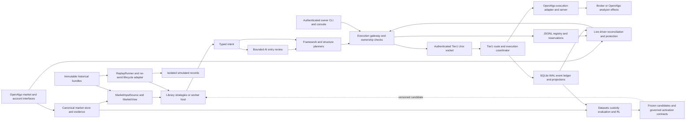
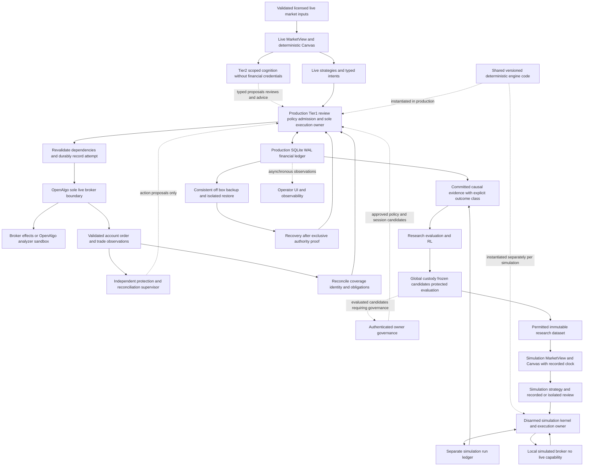
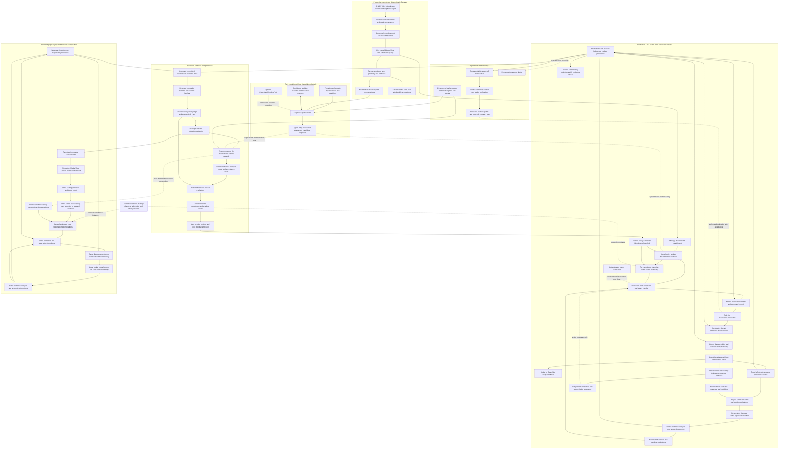

# AutonomousTrading — boundary-first architecture with selective reuse

**Research date:** 24 October 2026 UTC. **Inspected revision:** `445eb116514d97c2574c44d4d5374f938dec57a3`, branch `claude/openalgo-trading-architecture-uu1bxn`. **Status:** original research baseline; D01–D10 and the later requirements/transaction refinements D11–D16 were accepted on 25 October 2026 UTC. Acceptance authorizes this design update, not implementation, deployment or financial-policy changes.

## Recommendation

**Accepted design principle — 25 October 2026 UTC:** Design around the best justified boundaries, then reuse code only where it fits. Preserve approved money policies and useful contracts—not accidental directory layouts, coupling, or implementation limitations. These are recommended improvements; implementation tests and measurements must establish their correctness and practical benefit.

The existing project is evidence and a source of reusable implementations, not the template that fixes the target's boundaries. Evaluate retention, extraction, replacement and new implementation against correctness, delivery cost, operational simplicity and acceptance evidence. Reuse is a means to a better system, not a requirement to reproduce its defects. The clean Python layout in §6 remains the target; compatibility adapters are migration tools, not permanent competing owners.

Recompose the existing system into one installable Python application around its deterministic financial kernel. Reuse the existing Tier-1 ledger/coordinator, causal market contracts, strategy/planning/protection logic, bounded AI review, research custody, candidate evaluation and offline RL implementations where they satisfy the accepted boundaries and proof obligations. Correct persistence/projection behavior in isolated target slices before production acceptance; source repairs are not a prerequisite for extraction. Add Market Canvas through the current market-data seam. A wholesale engine replacement is not justified by the current evidence; reconsider a component when a better-supported implementation demonstrably fits the target.

The highest-value architectural change is **one canonical financial history and one execution owner**. Make the current JSONL ownership registry a verified compatibility projection of Tier-1. Today SQLite and JSONL participate in execution/recovery without one transaction; cleaner folders alone would retain that failure boundary.

Evidence labels: **C** source-verified current implementation; **O** runtime observation; **H** historical attached claim; **P** user-proposed direction; **R** external reference; **D** this report's recommendation; **U** unverified. “Implemented” means executable source was inspected, not that its tests passed. Proposed invariants require future code/deployment enforcement. OpenAlgo's actual analyze/live effects are enforced by OpenAlgo; its deployed mode was not queried.

**24 October audit scope:** only the original Markdown was created, outside the live checkout. No source, tracked document, test, service, configuration, financial record, policy or broker state was changed. No broker request was sent; no protected locked-OOS payload was opened. No application modules were imported or tests executed. Public research used public names/URLs; private code was not uploaded.

## Required behavior before source parity

**Reading guide — 25 October 2026 UTC:** First describe what the target needs to do, then choose code that fits. “Source parity” means matching the existing project's behavior; it is useful evidence of compatibility, not the definition of correctness. The examples below explain the target's existing direction in everyday language. Reuse choices are recommendations awaiting implementation evidence, not claims that the source code or its tests already pass these checks. D11 accepts this requirements-first approach; D12–D16 below record the separately agreed ownership and transaction refinements. No row changes money policy.

**D11 baseline rule:** For each meaningful behavior, identify its reason, accountable owner and independent acceptance proof before choosing reusable code. Classify it as approved money policy, useful compatibility promise, architectural choice, historical behavior or unresolved decision. Preserve approved policies and supported compatibility promises; historical behavior is not automatically required. Record intentional corrections and migrations, and ask the owner about unclear user-facing consequences or owner-controlled policy—not low-level implementation details. The table gives examples rather than an exhaustive catalogue.

**Required behavior → reason → responsible module → acceptance proof → reuse decision**

| Required behavior | Reason | Responsible module | Acceptance proof | Reuse decision: choices and recommendation |
|---|---|---|---|---|
| **Requirement:** An installed application can load its default settings from any working directory. | **Reason:** Starting it from another folder should not break it. | **Owner:** Packaging and settings (`resources/`, `settings.loader`). | **Proof:** Install it in a clean environment, start it outside the checkout, and verify the expected settings load. | **A — Recommended:** Adapt useful loading code to packaged resources; modest migration work removes checkout dependence. **B:** Reuse unchanged if it already passes this proof. **C:** Replace the loader if adapting it is more complex than a small replacement. |
| **Requirement:** Each component receives valid settings with the same meaning wherever it runs. | **Reason:** A service file and a worker should not disagree about a setting or its default. | **Owner:** `settings.schema` defines the contract; deployment and runtime consume it. | **Proof:** Give the service renderer and worker the same valid and invalid examples; verify consistent values and clear rejection of invalid input. | **A — Recommended:** Consolidate useful validators behind one settings contract; some caller changes prevent duplicated rules. **B:** Keep a temporary compatibility reader for old names. **C:** Replace validation code only if it cannot express the target contract simply. |
| **Requirement:** A component can be used through a clear interface without loading unrelated services. | **Reason:** A calculation should be understandable and testable without starting the whole application. | **Owner:** Each domain module owns its behavior; `contracts/` owns shared types; `bootstrap.py` connects implementations. | **Proof:** Run a calculation with explicit sample inputs and verify that it neither starts services nor writes files or makes network calls. | **A — Recommended:** Extract or refactor useful functions behind the target interface; preserve their justified outputs. **B:** Wrap a self-contained component when its internals already fit. **C:** Rebuild only when hidden dependencies make extraction riskier. |
| **Requirement:** Isolated development and research can run while production is operating. | **Reason:** Unrelated production readiness or market hours should not stop safe independent work. | **Owner:** `operations.isolation` defines isolation checks; research and development processes use separate resources. | **Proof:** Run a permitted sample job with separate writable storage, scoped credentials and resource limits; verify it cannot modify production or access protected evidence. | **A — Recommended:** Reuse suitable isolation mechanisms and replace blanket schedule restrictions with checks tied to actual effects. **B:** Move demanding workloads to another host if isolation is insufficient; this costs more. **C:** Defer only the workload whose isolation cannot be established. |
| **Requirement:** Users and integrations can keep using explicitly supported interfaces during migration. | **Reason:** Cleaner internal code should not unexpectedly break a supported command or data reader. | **Owner:** `interfaces/` owns public behavior; `adapters.compatibility` translates supported legacy formats. | **Proof:** Run representative supported requests against the target and compare the promised outputs, errors and permissions. | **A — Recommended:** Use thin compatibility adapters that delegate to one implementation; this adds temporary maintenance. **B:** Retain an interface unchanged when it already fits. **C:** Make an explicit versioned migration when continued compatibility is too costly or unsafe. |
| **Requirement:** Tests show that the target meets its requirements, including failure behavior. | **Reason:** Matching an old test can still preserve an old mistake. | **Owner:** Each module owns its contract checks; target `tests/` also covers integration and failure scenarios. | **Proof:** Derive expected results from the requirement, then deliberately break the promised behavior and confirm the check fails. Check inputs and expected results independently of the implementation being tested. | **A — Recommended:** Assess each relevant source test and fixture before reuse; keep useful checks, adapt implementation-bound ones and add missing target proofs. **B:** Write a new focused check when the old test obscures the requirement. **C:** Retire a test only when its obsolete assumption has no remaining requirement. |
| **Requirement:** Useful diagnostics remain available without making the application depend on a telemetry backend. | **Reason:** A monitoring outage should not become an unrelated application outage. | **Owner:** `operations.telemetry`; canonical financial evidence remains owned by the kernel ledger. | **Proof:** Make the telemetry destination unavailable; verify bounded resource use and continued application behavior, while required canonical evidence still follows its own persistence rules. | **A — Recommended:** Wrap suitable logging/export code behind the existing bounded asynchronous seam; small integration cost keeps the backend replaceable. **B:** Keep a simpler local diagnostic sink if sufficient. **C:** Adopt a larger observability stack only after a measured operational need. |

**How to choose:** Keep approved policies and useful compatibility promises. Evaluate internal code, directory layouts and historical workarounds against the target requirement. Reuse unchanged when it fits; adapt or wrap when that is simpler; replace or rebuild only when the benefit justifies the cost. Record intentional behavior changes and their proof. An old/new comparison is one check, not the sole correctness oracle.

These are focused examples, not a complete requirement catalogue or a new approval step for every function. Add rows when a meaningful boundary needs clarification. Independent isolated work can continue while unrelated acceptance evidence is pending. Existing owner-controlled money decisions retain their separate approval rules.

## Contents

1. [Sources and precedence](#1-sources-and-precedence)
2. [Verified current architecture and coverage](#2-verified-current-architecture-and-coverage)
3. [Audit findings](#3-audit-findings)
4. [Open-source reference research](#4-open-source-reference-research)
5. [Target architecture and contracts](#5-target-architecture-and-contracts)
6. [Fully commented target repository](#6-fully-commented-target-repository)
7. [Reuse mapping and migration](#7-reuse-mapping-and-migration)
8. [Constraints and independent work](#8-constraints-and-independent-work)
9. [Unresolved decisions and continuation](#9-unresolved-decisions-and-continuation)

## 1. Sources and precedence

### Attachment inventory

| Source | Date/provenance | Contribution | Limit/classification |
|---|---|---|---|
| `1-source_north_star_architecture_evidence_review_research_2026-10-10.md` | User attachment; review 10 October, expansion/scope revision 11 October 2026; 675 lines, 121,126 characters | C01–C29 authority, replay, ambiguous effects, OpenAlgo basket/status cautions, evaluation criticism; 32 public references and private-source provenance | Read in full. H/R/interpretation, not current implementation or deployment proof. Its own record excludes private code audit and live fault testing. |
| Current assignment | User, this turn | P: Cognitive Fabric, Canvas, shared engine, Tier-1, custody/RL, independent development and concrete outputs | Goals to challenge, not a prescribed package tree or permission to implement. |
| Earlier README/transcript/recovered conversation, attachment U01–U03 | Historical sources described by the attachment | H: intended boundaries and reported implementation gaps | Originals were not separately attached. Earlier transcript review was sampled. This session cannot claim original conversations were reviewed. |
| Historical/current architecture images, detailed prior Mermaid, repository-tree proposals, standalone Canvas/Sketchpad image | Mentioned in the request but not separately present | Potential H/P | Only one file is present in the supplied attachment directory. These originals are inaccessible here; no visual review or reconstruction is claimed. |
| Linked [arXiv taxonomy figure](https://arxiv.org/html/2608.31041v1/figures/agentic.png) | Public URL in attachment | R/H: organization, coordination and adaptation vocabulary | Access did not yield a renderable image in this session. Prior interpretation remains historical; this is not a Canvas image. |

Attachment SHA-256: `cda0d9dc901c523a8e41b4366743417ac62b4704f6f58ab92e57f98570490cad`. Supplied path: `/tmp/codex-remote-attachments/01a16d3e-4db1-7981-a8f2-121c373e4d65/14452b9d-0071-4b66-a9d2-8074fbecb2e1/1-source_north_star_architecture_evidence_review_research_2026-10-10.md`.

### Evidence precedence

Executable code and actual wiring establish current implementation. Runtime observations establish only their observed properties. Comments, names, diagrams and old reports are hypotheses. Fresh validated OpenAlgo observations remain external truth; no financial endpoints were called. External upstream code establishes that revision, not the installed OpenAlgo server.

The audit asked codegraph/Graphify first, then opened source. Graph results are leads, not evidence. Excluded docs/tests surfaced incidentally in graph navigation were not used as proof. The latest user restriction superseded the normal repository knowledge-map/document-first procedure: in-repository Markdown, changelogs and tests were excluded, with root README used only for boundaries/diagrams. External READMEs and the attachment were allowed context. No protected evidence or effective secret configuration was loaded.

### Contradictions and qualifications

| Tension | Resolution |
|---|---|
| Attachment says Tier-1/shared replay/model paths were unproved | Historical status, not current absence. Current source contains these implementations; production effectiveness is still U. |
| Attachment says kill blocks all writes; new direction expects protection to continue | Current sender permits a narrow authenticated-owner cancel/close exception. Automatic protection writes remain subject to kill. Preserve behavior; do not choose broader emergency permissions. |
| “Paper” could mean local simulation or OpenAlgo analyze | Different boundaries. Local simulation must have no live transport. OpenAlgo analyze uses the public API and is externally selected; it is not structural local disarmament. |
| Agent taxonomy implies mandatory councils/hierarchy | It supplies vocabulary, not measured benefit. Begin with existing bounded review; compare more agents experimentally. |
| Hash chain implies complete immutable truth | It detects changes within scope, not completeness, source truth, all side-table integrity, retention or remote uniqueness. |
| Earlier workflow implies research waits for close | Current research eligibility omits calendar; isolated test checkouts are exempt. Correct specific isolation/guard problems rather than reinstate a global schedule lock. |
| OpenAlgo historical/current/local identities differ | Attachment pin `12e1114657981a3e50dde8c8ce04eb778ae1cf2f`, local mirror `b9d155ff6a22ce60337ac6f9a3bd6fe709e95838`, public research pin `91ced6f…` are separate. None proves deployed server identity. |

## 2. Verified current architecture and coverage

Inventory found **528 Python files under `src/`**: analysis 120, runtime 106, interfaces 106, core 77, data 52, Tier-1 33, contract 13, authoring 9, strategies 5, config 2, knowledge 2, plus three root modules. This is a coverage denominator, not 528 deeply reviewed files.

### Capability and authority map

| Owner/capability | Verified implementation evidence | Status and limits |
|---|---|---|
| Market providers and causal views | `src/runtime/input_source.py:34`, `:47`, `:78`; `src/runtime/market_view.py:185`, `:239`, `:401` | C implemented: shared live/bundle port, availability indexes, as-of reads. Constructor defaults `as_known=False`, `max_age=None`; common classes do not prove identical causality settings in every caller. |
| Worker strategies | `src/runtime/worker_host/__init__.py:452`; `src/runtime/worker_sdk/__init__.py:543` | C implemented: non-abstained decision → intent; intent does not mint broker/financial identity. All strategy-kind behavior/economic value not proved. |
| Planning/financial semantics | `src/core/framework/runtime/orchestrator.py:90`; `src/core/framework/structures/planner.py:195`, `:211`, `:227` | C implemented: ordered gates, concrete legs, payoff/loss budget, selection/sizing/protection. One-leg compatibility and structure planner coexist; cannot merge by deleting one path without parity. |
| Execution gateway/ownership | `src/runtime/execution_gateway/__init__.py:389`, `:879`, `:1002`; `src/core/framework/execution/registry.py:186` | C implemented: shape/authority/holds/checkpoint checks, ownership formation, durable SENT, exact command submission. JSONL overlaps financial lifecycle with Tier-1. |
| Canonical transport authority | `src/runtime/tier1_authority/channel.py:215`; `service.py:270`, `:304`; `src/tier1/gateway_route.py:617`; `coordinator.py:94` | C implemented: authenticated Unix request, proposal binding, send-intent-before-one-call and outcomes. Financial semantics still span gateway/live driver/registry/Tier-1; one service does not prove fully centralized admission. |
| Ledger/projections | `src/tier1/runtime.py:67`, `:97`; `ledger.py:109`, `:164`, `:192`, `:299`; `projections/base.py:132` | C implemented: safe loaded SQLite, WAL/FULL readback, writer lock, transactions/hash chain and verified projections. Runtime fault tests not inspected/executed. |
| Ambiguity/recovery | `src/tier1/coordinator.py:94`, `:139`; `gateway_route.py:715`; `recovery.py:117` | C implemented: interrupted intent becomes ambiguous; observation-based resolution; recovery fence. No remote exactly-once guarantee. Local epoch cannot revoke another host's key. |
| Shared replay | `src/data/replay_engine/runner.py:237`, `:359`; `guard.py:71`; `producer.py:253` | C implemented/partial parity: same view/worker seam, broker-denying guard and no-send lifecycle adapter. Exact AI application replay differs from fresh inference; full parity not tested. |
| Advisors/teams | `src/runtime/advisor/__init__.py:353`; `backends/http.py:231`; `agent_team/__init__.py:176`, `:193`, `:811` | C implemented: failure-to-abstention, whitelisted output, scoped inputs/bounded children and broker-key removal. Environment stripping alone is not universal OS/tool isolation. |
| AI management | `src/runtime/ai_management/contracts.py:359`; `service.py:275`, `:384`, `:430` | C implemented: typed review, identity/expiry checks, existing ALLOW/BLOCK/PAUSE/unavailable semantics. Not a replacement risk authority. |
| Exit advice | `ai_management/advice_orchestration.py:263`; `advice.py:899` | C implemented: generation records advice; application requires authenticated human, fresh identity/position/config checks. Human application may create deterministic commands. |
| Research custody/evaluation | `src/analysis/core/custody.py:184`, `:1183`; `trials.py:121`, `:300`; `datasets/__init__.py:203`, `:815`; `evaluation/candidate.py:912` | C implemented: hash/claim/freeze/partition checks. Historical cleanliness and restored consumed-state behavior not certified. Protected bytes not opened. |
| Offline RL | `src/analysis/rl/{environment,lab,gym_env,reward}.py`; `analysis/candidates/research_policy.py:121`, `:328`; `runtime/advisor/backends/research_policy.py:200` | C implemented: optional RL lab and digest-verified CPU inference/abstention. Research candidates, not autonomous live training/promotion or calibrated full exchange simulation. |
| Operations/interfaces/config | `src/interfaces/mcp/gateway.py:43`, `:131`; `console/api/security.py:45`, `:77`; `src/config/__init__.py:398`; deployment/backup code below | C implemented: composed MCP, human reachability/CSRF, config layering, supervision/release/recovery machinery. Not a full security or deployment certification. |
| Full Market Canvas | No Canvas implementation found in inspected source/search | P: new capability. Existing view/provider/quantitative code is foundation, not proof full scratchpad exists. |

### Existing AI entry policy

`src/runtime/ai_management/service.py:117` and `:430` establish:

| Review outcome | Observe mode | Enforce mode |
|---|---|---|
| ALLOW | Continue/record | Continue to deterministic planning/admission |
| BLOCK | Continue/record | Refuse current entry |
| PAUSE | Continue/record | Fixed-expiry bounded hold; refuse entry |
| AI_UNAVAILABLE, invalid/corrupt/expired result, capacity/timeout failure | Record/alert; continue | Record/alert; continue deterministic planning |

Required-role failure produces unavailable; optional absence remains in artifacts (`team.py:1003`, `:1376`, `:1433`). Advisor backend failures abstain. Preserve these different contracts during extraction; changing the financial consequence requires owner review. ALLOW never overrides deterministic admission.

### Current-state Mermaid — source-grounded



Canvas/workflow products are not drawn as current infrastructure. The external server selects analyzer/live; the diagram does not certify either mode.

### Runtime observations, not runtime acceptance

Read-only `systemctl show` at approximately **09:41–09:44 UTC, 24 October 2026** returned:

| Observation | Result | What it establishes/does not |
|---|---|---|
| Tier-1 authority | Loaded active/running; PID `3051534`, user `admin`, working directory `/home/admin/AutonomousTrading` | O: service manager reports a process. Not release/ledger/candidate/account attestation. |
| Strategy and old monitor units | `at-strategy.service` and `at-monitor.service` inactive/dead, PID 0 | O: those units inactive then. Other processes/monitor units not fully enumerated; no outage conclusion. |
| Research worker | Loaded active/running; PID `3051681`, user `admin`, `Slice=at-research.slice` | O: process exists, not job progress/eligibility. |
| Effective research sandbox | PrivateNetwork=yes, ProtectSystem=strict, NoNewPrivileges=yes, RestrictAddressFamilies=AF_UNIX; scoped inaccessible/RW paths | O: isolation properties configured. Installed ProtectControlGroups=yes differs from tracked `private`; actual per-attempt cgroup creation remains U. |
| Aggregate research slice | CPU quota 250ms; MemoryHigh 805306368, MemoryMax 1258291200, TasksMax 64 | O: aggregate limits configured. Child MemoryMax=infinity does not defeat parent slice limit; actual use not measured. |
| Authority sandbox | PrivateTmp=yes, NoNewPrivileges=yes, ProtectSystem=no, no explicit inaccessible/RW paths | O: broad trusted filesystem access and common user; not strong OS separation among every service. |
| Local upstream mirror identities | OpenAlgo `b9d155ff6a22ce60337ac6f9a3bd6fe709e95838`; QuantDinger `22a3da5c82e721feb8c068798f35fdc69321b7db` | C: `git submodule status`, not installed external server revision. Mirrors untouched. |

No environment values, effective secrets/config, ledger/financial payloads, private model calls or account endpoints were read. Current deployment acceptance remains U.

### Audit coverage record

“Inspected” includes targeted executable ranges/codegraph-returned source, not every line of every file. No historic test result became fresh evidence.

| Area | Paths inspected | Remaining limits |
|---|---|---|
| Tier-1 | `src/tier1/{schema,runtime,epoch,ledger,envelope,events,coordinator,openalgo_adapter,gateway_route,recovery,ports,proposal_contract,compare,activation,release}.py`; projections `{base,orders,positions,reservations,epochs}.py` | Core append/send/recovery; not every importer/event handler. |
| Financial callers | Runtime authority `{channel,service}` and execution gateway `{__init__,structures}`; framework execution `{orders,sender,registry,reconcile,recovery,reservations,loss_latch,structure_fsm,killswitch}`; structures `{planner,types,payoff}`; policy schema; runtime orchestrator; protection structures | Exact binding/ACK/lifecycle/refusal traces; not all policy combinations/formulas. |
| Market/replay | Runtime `{input_source,market_view,research_policy_view}`, worker SDK/host/providers; selected marketdata `{store,evidence,journal}`; replay `{producer,runner,guard,engine,loader}` | No measured tick completeness or all provider quality paths. |
| Cognition | Advisor core and selected `{http,team,research_policy,replay,rule,local_model,mcp}` backends; agent team parent/child; AI management `{contracts,service,team,blueprint,context,pause,advice,advice_orchestration,applications,config}` | Not all tools/egress/memory/promotion paths. |
| Research | Core `{custody,trials,promotion_evidence}`; datasets; candidate evaluation/research-policy bundles; RL environment/lab/gym/reward; jobs policy/worker/registry/containment | No protected bytes or historical outcomes; source controls, not forensic certification. |
| Ops/config/interfaces | pyproject; config loader/defaults/profiles selected settings; safe_pytest/pytest_storage; research installer/service templates; selected deploy/release/recovery/backup; selected live driver integration; MCP/client and owner API security | Live driver 8,486 lines, sampled; dataset module 3,054 and management team 1,526 lines, targeted ranges. Full frontend/proxy/tool/security/deploy review U. |
| Excluded | Repository Markdown except root boundaries/diagrams, tests, `.env`, `run/`, protected OOS, financial payloads, mirror internals | Deliberate assignment scope; not a recommendation to skip future authorized acceptance. |

## 3. Audit findings

No critical exploit, actual duplicate broker order or current financial loss was established. Severity applies to demonstrated contracts, not invented incidents.

| ID/severity | Evidence/root cause | Impact | Correction |
|---|---|---|---|
| **F1 High — ACK success despite local persistence failure** | `src/core/framework/execution/registry.py:139` catches write/fsync error; `:414` records persisted=false and emits lifecycle. `src/runtime/execution_gateway/__init__.py:1151` ignores `mark_ack` result and returns ok=true. | Tier-1 retains canonical ACK but local ownership can stay SENT while caller sees success. Recovery waits for writer-gone (`reconcile.py:276`). No duplicate send/canonical history loss proved. | Return explicit broker-accepted/projection-unresolved, sent=true and broker/canonical IDs; check persistence and qualify emission. Later replace overlapping authoritative writes with verified projections. |
| **F2 Medium — cancel/modify intents never settle locally** | Gateway reserves intents at `execution_gateway/__init__.py:691`, `:1237`, `:1403`; success paths at `:1267`/`:1457` update other rows; only close calls intent updater at `:1580`. Recovery hardcodes close (`tier1_authority/service.py:622`). | JSONL retains reserved intent after canonical outcome; monitoring/recovery view stale. Canonical scope still constrains resend. | Settle every verb on submitted/rejected/ambiguous/never-reached results; generic exact-identity reconciliation. |
| **F3 Medium — mutable authority indexes outside chain validation** | Epoch/command/broker tables at `tier1/schema.py:51`, `:63`, `:71`; `ledger.py:299` verifies event rows only; route `:398` repeats chain-only check after external DB change. Writer epoch/dedupe trust tables (`ledger.py:150`, `:263`). | Same-UID tamper, qualifying corruption or future writer bug can disagree with chain while chain stays green. Normal writers are transactional; no current incident observed. | Rebuild/compare indexes/epoch against event-derived truth at startup/recovery/external changes. Preserve existing release-binding event/digest check and lazy projection checkpoint verification. |
| **F4 Medium — wheel omits required packages** | Explicit package list `pyproject.toml:112`–167 omits regular packages `src.config`, `src.core.governance`, `src.runtime.ai_management`, `src.tier1`, authority/worker host and nested packages. Included consumers import them (`src/runtime/session_state.py:14`; `src/data/replay_engine/proposal_receipt.py:11`). | Checkout masks incomplete installed artifact. Wheel compatibility unsupported as configured; build failure not executed here. | Deliberate discovery/data inclusion; installed wheel entrypoint tests from empty directory. Keep temporary checkout-only MCP exception explicit. |
| **F5 Medium — service environment conflicts with research guard** | Template `deploy/systemd/at-research-worker.service:13` injects AT_RUN_DIR; `_SERVICE_ENV_KEYS` at `src/analysis/jobs/policy.py:33` omits it; `:95` rejects any unexpected variable. Eligibility `:199`, worker `:516` before claim; fixed entrypoint `:765` does not sanitize. | Newly rendered matching workers can remain active but leave jobs queued. Source blocker confirmed; installed environment/queue progress not inspected. | Permit the intentional nonsecret path setting or pass validated explicit argument; one service-environment contract. Keep credential exclusion/resource/custody controls. |
| **F6 Low — informational mode auth mismatch** | REST honors header/custom body auth (`src/interfaces/mcp/core/openalgo.py:164`); `analyze_mode` hardcodes apikey body (`:576`). | Header/custom-field deployment may report unknown while execution works. Does not gate sends. | Reuse auth builder; preserve live/unknown distinction and informational-only status. |
| **F7 Low — legacy replay marker missing** | Multi-leg formation uses replay=true (`src/data/replay_engine/producer.py:266`); legacy at `:282` omits it; registry accepts extras (`registry.py:186`). | Inconsistent provenance metadata, no send risk due disarmed adapter. | Check exact-shape compatibility; add marker if not intentionally excluded. |
| **F8 Low/dormant — duplicate checkpoint API hazard** | `tier1/projections/base.py:174` assumes new events; `ledger.py:217` skips duplicates but stores supplied checkpoint `:253`. No production caller found. | Future use can commit a nonreplayable digest and fail closed. Not a current runtime failure. | Compute from actual appended events or remove unused hook before adoption. |
| **F9 Known boundary — cross-host fencing is operational** | Local flock/epoch (`tier1/ledger.py:83`, `:150`); recovery fence (`recovery.py:117`). | Local epoch/restore cannot disable old host's credential. | Keep external old-host incapability/revocation and reconciliation before activation; no network WAL/active-active shortcut. |

### Policy limitations, not automatic fixes

- **Gross economics:** `src/core/framework/structures/planner.py:211` supplies costs=0, used for risk/loss budget at `:227`–263. Record gross/modeled-net/reconciled-net separately. Whether costs/slippage affect admission is an owner decision; no numeric policy selected.
- **Planned protection:** gateway builds entry and protective basket from plan values (`execution_gateway/__init__.py:1012`; `execution/orders.py:188`–214). Actual fill can differ. Measure protection drift/partial fills/sibling cancellation; repricing or staging changes money behavior and needs approval. Basket is not atomic or automatically OCO.
- **Emergency permissions:** current sender permits narrow human cancel/close under kill; automatic writes remain constrained. Preserve source behavior; owner chooses any changed daily-loss/kill/recovery/risk-reduction matrix.

### Findings narrowed after cross-check

Global idempotency should survive epoch/principal rotation; scoping keys to new epochs can permit resend. Current coordinator checks prior execution outcomes and namespaced IDs. Treat inconsistent identity fields as verification work, not an instruction to reset dedupe. Release bindings already compare receipt digest with a RELEASE_BOUND event (`gateway_route.py:360`); they are not included in F3. Projection checkpoints self-verify (`projections/base.py:159`). Missing test inspection is an evidence gap, not evidence tests are missing.

### 25 October follow-up audit and accepted target decisions

**Provenance:** follow-up source audit dated 25 October 2026 UTC; `AutonomousTrading/claude/openalgo-trading-architecture-uu1bxn` at `445eb116514d97c2574c44d4d5374f938dec57a3`; design workspace `AutonomousTradingArchitect/main` at pre-update baseline `a4c6308641d12b1a15898c05ce2bbd022cd46822`. Scope: module boundaries, transaction readiness, packaging, deployment and isolation; 528 source files parsed for import relationships plus targeted executable traces. No application tests, live broker calls or protected evidence reads. F1–F5 remain open; design acceptance does not close them. The original audit and external research retain their 24 October dates.

The owner accepted all ten recommendations together for README/ROADMAP updates. **D01–D10 are stable decision IDs in the discussion's order**, not ten additional defects or a serial implementation schedule. F-identities retain their original meanings. These are accepted target requirements awaiting implementation proof; they are not assertions of current enforcement.

| Decision | Accepted target behavior and owner | Evidence and why this improves the target |
|---|---|---|
| **D01 — truthful outcomes** | `contracts.execution` separates broker effect, canonical persistence and projection freshness; callers retain identities and never infer retry permission from local projection failure. | F1 remains at `src/runtime/execution_gateway/__init__.py:1151`. Fix the outcome contract, not just an ignored boolean. |
| **D02 — canonical monetary admission** | `kernel.admission` commits admission, monetary reservation and command identity atomically; JSONL is a verified compatibility projection. | Current `src/tier1/gateway_route.py:540` accepts a command; capital/margin remain in `src/core/framework/execution/reservations.py:377`. Registry locking at `src/runtime/execution_gateway/structures.py:650` is real protection, not proof of canonical SQLite ownership. No overspend was established. |
| **D03 — one command lifecycle** | `kernel.lifecycle` owns shared command states and verb-specific transitions for entry, cancel, modify and close, with exact command identity and reconciliation. | F2 and `src/runtime/tier1_authority/service.py:622` show the close-specific join. Replace fragmented settlement with one contract, not four unrelated patches. |
| **D04 — complete derived-state verification** | `kernel.ledger.projections` compares authority indexes and financial read models with event-derived truth at required heads. | F3: `src/tier1/ledger.py:299` checks the chain, not all mutable authority tables. Preserve existing transactional writes and valid release/projection checks. |
| **D05 — installable, versioned application** | Packaging owns executable entrypoints and immutable resources; settings owns external state roots; operations stages versioned artifacts/environments before activation. | F4: `pyproject.toml:112` omits 34 of 87 regular source packages and declares no console scripts; `src/config/__init__.py:52` assumes checkout resources; `deploy/deploy_tier1.py:618` and `:661` mutate checkout/venv in place. Broaden the remedy beyond package discovery. |
| **D06 — one worker configuration contract** | `settings.schema` defines scoped worker settings consumed by service rendering and runtime validation. | F5 affects both `deploy/systemd/at-research-worker.service:13` and `at-research-model.service:13`; `src/analysis/jobs/policy.py:33` excludes their `AT_RUN_DIR`. Fix contract drift, not merely one variable. Installed queue failure was not established. |
| **D07 — pure planning, explicit effects** | `kernel.planner` computes versioned plans from explicit inputs; admission owns persistence/effects. Neutral contracts do not import runtime implementations. | `src/core/framework/runtime/orchestrator.py:393` defaults registry writes and `:787` performs them; `src/core/framework/execution/loss_latch.py:377` resolves runtime routing. Preserve approved semantics and proof seals while replacing coupling. |
| **D08 — causal Canvas by contract** | `market.view` and Canvas require explicit cutoff/availability/freshness policy and versioned facts; rendering stays downstream. | `src/runtime/market_view.py:185` has compatibility defaults; `src/data/replay_engine/runner.py:320` already supplies causal replay settings. Reuse the seam, not unsuitable defaults; full Canvas remains new work. |
| **D09 — enforced cognitive capabilities** | Cognition uses narrow job/tool ports; operations enforces filesystem, socket, credential, network and resource boundaries, including descendants. | `src/runtime/agent_team/__init__.py:176` strips credentials but `:824` does not itself establish OS denial; designer/job coupling appears at `src/runtime/ai_management/designer.py:869` and `src/analysis/jobs/tasks.py:374`. No leak was established. |
| **D10 — recovery proof before cutover** | Operations proves candidate-artifact crash recovery, clean-host restoration and exclusive activation before Phase 7. Phase 8 tunes recovery targets and growth. | `src/tier1/recovery.py:117` already fences restored authority. The original phase order left baseline restoration proof too late; this changes the target dependency, not current trading permissions. |

[ROADMAP.md](ROADMAP.md#accepted-decisions-and-delivery-order) records implementation order and acceptance checks. All decisions preserve unresolved money-policy choices and independently safe development.

### Accepted requirements and transaction refinements — 25 October 2026 UTC

The owner chose option A for audit item 1, option A for item 2, and option A for the connected items 3–6, then authorized both documents to be updated together. **D11–D16 map to those six items in order** and extend D01–D10 without renumbering them or F1–F9. Status changed from proposed to **accepted design; implementation and acceptance proof pending**.

This was a target-document review on `AutonomousTradingArchitect/main` at `ecf39ad731ad20b9e541b238225f9ca8d1213537`, including the subsequent local requirements-table and working-style edits. It was not a new source audit. Historical source evidence remains scoped to `AutonomousTrading/claude/openalgo-trading-architecture-uu1bxn` at `445eb116514d97c2574c44d4d5374f938dec57a3`; no new broker, runtime or test claims are made.

| Decision and requirement | Reason and responsible owner | Acceptance proof | Choice, trade-off and reuse direction |
|---|---|---|---|
| **D11 / item 1 — Requirements before parity.** Keep useful behavior while improving internal structure. | Old behavior can contain workarounds or defects. Each target module owns its requirement; composition connects modules. | Each meaningful requirement has an independent expected result; source comparisons prove named compatibility only. | **Accepted A:** classify requirements first, then keep, extract, wrap, refactor or replace code that fits. More initial clarification than blanket parity, less inherited coupling. Assess tests and fixtures by the same rule. |
| **D12 / item 2 — Kernel-owned review application.** AI supplies review evidence; the kernel applies approved rules. | Entry eligibility needs one policy owner. `cognition.review` produces reviews; `kernel.policy` interprets them and `kernel.admission` enforces the binding. | Every entry path rejects bypass or mismatched review evidence; live/replay preserve approved outcomes and timeout behavior. | **Accepted A:** move application ownership into existing kernel modules. External application plus kernel verification was the alternative; avoiding duplicated interpretation is worth the caller refactor. |
| **D13 / item 3 — Valid admission at dispatch.** Check relevant approval conditions before an attempt starts. | A pause or crash can make earlier approval stale. Coordinator and admission use the sole ledger writer for the dispatch transition. | Pause/restart across admission and dispatch; changed relevant conditions prevent stale dispatch, while uncertainty cannot expire into retry permission. | **Accepted A, shared with D14–D16:** track the affected action and its dependencies. Broader holds are simpler but can unnecessarily stop unrelated actions. No new deadlines or emergency permissions are selected. |
| **D14 / item 4 — Identity through transport.** Recover a command without blindly sending it again. | A lost response does not mean an order failed. Coordinator owns attempts; the OpenAlgo adapter exposes transport evidence and retry behavior. | Duplicate submissions, disconnects and crashes preserve identity; potentially effective requests are not silently retried. | Extend fitting identity/recovery code behind the existing boundary. Local uniqueness is not remote deduplication; endpoint-specific guarantees require proof. |
| **D15 / item 5 — Evidenced observations.** Resolve uncertainty from reliable, attributable observations. | Successful queries may still be incomplete or describe different instants. Adapter reports coverage; reconciliation interprets it. | Missing pages, late fills, conflicting snapshots and manual orders cannot create false resolution or release. | Reuse normalization only where coverage and identity contracts fit. Repeated stable polling alone is insufficient proof of completeness. |
| **D16 / item 6 — One accounting transition.** Update obligations consistently as orders fill, cancel or remain uncertain. | Command completion is not position closure. Reconciliation validates evidence, lifecycle determines transitions, reservations computes consequences, and the ledger writer commits them together. | Duplicate/reordered observations do not double-count fills or release capacity early; corrections and revaluations remain explicit. | Use the existing canonical ledger, not another journal. Explicit transitions cost more than blanket reservation holds but avoid unnecessary capacity restrictions; valuation policy stays unchanged. |

Establish D11–D12 first; specify D13–D16 together because dispatch, identity, reconciliation and accounting depend on each other. These refine the existing clean packages rather than add services. Isolated development and synthetic verification do not wait for market close or unrelated broker acceptance. [The roadmap](ROADMAP.md#accepted-decisions-and-delivery-order) owns delivery dependencies and status.

## 4. Open-source reference research

Checked **24 October 2026**, cutoff approximately **09:38:37 UTC**, window **24 September–24 October**. Resolve default-branch SHA, request `https://api.github.com/repos/{owner}/{repo}/git/trees/{sha}?recursive=true`, inspect implementation/license and in-window relevant source commits. All listed recursive responses returned **truncated=false**; subtree traversal unnecessary. No repository was installed/executed. Nine qualify as maintained implementation references, not nine recommended dependencies.

| Project, immutable pin and complete tree | Relevant source/maintenance evidence | License, fit, trade-off and decision |
|---|---|---|
| **Nautilus Trader** [`fe3e48024713204f2b804bcd19f4ea52bcb8344e`](https://github.com/nautechsystems/nautilus_trader/tree/fe3e48024713204f2b804bcd19f4ea52bcb8344e), 24 Oct; [tree 6,195](https://api.github.com/repos/nautechsystems/nautilus_trader/git/trees/fe3e48024713204f2b804bcd19f4ea52bcb8344e?recursive=true) | [24 Oct `c212a67…`](https://github.com/nautechsystems/nautilus_trader/commit/c212a67a03d62fa6fe09ac7bb74ebf0b1003462c) fixes timer/data starvation. Inspected [`crates/live/src/node/mod.rs`](https://github.com/nautechsystems/nautilus_trader/blob/fe3e48024713204f2b804bcd19f4ea52bcb8344e/crates/live/src/node/mod.rs), [`crates/backtest/src/engine.rs`](https://github.com/nautechsystems/nautilus_trader/blob/fe3e48024713204f2b804bcd19f4ea52bcb8344e/crates/backtest/src/engine.rs). | [LGPL-3.0](https://github.com/nautechsystems/nautilus_trader/blob/fe3e48024713204f2b804bcd19f4ea52bcb8344e/LICENSE). Strong shared-engine/scheduling reference. Full Rust/Python framework migration duplicates domain/authority and costs high. **Reference patterns; retain engine.** |
| **vn.py** [`c6e231caf32b7fc97e6459817fff66458cf7e7c4`](https://github.com/vnpy/vnpy/tree/c6e231caf32b7fc97e6459817fff66458cf7e7c4), 6 Oct; [tree 259](https://api.github.com/repos/vnpy/vnpy/git/trees/c6e231caf32b7fc97e6459817fff66458cf7e7c4?recursive=true) | [4 Oct `ed893b7…`](https://github.com/vnpy/vnpy/commit/ed893b7acd67f134ba661f64c7393cbf8efcb7a3) tick/bar high-low correction. Inspected [`vnpy/trader/utility.py`](https://github.com/vnpy/vnpy/blob/c6e231caf32b7fc97e6459817fff66458cf7e7c4/vnpy/trader/utility.py), [`vnpy/event/engine.py`](https://github.com/vnpy/vnpy/blob/c6e231caf32b7fc97e6459817fff66458cf7e7c4/vnpy/event/engine.py) and RPC heartbeat change. | [MIT](https://github.com/vnpy/vnpy/blob/c6e231caf32b7fc97e6459817fff66458cf7e7c4/LICENSE). Readable queues/bar handling. Gateway/app ecosystem migration high; individual patterns medium. **Reference, not replacement.** |
| **OpenAlgo** [`91ced6f7772a5f4a2bf8d0d0613522240a6fa636`](https://github.com/marketcalls/openalgo/tree/91ced6f7772a5f4a2bf8d0d0613522240a6fa636), 22 Oct; [tree 4,097](https://api.github.com/repos/marketcalls/openalgo/git/trees/91ced6f7772a5f4a2bf8d0d0613522240a6fa636?recursive=true) | [22 Oct `0e18e8a…`](https://github.com/marketcalls/openalgo/commit/0e18e8a7be4ebea95095416f0760efbb64475c3f), [`sandbox/order_manager.py`](https://github.com/marketcalls/openalgo/blob/91ced6f7772a5f4a2bf8d0d0613522240a6fa636/sandbox/order_manager.py): atomic margin/order. [18 Oct `2b2d73b…`](https://github.com/marketcalls/openalgo/commit/2b2d73b5c93749dede09cff9289900d392c7d490), [`services/strike_profile_service.py`](https://github.com/marketcalls/openalgo/blob/91ced6f7772a5f4a2bf8d0d0613522240a6fa636/services/strike_profile_service.py): multi-expiry GEX/DEX. Basket/status/schemas inspected too. | [AGPL-3.0](https://github.com/marketcalls/openalgo/blob/91ced6f7772a5f4a2bf8d0d0613522240a6fa636/LICENSE). **Retain external API boundary**, verify consumed contract. Low incremental integration, ongoing version work. Do not copy internals/relicense; broker/regulatory internals remain OpenAlgo infra. |
| **Lightweight Charts** [`c9ec1cec25583a0200f3c85ad9019d19c1d65f97`](https://github.com/tradingview/lightweight-charts/tree/c9ec1cec25583a0200f3c85ad9019d19c1d65f97), 22 Oct; [tree 2,613](https://api.github.com/repos/tradingview/lightweight-charts/git/trees/c9ec1cec25583a0200f3c85ad9019d19c1d65f97?recursive=true) | [`d2e49db…`](https://github.com/tradingview/lightweight-charts/commit/d2e49db0b65a8f32c35b5868edf793ba5a37727f), authored 1 Oct/merged 9 Oct: logical-range fix. Inspected [`src/model/time-scale.ts`](https://github.com/tradingview/lightweight-charts/blob/c9ec1cec25583a0200f3c85ad9019d19c1d65f97/src/model/time-scale.ts), [`data-layer.ts`](https://github.com/tradingview/lightweight-charts/blob/c9ec1cec25583a0200f3c85ad9019d19c1d65f97/src/model/data-layer.ts). | [Apache-2.0](https://github.com/tradingview/lightweight-charts/blob/c9ec1cec25583a0200f3c85ad9019d19c1d65f97/LICENSE). **Adopt when Canvas UI is built**, honor notices/attribution. Low–medium frontend cost; renderer is not causal geometry or pixel identity proof. |
| **Pydantic AI** [`e3aba7adf6b9e4b952fc664c4ba9ae5ef1858a38`](https://github.com/pydantic/pydantic-ai/tree/e3aba7adf6b9e4b952fc664c4ba9ae5ef1858a38), 24 Oct; [tree 5,566](https://api.github.com/repos/pydantic/pydantic-ai/git/trees/e3aba7adf6b9e4b952fc664c4ba9ae5ef1858a38?recursive=true) | [23 Oct `877d8a6…`](https://github.com/pydantic/pydantic-ai/commit/877d8a62dd3c9fd972dee15838cc628635604774) durable operations/context. Inspected [`durable_exec/_operation_backend.py`](https://github.com/pydantic/pydantic-ai/blob/e3aba7adf6b9e4b952fc664c4ba9ae5ef1858a38/pydantic_ai_slim/pydantic_ai/durable_exec/_operation_backend.py), [`_run_context.py`](https://github.com/pydantic/pydantic-ai/blob/e3aba7adf6b9e4b952fc664c4ba9ae5ef1858a38/pydantic_ai_slim/pydantic_ai/durable_exec/_run_context.py). | [MIT](https://github.com/pydantic/pydantic-ai/blob/e3aba7adf6b9e4b952fc664c4ba9ae5ef1858a38/LICENSE). Typed model/tool/provider layer; rapid evolution, existing contracts make wholesale migration medium–high. **Optional adapter experiment**, preserve sandbox/review behavior. |
| **Temporal Python** [`df8caecda503be16cdf54b136fcd1d40811df2dd`](https://github.com/temporalio/sdk-python/tree/df8caecda503be16cdf54b136fcd1d40811df2dd), 23 Oct; [tree 915](https://api.github.com/repos/temporalio/sdk-python/git/trees/df8caecda503be16cdf54b136fcd1d40811df2dd?recursive=true) | [15 Oct `c1b63bf…`](https://github.com/temporalio/sdk-python/commit/c1b63bf5c9e6ec88a07cb94fda3583e7deaf802d) fixes cancellation/backoff nondeterminism. Inspected [`worker/_workflow_instance.py`](https://github.com/temporalio/sdk-python/blob/df8caecda503be16cdf54b136fcd1d40811df2dd/temporalio/worker/_workflow_instance.py), [`_replayer.py`](https://github.com/temporalio/sdk-python/blob/df8caecda503be16cdf54b136fcd1d40811df2dd/temporalio/worker/_replayer.py). | [SDK MIT](https://github.com/temporalio/sdk-python/blob/df8caecda503be16cdf54b136fcd1d40811df2dd/LICENSE). Mature durable replay; needs separate service operations, retries do not grant remote uniqueness. **Interface now/adopt later outside Tier-1.** High cost. |
| **Restate Python** [`37953b6f6fe50554aaea98b9d72f34e4da4d6256`](https://github.com/restatedev/sdk-python/tree/37953b6f6fe50554aaea98b9d72f34e4da4d6256), 21 Oct; [tree 133](https://api.github.com/repos/restatedev/sdk-python/git/trees/37953b6f6fe50554aaea98b9d72f34e4da4d6256?recursive=true) | [21 Oct `121490a…`](https://github.com/restatedev/sdk-python/commit/121490a69bca35d9ab38162f7a5f70554aeea492) explicit recovery. Inspected [`python/restate/_preview.py`](https://github.com/restatedev/sdk-python/blob/37953b6f6fe50554aaea98b9d72f34e4da4d6256/python/restate/_preview.py), [`context.py`](https://github.com/restatedev/sdk-python/blob/37953b6f6fe50554aaea98b9d72f34e4da4d6256/python/restate/context.py). | [SDK MIT](https://github.com/restatedev/sdk-python/blob/37953b6f6fe50554aaea98b9d72f34e4da4d6256/LICENSE); server grant/version separate evaluation. Preview retry can repeat calls. **Alternative to Temporal later, not both**, medium–high operations. |
| **Gymnasium** [`5b6c5280e1e23a6f41b3cdfb297a26e349f6ef73`](https://github.com/Farama-Foundation/Gymnasium/tree/5b6c5280e1e23a6f41b3cdfb297a26e349f6ef73), 23 Oct; [tree 817](https://api.github.com/repos/Farama-Foundation/Gymnasium/git/trees/5b6c5280e1e23a6f41b3cdfb297a26e349f6ef73?recursive=true) | [22 Oct `8e14761…`](https://github.com/Farama-Foundation/Gymnasium/commit/8e147615be5e864f46e9159edb5bd80f2dbc1a1b) autoreset/final observations. Inspected [`gymnasium/wrappers/common.py`](https://github.com/Farama-Foundation/Gymnasium/blob/5b6c5280e1e23a6f41b3cdfb297a26e349f6ef73/gymnasium/wrappers/common.py), [`vector/vector_env.py`](https://github.com/Farama-Foundation/Gymnasium/blob/5b6c5280e1e23a6f41b3cdfb297a26e349f6ef73/gymnasium/vector/vector_env.py). | [MIT](https://github.com/Farama-Foundation/Gymnasium/blob/5b6c5280e1e23a6f41b3cdfb297a26e349f6ef73/LICENSE). **Retain optional integration.** Clear episode semantics; no financial simulation guarantees. Low incremental cost. |
| **Litestream** [`f282d0ef6815570235ca09ecbb53e81568acc5e7`](https://github.com/benbjohnson/litestream/tree/f282d0ef6815570235ca09ecbb53e81568acc5e7), 20 Oct; [tree 386](https://api.github.com/repos/benbjohnson/litestream/git/trees/f282d0ef6815570235ca09ecbb53e81568acc5e7?recursive=true) | [19 Oct `716acc5…`](https://github.com/benbjohnson/litestream/commit/716acc52ee804b2b198309d126f1315fae3c94b7) stalled read fix; [8 Oct recovery change](https://github.com/benbjohnson/litestream/commit/899a804f180104736f16034ed41c34ad4e83e7bc). Inspected [`internal/resumable_reader.go`](https://github.com/benbjohnson/litestream/blob/f282d0ef6815570235ca09ecbb53e81568acc5e7/internal/resumable_reader.go), [`db.go`](https://github.com/benbjohnson/litestream/blob/f282d0ef6815570235ca09ecbb53e81568acc5e7/db.go). | [Apache-2.0](https://github.com/benbjohnson/litestream/blob/f282d0ef6815570235ca09ecbb53e81568acc5e7/LICENSE). **Evaluate if backup RPO inadequate**; Go binary/object-store/SQLite compatibility cost medium. Replication is not authority/failover or custody. |

### Ultron: inspect first, copy neither code nor authority model

Requested `@AbuZar-Ansarii/Ultron/files/README.md` resolved to root [README](https://github.com/AbuZar-Ansarii/Ultron/blob/c4f2db8966ed6683ae9f503444880ba2974e3aee/README.md); literal `files/README.md` was not established separately. Pin [`c4f2db8966ed6683ae9f503444880ba2974e3aee`](https://github.com/AbuZar-Ansarii/Ultron/tree/c4f2db8966ed6683ae9f503444880ba2974e3aee), 22 October, [complete tree 107](https://api.github.com/repos/AbuZar-Ansarii/Ultron/git/trees/c4f2db8966ed6683ae9f503444880ba2974e3aee?recursive=true). [19 October source commit](https://github.com/AbuZar-Ansarii/Ultron/commit/1b85b7369cdf71ab2b9faf19314f46747497542a) adds action/plugin loading, graph memory and self-evolution.

Its readable action/coordination/memory/operator organization is useful inspiration. Inspected `main.py`, `memory/cerebro_graph.py`, action/plugin loaders, confirmation and self-evolution. [`actions/self_evolution.py:135`](https://github.com/AbuZar-Ansarii/Ultron/blob/c4f2db8966ed6683ae9f503444880ba2974e3aee/actions/self_evolution.py#L135) parses, line 152 writes, line 170 executes generated code; four destructive-command regexes are not a sandbox. [`main.py:648`](https://github.com/AbuZar-Ansarii/Ultron/blob/c4f2db8966ed6683ae9f503444880ba2974e3aee/main.py#L648) connects it to live registries. [`core/action_loader.py:197`](https://github.com/AbuZar-Ansarii/Ultron/blob/c4f2db8966ed6683ae9f503444880ba2974e3aee/core/action_loader.py#L197) imports before validation; plugin loading has the same problem. Confirmation applies only when explicitly requested, not complete mediation.

README has MIT badge, but tree has no license file and GitHub license field is null. **No code donation/adoption without a grant.** Fresh source does not overcome license/domain/authority problems. Graph memory is not a financial ledger or protected evidence service.

### Nonqualifying references and category gaps

**Stable-Baselines3:** pin [`b2878f4b83e21f16a53c54a62def628e05fd2e96`](https://github.com/DLR-RM/stable-baselines3/tree/b2878f4b83e21f16a53c54a62def628e05fd2e96), 13 October, [complete tree 208](https://api.github.com/repos/DLR-RM/stable-baselines3/git/trees/b2878f4b83e21f16a53c54a62def628e05fd2e96?recursive=true), [MIT](https://github.com/DLR-RM/stable-baselines3/blob/b2878f4b83e21f16a53c54a62def628e05fd2e96/LICENSE). Only in-window commit changes CONTRIBUTING.md; **fails recent-source criterion**. Still inspected [`common/on_policy_algorithm.py:162`](https://github.com/DLR-RM/stable-baselines3/blob/b2878f4b83e21f16a53c54a62def628e05fd2e96/stable_baselines3/common/on_policy_algorithm.py#L162), [`off_policy_algorithm.py:512`](https://github.com/DLR-RM/stable-baselines3/blob/b2878f4b83e21f16a53c54a62def628e05fd2e96/stable_baselines3/common/off_policy_algorithm.py#L512), [`policies.py:331`](https://github.com/DLR-RM/stable-baselines3/blob/b2878f4b83e21f16a53c54a62def628e05fd2e96/stable_baselines3/common/policies.py#L331). Keep existing optional training/inference integration; a quiet month is not evidence it is unusable.

`pyeventsourcing/eventsourcing` maintenance lead [`5cbf654…`](https://github.com/pyeventsourcing/eventsourcing/commit/5cbf654586db6e05d131da12f194bef1fabc7708) concerns PostgreSQL notification shutdown, not compelling SQLite financial recovery. Not shortlisted/adopted. `eventsourcing/eventsourcing` returned 404; corrected owner recorded.

No recently source-qualified reference here supplies a drop-in OpenAlgo intraday-options Canvas plus governed financial kernel, or a financial event ledger matching this project's custody/identity semantics. No dedicated trading agent-team repository was source/freshness-qualified; the attachment's TradingAgents paper remains historical research. Use maintained component libraries; compose project-specific semantics.

### Fresh OpenAlgo contract scope

At the public pin, [`basket_order_service.py:335`](https://github.com/marketcalls/openalgo/blob/91ced6f7772a5f4a2bf8d0d0613522240a6fa636/services/basket_order_service.py#L335) sorts BUY before SELL but dispatches concurrent live batches, collecting completion order. Failed legs can coexist with wrapper success. Inspect per-leg results, roles and actual quantities; BUY sorting is no filled-hedge barrier. [`orderstatus_service.py:253`](https://github.com/marketcalls/openalgo/blob/91ced6f7772a5f4a2bf8d0d0613522240a6fa636/services/orderstatus_service.py#L253) separately derives completed-order average price; zero is not reliable partial-fill price evidence. The attachment's main cautions persist at this pin, not necessarily this deployment.

Basket/status files last changed before the 30-day window; OpenAlgo qualifies through identified sandbox/options implementation changes. A recent upstream project and a verified installed contract are different claims.

## 5. Target architecture and contracts

### Alternatives and selection

| Approach | Benefit | Cost/risk | Judgment |
|---|---|---|---|
| Continue in-place refactoring indefinitely | Least initial movement | Packaging exceptions/oversized driver/dual history easily persist | First correctness repairs useful; insufficient final boundary. |
| **Boundary-first installable target with selective reuse** | Justified ownership, selective reuse, isolated parity and incremental transfer | Explicit compatibility readers and exclusive cutover required | **Recommended engineering choice.** Clean project by recomposition. |
| Replace engine with broad trading/agent/workflow framework | Ready-made machinery | Highest semantic migration, duplicate ownership, operational stack | Reject initially; adopt selected libraries for measured gains. |

The owner accepted D01–D16 as target design direction on 25 October; D11–D16 refine requirements, review ownership and transaction contracts. Implementation choices still require evidence of fit; this approval does not authorize production rollout or decide unresolved money policy.

### Primary TARGET diagram 1 — higher-level architecture



Production and simulation share **code and contracts**, not running authority, ledgers, credentials or mutable state. Both export their complete committed decision/lifecycle histories with explicit outcome class. Supervisors propose; they do not send independently. The production kernel is sole internal authority; validated OpenAlgo observations remain external truth.

### Primary TARGET diagram 2 — detailed end-to-end architecture



These are exactly two primary target diagrams plus the separate current-state diagram. Separate production/simulation ledgers are explicit: no runtime broker-mode toggle and no shared financial state. All simulation decisions, applications, reservations and lifecycle events enter its own history before export. The same code serves both compositions. `CognitiveWorkflowPort` remains a conceptual seam, not a required service/package. Locked evaluation uses its custody-scoped evaluator and disarmed engine with protected access, never the ordinary development dataset path.

### Financial authority and executable contracts

**Proposed code/deployment enforcement:** one effective authority per broker-account scope across its strategies. Strategy/portfolio policies may be narrower but cannot create independent senders. Preserve existing account identities until actual authority scope is confirmed. Every broker-changing verb—including human cancel/close, protective replacement, structure recovery and compensating actions—passes through one execution owner. Independent supervisors are independently scheduled readers/proposers with no write credential; independence is not a second sender.

Extract or implement pure selection/sizing/payoff/protection functions within that boundary after comparing existing code against the required contracts. One authoritative planning port initially retains the versioned one-leg compatibility and structure implementations, selected deterministically by the existing contract. This is one ownership/interface boundary, not an instruction to replace both algorithms. Compare approved financial outputs and supported contracts before consolidating algorithms; record explicit regression expectations for correctness fixes and obtain separate approval for owner-controlled financial changes. D11 does not require matching accidental source gate order or internal structure. Strategies emit intent; kernel policy applies AI review evidence according to approved policy; preview planning remains non-authoritative. **D07:** the planning function reads explicit immutable inputs and returns a plan or refusal without registry, ledger, socket or configuration writes. The application passes resulting effect requests to admission. Move neutral market/identity/activation-verification contracts out of runtime dependency cycles; preserve the security meaning of private proof seals rather than replacing them with freely forgeable serialized flags. Final admission validates the fully specified executable object against current canonical state.

| Contract | Bound meaning |
|---|---|
| Intent | Strategy/family/version, session/candidate, causal view, direction/abstention and evidence; no autonomous order identity or limit override. |
| Review application | Kernel-produced interpretation bound to intent digest, strategy/candidate/session, review evidence or explicit unavailable/timeout cause, policy version and deadline. Admission verifies this binding; caller-supplied ALLOW is not approval. |
| Plan | Exact instruments/leg roles/quantity/units/prices/rounding, policy/candidate/view digest, structure identity, expected residual exposure and lifecycle/protection policy. |
| Admission | Exact plan digest, account and state head, epoch, policy/candidate, freshness/deadline and actor/capability. Bind the relevant dependency versions and applicable dispatch deadline; revalidate them at dispatch without treating every unrelated ledger append as invalidation. |
| Command | Global logical command/execution identity, immutable request digest, causation/plan/admission identity, endpoint/args and linked attempt identities/states. Duplicate key with changed content refuses; the same key and content returns existing state. Command, attempt, broker order and position identities have distinct lifetimes. |
| Observation | Account and OpenAlgo source, endpoint/query interval/as-of/arrival, coverage evidence including pagination and source watermark where available, normalized order/trade/position identity, raw evidence reference and unresolved conflicts. Query success alone is not completeness. |
| Outcome | Typed effect classification (not-sent/rejected/acknowledged/ambiguous), canonical persistence status and projection freshness; stable command/execution/broker IDs and explicit simulator/analyzer/live attribution. Transport ACK is distinct from fill/cancel/settlement. |

Execution sequence:

1. Validate intent/candidate/session identity and required causal inputs. Kernel policy applies the bound review or approved unavailable/timeout rule; admission verifies its applicability on every entry path. Preserve approved financial semantics and supported refusal contracts, not incidental source call order (D11–D12).
2. Compute exact plan; final risk covers resulting quantity/instrument/legs, not merely earlier directional approval.
3. Serialize account-wide admission against reconciled observations **plus pending reservations and uncertain effects**. Detect observation skew/incomplete snapshots; no empty-query-as-flat shortcut.
4. Commit admission, monetary reservation, command identity and required authoritative projection changes in one SQLite transaction, binding exact plan/policy/account identity and reconciliation/state heads. This is D02; current `COMMAND_ACCEPTED` alone does not provide it. Keep transactions short; never hold SQLite transaction across HTTP.
5. Under the sole writer, revalidate relevant admission dependencies and atomically claim dispatch with a durable attempt/send-intent record (D13–D14). Invoke the adapter outside the database transaction without hidden retries, then persist the classified outcome. ACK is not fill/protection. Unknown retains obligations; no blind retry.
6. Reconciliation validates observation coverage and matching; lifecycle determines the transition and reservations computes its consequences under approved valuation. Commit evidence references, lifecycle and accounting changes atomically in the existing ledger (D15–D16). Include partial fills, cancel/fill races, foreign activity and fees under current policy; release only demonstrated unused obligations. Compensation is another admitted effect, not rollback.

**D01/D03:** use one command lifecycle with explicit verb-specific completion rules, not one generic success boolean. Cancel ACK is not cancellation or proof that no fill occurred; modify ACK is not a verified protective state. Every accepted, rejected, not-sent, ambiguous and reconciled attempt updates the same exact command identity. A compatibility projection failure after canonical ACK returns “broker accepted; projection unresolved” with `sent=True` and retained IDs, schedules projection repair and cannot authorize resend. If transport may have succeeded but the canonical outcome could not be committed, retain the durable send intent and reconcile uncertainty. Do not disguise that distinct failure as a mere stale projection. Projection repair uses committed events and verified heads, never another financial sender.

**D12 — one review-policy owner:** `cognition.review` produces typed reviews, not authoritative eligibility. `kernel.policy` interprets ALLOW/BLOCK/PAUSE, abstention and unavailable/timeout outcomes under the approved policy; `kernel.admission` verifies the frozen application against the exact intent, candidate, session and policy. All entry paths use this contract. Human cancel/close and record-only exit advice retain their action-specific rules; this does not impose entry-review prerequisites on unrelated operations. Replay uses the same policy function and recorded evidence, not fresh model inference masquerading as the old decision.

**D13 — dispatch boundary:** distinguish admitted-but-unattempted commands from durable send intent and possibly sent attempts. Revalidate relevant account/obligation, policy/review, deadline, release and authority dependencies at the serialized dispatch transition. Unrelated ledger events must not invalidate a command by themselves. A failed check records why dispatch did not proceed; only demonstrably unsent obligations may be released or re-admitted under the approved rules. A durable send intent without a proven outcome remains potentially effective across restart, even if its deadline later expires. Define and test the ordering of a hold against dispatch and already-started transport; a local transaction cannot retract an in-flight request. Exact deadline values, permission semantics and emergency treatment remain owner-policy questions. No database transaction or writer lock spans HTTP.

**D14 — command and transport identity:** caller retries retain the same logical command key; the coordinator records distinct attempts beneath it and never resets identity on process, release or epoch change. Disable automatic effect retries in the adapter and underlying client. Further dispatch requires durable proof of retry eligibility and fresh validation; missing responses after possible transport are ambiguous. Only a verified endpoint contract may justify remote deduplication, using its stable remote key. Payload similarity, local uniqueness or an operator retry button cannot manufacture that guarantee. Explicitly governed recovery or compensation remains attributable to the unresolved original command.

**D15 — observation evidence:** the adapter reports what was observed, including coverage limits; reconciliation decides what it establishes. Track account/source, endpoint, query interval, pages/cursors and source sequence or watermark where available, raw evidence and matching-rule version. Unknown coverage remains unknown. Match by verified identities; instrument/quantity similarity alone cannot settle a command. Absence is usable only when the endpoint coverage contract or corroborating authoritative evidence supports the claim. Conflicting snapshots and foreign activity remain attributable and unresolved where necessary; repeated successful polling alone is not proof of completeness. Missing broker evidence blocks broker-specific acceptance, not isolated synthetic work.

**D16 — obligation accounting:** use the existing event ledger and verified projections, not a second financial journal. Reconciliation validates evidence; lifecycle owns command/order/position transitions; reservations owns their accounting calculation; the sole writer commits the combined transition. Completing a cancel command does not close a position or remove its protection obligation. Specify each capacity measure's meaning, including whether broker-reported available capacity already deducts working orders, to avoid subtracting a commitment twice. At each committed head, quantities and obligations must reconcile without duplicate fills, unexplained releases or omitted uncertain exposure. Revaluations, fees and corrections are explicit events under approved formulas—not an assumption that monetary value stays constant. Delayed observations may change present knowledge, but cannot rewrite the evidence available to an earlier admission. Broad reservation holds, new cost buffers or automatic protection changes are not selected by this decision.

Proposed safety precedence separates non-negotiable capability integrity from owner-selected action policy:

| Condition | Deterministic treatment | Policy boundary |
|---|---|---|
| Invalid identity, unavailable exclusive writer, corrupt canonical state or incompatible release | No financial send; preserve evidence and observation/escalation | Never repaired by model/workflow approval. Recovery must restore a verified authority. |
| Prior uncertain effect or unresolved order/leg obligation | Retain identity/reservation and reconcile before conflicting action | Approved recovery actions still need exact scope; do not blanket-block unrelated analysis. |
| Kill, daily-loss latch or explicit operator hold | Evaluate named action/actor against the bound permission matrix | Preserve current semantics until owner chooses changes; do not infer all risk-reducing writes are allowed. |
| Stale/incomplete market or account evidence | Require inputs specific to the proposed operation | New entry, selective cancel and reconciliation have different real dependencies; owner-approved emergency treatment remains explicit. |
| Optional cognition unavailable | Apply existing unavailable behavior, then all deterministic checks | Do not silently turn optional AI availability into new financial safety policy. |

Global idempotency survives release/process/epoch rotation. Strategy/structure/leg IDs, command/execution IDs and broker IDs remain distinct. Stable payload similarity is not remote uniqueness. Reserve worst permitted intermediate obligations under existing owner policy; do not assume completed spread payoff while legs are incomplete. New treatment of costs/intermediate exposure is an explicit policy change where behavior differs.

### Ledger, SQLite and recovery

Reuse APSW ledger/runtime where acceptance proves fit. **D04:** rebuild and compare epoch, command and broker identity indexes plus financial projections against event-derived state at startup, recovery and detected external modification. A valid event hash chain alone does not prove these tables agree. Refuse financial authority on mismatch; repair from verified history under the exclusive writer, preserving existing release-binding and checkpoint checks. Use local durable block storage, WAL/FULL, explicit schema versions/migrations, readback of actual settings and loaded SQLite identity. Quantity and money units/rounding are explicit; avoid silently changing existing numeric semantics during extraction.

[SQLite WAL guidance](https://sqlite.org/wal.html) requires same-host access and identifies the WAL-reset fix in 3.51.3/backports. Current safe-version enforcement is justified. [WAL file-format guidance](https://sqlite.org/walformat.html) explains the committed state may include the WAL; copying an active `.db` alone is insufficient. FULL sync depends on actual filesystem/storage guarantees. Use consistent backup API/snapshots and restoration proof, not network-shared WAL or package-version assertions.

Event envelopes retain sequence/schema, event/observed/append times, actor/principal/epoch, causal/correlation IDs, release/policy/candidate identity, command/broker IDs, source evidence and canonical payload/predecessor/hash. Independently anchor head digests/off-box checkpoints to detect rollback/truncation; hashes alone cannot establish truth or completeness. Export only committed evidence with licensing/redaction.

Materialized financial state is transactional or reproducible and checked at a required head. JSONL becomes an export/compatibility view with versioned serializers. Large market data, model artifacts, research custody and analytics stay outside the latency-critical financial DB. Custody is a separate evidence authority, never a second financial authority.

Recovery begins read-only: verify storage/chain/projections/release compatibility, preserve reservations/unknown commands, validate fresh external observations, explain recovery gaps, and prove old writer incapability. Only authorized activation enables sends. Restoring backup cannot restore permission to reuse consumed OOS. Cross-host failover requires credential/network/host fencing that actually prevents old effects; a local epoch record cannot enforce it remotely. Never restore an old financial snapshot as if later trades vanished.

### Shared live, paper, replay and backtest

Same intent/planner/admission/reservation/lifecycle/protection functions, explicit injected clock/input/advice/broker/cost assumptions/store. A simulated composition receives no live adapter, authority socket, broker key or writable production store. OS network/filesystem restrictions supplement Python ports.

Keep outcome classes **simulated**, **OpenAlgo analyzer**, **live acknowledged**, **live broker-reconciled**. Existing `execution.live=False` dry run is not itself a complete paper engine. OpenAlgo analyzer uses the same public API as live and is externally selected/informational; never gate production sends on analyzer mode.

Exact replay uses retained ordered inputs, compatible code/state, clock advances and recorded AI applications. Fresh historical model inference is a new evaluation. Counterfactual policy/fill assumptions receive new run identity. Parity claims separately name decision, review application, plan, admission, lifecycle and economic scope.

### Deterministic Canvas and full market scratchpad

Build through the canonical market-source/provider/view boundary, reusing existing `MarketInputSource` and `MarketView` code where suitable. **D08:** new Canvas APIs require an explicit view policy covering cutoff clock, arrival/event-time semantics and freshness. Exact live replay uses knowledge available at the cutoff; event-time research views are labeled separately. Legacy compatibility factories preserve old behavior during migration, without silently inheriting those defaults in new APIs. Initial useful functions: causal as-of slice, multi-timeframe bars, deterministic confirmed swings, levels/zones, trends/ranges, algorithm explanations, annotations/history. Add patterns/depth/Greeks only with valid available inputs and defensible algorithms. Missing depth/bid-ask stays unavailable, never an LLM guess.

| Layer | Required representation/behavior |
|---|---|
| Market record | Instrument/venue/expiry/strike identity, units/source/license, sequence, event/vendor/app arrival/available times, finality/correction, raw-content reference and quality/gaps. |
| Causal view | Cutoff, included sequences/input hashes, session/calendar, freshness/join skew, missing fields and availability policy. Later correction cannot become earlier knowledge. |
| Computed fact | Stable ID, named algorithm/version/parameters, inputs/digest, anchor/confirmation/availability timestamps, coordinates/units, quality and supersession. “Support” describes algorithm output, not guaranteed price response. |
| Tools | `view(as_of)`, `compute_overlay`, `compare_timeframes`, `inspect_fact`, `annotate`, `history`; typed allowlisted algorithms with row/timeframe/CPU/bytes budgets. |
| Annotation | Agent/human/run/role identity, creation time, referenced facts/view, subjective claim/confidence, version/supersession; separate from computed facts. Cannot edit financial state or prior facts. |
| Renderer | Consume structured facts/geometry, label version/view, provide evidence drill-down. Geometry determinism is required; cross-browser pixel identity is a separate optional test. |

A pivot requiring k right-hand bars is unavailable until those bars are final and received. Store both anchor and confirmation/availability. At the anchor it is provisional, not a historical confirmed signal. Perturb later bars and prove earlier views unchanged. Revisions append new versions; no silent repainting. Multi-timeframe joins honor availability, not just equal minute labels. Cache by input/cutoff/algorithm/parameters digest.

Canvas facts initially support inspection/research. Adding geometry to entry rules creates a new frozen candidate and governed policy evaluation, not a packaging cleanup.

### Cognitive Fabric

Retain AdvisorContext, bounded team supervision, proposal/review identity, RecordStore and human-applied exit advice. Wrap one **CognitiveAgentRuntime** around existing contracts. Tools are role-scoped reads over market/Canvas/outcomes/research and permitted external content. **D09:** enforce capabilities through service identities or equivalent namespaces/mounts, denied financial sockets and protected paths, scoped credentials, controlled egress and descendant-wide resource limits. Environment stripping and typed tools supplement this boundary; they do not prove it. Use a narrow research-job submission port instead of mutual cognition/research implementation imports; custody requirements follow the requested data and operation, and locked evaluation retains a distinct protected capability. No financial writer/socket/command tool, broker-changing credential, live policy write or ordinary locked-OOS retrieval.

Blueprints pin roles/model/provider/prompts, capabilities/context fields, required/optional dependency DAG, concurrency, token/tool budgets, absolute deadline, lead/output schema. Reject cycles. Required missing roles/expired synthesis produce explicit unavailable evidence; kernel policy applies the approved consequence (D12). Bound descendants and tool outputs; every result identifies as-of/source/partition. More reasoning cannot silently extend a financial deadline.

Begin with simple fan-out/synthesis. Hierarchies/debate/selectors/reflection/regime teams are variants evaluated for incremental benefit, latency tails, costs and correlated errors. ALLOW is advisory policy input; financial admission still decides.

Memory partitions: working state; immutable versioned outcome episodes; research/design/proposal memory; protected evaluation outside ordinary retrieval. Enforce purpose/session/as-of/license/strategy/account filters. A model narrative is an attributed interpretation, not faithful causal proof. Reflection creates experiment/candidate proposals, never live code/prompt/weight/limit edits or self-promotion.

**CognitiveWorkflowPort** conceptually submits/cancels/observes/recovers bounded cognitive runs and returns typed artifacts. Add a concrete interface only at an actual consumer seam, no placeholder package. Temporal/Restate may own scheduling history, never financial admission/reservations or broker activities. Pydantic AI may implement model/tool calls while preserving authority/isolation/application contracts. Choose a backend only after measured interruption/recovery cost; require version replay, sandbox equivalence, latency/cost comparison and reversible adapter migration.

### Research, RL and promotion

Retain custody/trial/freeze/dataset/evaluation code; financial authority, evidence-access authority and artifact storage remain separate. Ledger references custody receipts but cannot allocate another OOS claim.

Lifecycle: licensed acquisition → immutable bundle → global role/identity custody → causal dataset → all trial attempts → exact candidate freeze → claim-specific protected evaluation → economic/robustness/shadow evidence → owner governance → next-session binding → Tier-1 identity verification. Alias/copy/source interval/transform overlap matters; filenames do not establish independent evidence. Purge/embargo derive from labels/horizon/overlap, not a universal invented number.

Locked evaluation reserves/consumes before disclosure, binds exact candidate/code/model/prompt/environment/claim, records failures and metric disclosures, and cannot reset via backup/new search ID. Restore must reconcile consumed evidence with authoritative monotonic custody state. Historical experiments without complete attempts/provenance remain limited; new hashes do not retroactively establish pristine OOS or eliminate model-pretraining contamination.

Reuse current RL environment/reward/Gym/SB3/artifact verification. Specify observation availability/normalization, action meaning/mask, cost/reward accounting, terminated/truncated/session reset, seeds and all artifacts. Apply shared admissibility functions with simulated broker; version latency/spread/fees/slippage/volume/rejection/partial-fill assumptions. Action constraints do not grant live permission.

Start with existing direction/abstention candidate boundary, not unconstrained order actions. Compare deterministic baselines, costs, seed variation, delays/missing data, time/regime splits and every attempt. Freeze weights/normalizers/dependencies/code/data/environment. Mutable registry alias never suffices identity. Shadow/paper and broker-reconciled outcomes are distinct. Promotion is governed and session-bound; no live self-training.

### Low-cost deployment and optional growth

**D05:** build one installable application with declared operator, kernel, market, supervisor, cognition and research entrypoints, including recovery commands through the operator CLI. Package immutable defaults, schemas and migrations and load them through package-resource APIs; configure mutable roots externally. Runtime discovery must not require a source checkout or `.git`. An explicit shipping manifest identifies any separately deployed UI assets. Stage the wheel and locked environment in a versioned release directory; validate disarmed before switching supervised service targets at an exclusive activation boundary. Attest artifact/dependency/config/schema digests, retaining Git SHA as provenance. A staging failure leaves the prior release intact; rollback after effects changes compatible software over current financial history, never rewinds state.

**D06:** one typed worker configuration contract feeds both unit rendering and worker validation, including intentional nonsecret path settings. Preserve role-specific credential exclusions; test the actual rendered environment rather than independently invented fixtures. This contract belongs to `settings.schema`, not two competing lists in deployment and jobs.

Initial deployment: one Linux host, local durable Tier-1 storage, systemd, current operator surface, bounded research slice, independently scheduled protection/reconciliation readers. Critical supervisors may use the same installed package but retain independent process/restart/resource supervision. One host is a failure domain; honest RPO/RTO and fencing beat an unproved HA label.

| Timing | Capability | Adoption trigger and proof |
|---|---|---|
| **Reuse/build now** | Ledger/projections, OpenAlgo, existing teams, providers, custody/RL, independent readers | Repair active defects and demonstrate parity; no distributed runtime needed. |
| **Build incrementally now** | Canvas facts/tools/history and existing UI renderer | Valid inputs, causal reproducibility, no changed financial policy. Adopt chart library rather than invent rendering. |
| **Interface now/adopt later** | Cognitive workflow/provider backend | Meaningful interruption/human-wait/remote recovery cost. Compare existing runtime vs Temporal/Restate/Pydantic AI; one backend, sandbox/version proof, server/license/operations cost. |
| **Interface now/adopt later** | Artifacts/export/optional MLflow and observability | Measured artifact discovery/retention/debugging cost. MLflow is metadata; OTel/Logfire/OpenLLMetry bounded async/drop-capable, never blocks/authorizes money. |
| **Adopt later if needed** | Litestream/object retention | Backup lag/RPO inadequate. Prove SQLite/VFS compatibility, restoration, chain/custody continuity and exclusive activation. Replication cannot elect writer. |
| **Adopt later if needed** | Remote research/accelerators | Local quotas inadequate. Export licensed dev/validation inputs and scoped model credentials, never broker keys/ordinary locked access. |
| **Defer entirely initially** | Kafka, Kubernetes, package explosion, active-active Tier-1, distributed WAL, broad councils | No current measured need. Reopen only with capacity/availability evidence and exclusive-authority design. |

## 6. Fully commented target repository

This is a proposed layout, not scaffolding created here. Large existing implementations can move intact as subpackages; names identify owners rather than demanding premature compression. All shown entries have one short end-of-line comment. Root is a regular package; unmarked subdirectories may be namespace packages validated by discovery. No speculative optional backend folders are included.

```text
AutonomousTrading/                         # Recompose existing behavior into one application
├── pyproject.toml                         # Discover packages and declare optional extras
├── requirements.lock                      # Pin tested deployment dependencies
├── README.md                              # Explain boundaries and operator entrypoints
├── LICENSE                                # State owner-selected licensing terms
├── .gitignore                             # Exclude secrets state and generated files
├── .pre-commit-config.yaml                # Preserve secret and source hygiene guards
├── .github/                               # Repository automation
│   └── workflows/                         # Isolated verification workflows
│       └── verify.yml                     # Check artifacts contracts and secret hygiene
├── config/                                # Nonsecret operator configuration examples
│   ├── live.example.yaml                  # Show live composition without credentials
│   ├── simulation.yaml                    # Select structurally disarmed composition
│   ├── research.yaml                      # Set isolated stores and resource quotas
│   ├── teams.yaml                         # Pin blueprints capabilities and budgets
│   └── policies.example.yaml              # Illustrate owner-managed policy schema
├── src/                                   # Installable source root
│   └── autonomous_trading/                # Single unambiguous Python namespace
│       ├── __init__.py                    # Export version and public contracts
│       ├── __main__.py                    # Invoke operator CLI
│       ├── bootstrap.py                   # Compose mode-specific capabilities explicitly
│       ├── contracts/                     # Shared types without authority or I/O
│       │   ├── __init__.py                # Export stable contract types
│       │   ├── identity.py                # Define account session candidate and command IDs
│       │   ├── market.py                  # Define records views quality and availability
│       │   ├── decisions.py               # Define intent review and advice envelopes
│       │   ├── execution.py               # Define plan action observation and outcomes
│       │   ├── evidence.py                # Define causal references and artifact digests
│       │   └── clock.py                   # Define injected clock interfaces
│       ├── resources/                     # Immutable assets shipped inside the wheel
│       │   ├── defaults.yaml              # Ship explicit runtime defaults
│       │   ├── events.schema.json         # Define canonical event envelope versions
│       │   ├── candidates.schema.json     # Define frozen identity manifests
│       │   ├── canvas.schema.json         # Define facts annotations and tool responses
│       │   └── migrations/                # Ordered financial database migrations
│       │       └── 001_initial.sql        # Establish extracted audited schema baseline
│       ├── settings/                      # Single configuration owner
│       │   ├── loader.py                  # Resolve defaults profiles and scoped overrides
│       │   ├── schema.py                  # Share typed settings and worker environment contracts
│       │   └── secrets.py                 # Resolve service credentials without propagation
│       ├── market/                        # Canonical market ingestion and views
│       │   ├── ingest.py                  # Validate order and retain incoming records
│       │   ├── providers.py               # Preserve provider dependency contracts
│       │   ├── store.py                   # Retain records and provenance
│       │   ├── sources.py                 # Implement live and historical input sources
│       │   ├── view.py                    # Reuse indexed causal MarketView behavior
│       │   ├── quality.py                 # Expose gaps corrections finality and stale joins
│       │   └── canvas/                    # Deterministic scratchpad over MarketView
│       │       ├── facts.py               # Define versioned geometry and availability
│       │       ├── algorithms.py          # Compute initial swings levels trends and ranges
│       │       ├── tools.py               # Expose bounded as-of sketch operations
│       │       ├── annotations.py         # Retain attributable subjective interpretations
│       │       └── history.py             # Resolve causal fact and annotation versions
│       ├── strategies/                    # Intent-producing implementations
│       │   ├── registry.py                # Preserve kinds families and version identity
│       │   ├── worker.py                  # Reuse source-neutral worker host and SDK
│       │   ├── buyer_edge.py              # Wrap existing score behavior unchanged
│       │   ├── ema_cross.py               # Retain deterministic example strategy
│       │   └── model_strategy.py          # Convert bounded advisor output into intent
│       ├── cognition/                     # Tier2 analytical coordination and proposals
│       │   ├── runtime.py                 # Reuse bounded CognitiveAgentRuntime behavior
│       │   ├── blueprint.py               # Validate roles dependencies budgets and versions
│       │   ├── tools.py                   # Enforce role-scoped read capabilities
│       │   ├── providers.py               # Wrap existing model and advisor backends
│       │   ├── review.py                  # Produce typed entry review and unavailable evidence
│       │   ├── advice.py                  # Record advice with human application seam
│       │   ├── records.py                 # Retain typed run role and application evidence
│       │   ├── memory.py                  # Partition causal working outcome and research memory
│       │   └── reflection.py              # Produce experiments and candidate proposals
│       ├── kernel/                        # Sole internal financial authority boundary
│       │   ├── authority.py               # Authenticate requests and own writer scope
│       │   ├── policy.py                  # Apply approved policy and bound review semantics
│       │   ├── planner.py                 # Compute pure versioned plans without persistence effects
│       │   ├── selection.py               # Preserve instrument selection and sizing
│       │   ├── admission.py               # Verify plans review bindings and relevant state
│       │   ├── reservations.py            # Compute obligation changes under approved valuation
│       │   ├── lifecycle.py               # Own command order and position obligation transitions
│       │   ├── protection.py              # Reuse stop trail and residual decisions
│       │   ├── safety.py                  # Apply explicit condition and action precedence
│       │   ├── coordinator.py             # Revalidate dispatch and persist identified attempts
│       │   ├── reconciliation.py          # Validate coverage identity and resolution evidence
│       │   ├── recovery.py                # Enforce read-only restore fencing and activation
│       │   ├── ports.py                   # Define broker observation and owner boundaries
│       │   └── ledger/                    # Financial events and verified read models
│       │       ├── runtime.py             # Verify loaded SQLite and effective WAL settings
│       │       ├── envelope.py            # Canonicalize events and chain digests
│       │       ├── store.py               # Atomically commit events identity and accounting
│       │       ├── schema.py              # Validate version and apply owned migrations
│       │       ├── projections.py         # Rebuild and compare authoritative read models
│       │       └── export.py              # Publish committed causal evidence asynchronously
│       ├── adapters/                      # Concrete boundary implementations
│       │   ├── openalgo.py                # Expose coverage and transport without hidden retries
│       │   ├── simulated_broker.py        # Model orders fills costs and uncertainty
│       │   ├── unix_channel.py            # Preserve authenticated local authority transport
│       │   ├── clocks.py                  # Implement live and recorded clocks
│       │   └── compatibility.py           # Read legacy schemas and expose migration views
│       ├── research/                      # Experiments without execution authority
│       │   ├── bundles.py                 # Validate licenses and publish immutable inputs
│       │   ├── datasets.py                # Build causal partitioned features and labels
│       │   ├── custody.py                 # Own global evidence roles aliases and consumption
│       │   ├── trials.py                  # Retain every attempt and selection history
│       │   ├── replay.py                  # Drive shared engine with recorded inputs
│       │   ├── evaluation.py              # Measure costs robustness regimes and parity
│       │   ├── candidates.py              # Freeze exact code model prompt and data identities
│       │   ├── promotion.py               # Stage governed next-session bindings
│       │   ├── jobs.py                    # Reuse durable leases limits and containment
│       │   └── rl/                        # Optional offline learning capability
│       │       ├── environment.py         # Reuse causal Gymnasium observation and action seam
│       │       ├── reward.py              # Version experiment reward and economics
│       │       ├── training.py            # Wrap existing SB3 seeds trials and artifacts
│       │       └── policy.py              # Verify frozen inference bundles and abstention
│       ├── operations/                    # Supervision recovery and resource isolation
│       │   ├── supervisor.py              # Observe protection and propose actions independently
│       │   ├── deployment.py              # Stage versioned artifacts and prove exclusive cutover
│       │   ├── backup.py                  # Produce consistent retained off-box artifacts
│       │   ├── restore.py                 # Verify clean-host recovery without activation
│       │   ├── isolation.py               # Validate workspace credential store and resource scope
│       │   ├── verification.py            # Record observations without global work gates
│       │   └── telemetry.py               # Emit bounded asynchronous diagnostics
│       └── interfaces/                    # Human and bounded tool entrypoints
│           ├── cli.py                     # Preserve operator commands through compatibility names
│           ├── api.py                     # Serve authenticated owner operations and read models
│           ├── mcp.py                     # Expose scoped cognition and research tools
│           └── authorization.py           # Mediate caller scope and human-only commands
├── operator_ui/                           # Reuse existing operator frontend
│   ├── package.json                       # Pin UI and chart dependencies
│   └── src/                               # Operational read models and governed commands
│       ├── app.tsx                        # Compose retained operational screens
│       ├── api.ts                         # Consume authenticated typed contracts
│       └── canvas.tsx                     # Render geometry annotations and evidence
├── deploy/                                # Small-host installation templates
│   ├── install.py                         # Render pinned service identities and paths
│   └── systemd/                           # Independently supervised services
│       ├── at-kernel.service              # Run sole writer with scoped credential
│       ├── at-market.service              # Collect canonical market inputs
│       ├── at-supervisor.service          # Propose protection and reconciliation independently
│       ├── at-cognition.service           # Run bounded proposal-only cognition
│       ├── at-research.service            # Run isolated research queue workers
│       ├── at-research.slice              # Cap aggregate research CPU memory tasks and I/O
│       ├── at-operator.service            # Serve authenticated operator interface
│       ├── at-backup.service              # Run consistent retained backup work
│       └── at-backup.timer                # Schedule backup without activation rights
├── scripts/                               # Thin development and operations launchers
│   ├── isolated_work.py                   # Start work with verified isolation
│   ├── safe_tests.py                      # Reuse resource and production-store test protection
│   ├── migrate_legacy.py                  # Import verified historical identities and events
│   ├── compare_parity.py                  # Compare behavior across compositions
│   ├── verify_recovery.py                 # Exercise isolated crash and restore acceptance
│   └── check_release.py                   # Observe artifact and process convergence
├── tests/                                 # Requirement proofs with assessed reusable coverage
│   ├── unit/                              # Pure deterministic domain checks
│   │   ├── test_planner_parity.py          # Pin selection sizing stops and refusal behavior
│   │   ├── test_canvas_causality.py        # Reject future bars repainting and false availability
│   │   └── test_review_semantics.py        # Pin unavailable timeout and review application
│   ├── contracts/                         # Compatibility and authority checks
│   │   ├── test_legacy_schemas.py          # Preserve historic readers and command shapes
│   │   ├── test_installed_artifact.py      # Verify wheel outside checkout
│   │   └── test_capabilities.py            # Deny unauthorized tools credentials and writes
│   ├── integration/                       # Isolated component exercises
│   │   ├── test_shared_engine.py           # Compare live-style paper and replay transitions
│   │   ├── test_openalgo_contract.py       # Use permitted recorded interface observations
│   │   └── test_custody_promotion.py       # Preserve one-use evidence and activation identity
│   ├── recovery/                          # Durable fault campaigns
│   │   ├── test_crash_boundaries.py        # Crash around each irreversible boundary
│   │   ├── test_restore_fencing.py         # Exclude old writers and preserve unknown obligations
│   │   └── test_projection_integrity.py    # Detect altered indexes and stale views
│   ├── isolation/                         # Host and evidence independence checks
│   │   └── test_resource_storage_scope.py  # Deny native descendants production and OOS mutation
│   └── fixtures/                          # Synthetic or permitted reproducible inputs
│       └── manifests.json                 # Identify provenance licenses and hashes
└── docs/                                  # Concise durable decisions and operations knowledge
    ├── architecture.md                    # Maintain boundaries contracts and diagrams
    ├── decisions.md                       # Record owner and measured engineering choices
    ├── operations.md                      # Explain releases recovery and emergency actions
    ├── research.md                        # Explain custody evaluation and promotion claims
    ├── routine-verifications.md           # Keep observations separate from action gates
    └── migration.md                       # Track parity ownership cutover and rollback proof
```

`LICENSE` requires an owner decision; no license is invented or upstream code relicensed. Runtime financial stores, market bundles, model artifacts, secrets, protected evidence and backup payloads live outside Git with service-owned permissions/mounts. One installable project does not imply every service can import/access every capability.

No Temporal/Restate/Kafka/MLflow/cloud placeholder package is created. Adopted integrations implement existing ports. Existing well-tested multi-file implementations may remain packages instead of being compressed into a large file. This target tree is delivered incrementally; do not scaffold empty future modules as a substitute for working slices.

## 7. Reuse mapping and migration

The dispositions below are candidate reuse choices, conditional on the accepted D01–D16 boundaries. Prefer replacing a mismatched implementation over distorting the target to retain it. Compatibility preserves approved policy and useful external contracts; correcting a confirmed defect deliberately changes the defective result and needs an explicit regression expectation, not bug-for-bug parity.

Effort is relative, not a schedule estimate: low = narrow adapter/move, medium = multiple callers/parity, high = authority/schema/lifecycle migration. Exact time requires implementation planning after existing acceptance evidence is inventoried.

| Current capability | Disposition/target | Effort, compatibility and payoff |
|---|---|---|
| Tier-1 envelope/runtime/ledger/schema/projections | **Reuse/harden**, kernel ledger | Medium. Preserve IDs/hash bytes/schema/safe SQLite checks; F3 consistency proof. Avoid reimplementing transactions/history. |
| Coordinator/OpenAlgoAdapter/ports | **Extract/refactor against D13–D15** | Medium. Retain fitting identity and ambiguity machinery; prove dispatch revalidation, explicit attempts, disabled hidden retries and observation coverage. No assumed remote guarantees. |
| Authority service/channel/release/fence | **Wrap/extract** | Medium–high. Keep Linux/systemd peer attestation initially; portable alternative needs equivalent enforcement. |
| Gateway/JSONL registry/reconcile | **Refactor ownership**, compatibility projection | High. Implement D01/D03 contracts, D02 ownership and D15–D16 atomic evidence/accounting transitions in the target; retain strict identity joins/readers and transfer writes once. Source repairs require separate authorization and are not a prerequisite for target development. Highest payoff and cutover risk. |
| One-leg orchestrator/structure planner/payoff | **Reuse behind one versioned planning port** | Medium–high. Separate pure computation from effects (D07); preserve approved gate order/score/rounding/size/stop and identity contracts. Correctness fixes have explicit changed expectations; financial-policy differences need owner approval. |
| Stops/trails/structure FSM/protection replay | **Extract intact** | Medium. Preserve transitions and session boundaries; supervisor independence does not add sender. |
| BuyerEdge/EMA/worker strategies | **Keep/wrap** | Low–medium. Preserve kinds/families/authority and model/process distinction. Never fix registry authority to match a file. |
| Providers/MarketInputSource/MarketView/data evidence | **Extract/extend** | Medium. Preserve as-of/freshness choices, explicit causal policy; enables Canvas with no duplicate ingestion. |
| Legacy and shared worker replay | **Keep compatibility; converge selectively** | Medium–high. Isolated roots/no-send and classified outcomes; do not discard historic evidence or claim universal parity. |
| Advisor/team/AI management/records | **Reuse cognition; relocate review application** | Medium. D12 keeps review generation and role evidence in cognition, applies approved entry/unavailable policy in kernel modules, and preserves record-only exit advice. No duplicated financial interpretation. |
| Custody/trials/datasets/freeze/evaluation | **Reuse with identity parity** | High sensitivity. No consumption/reset/copy-induced independence; serializers cannot silently alter identity. |
| RL environment/lab/Gym/reward/policy | **Reuse optional libraries** | Low–medium. Existing Gym/SB3/Optuna seam, exact artifact verification; simulation assumptions still need evidence. |
| Jobs/leases/cgroup containment | **Retain/simplify configuration** | Medium. Correct F5, preserve tree draining/capacity; safe direct experiments need not register a shipped job type. |
| CLI/MCP/console/frontend | **Retain surface; migrate imports/read models** | Medium. Preserve auth/CSRF/grants/audit/command shapes; reuse UI rather than rewrite. |
| Config/root/package scaffolding | **Replace packaging; preserve effective semantics** | Medium. F4, explicit roots/discovery/aliases; no silent default or live policy change. |
| Backup/release/restore | **Reuse/prove** | Medium–high. Consistent snapshots/custody exclusions/release receipts/fencing. Current restore success not established here. |
| Canvas algorithms/history/tools | **Build on market seam** | Medium, staged. Main new capability; adopt renderer and build causal domain geometry. |
| Broad engine/framework rewrite | **Reject initially** | Very high migration risk; no evidence it is fastest route to equivalent behavior. |

### Roadmap and independent lanes

| Phase | Working outcome and acceptance | Dependencies |
|---|---|---|
| **0 Boundaries and characterization** | Establish D11 requirement classifications and independent proofs, then D12 review ownership with D07 pure planning. Specify D13–D16 together alongside D02 and D01/D03; assess source code/tests against those contracts. | Analysis/synthetic tests proceed isolated. Missing broker proof blocks broker-specific acceptance only. |
| **1 Target contracts and reliability** | Specify and implement D01/D03 lifecycle, D04 integrity and D13–D16 dispatch/evidence/accounting contracts in isolated target slices, with explicit regression expectations; D06 worker settings share one contract. Track F1–F5 mappings without requiring edits to the source project. | No scores/threshold changes. Isolated fixes/tests need no market close/release convergence. Deployment separately authorized. |
| **2 Installable target** | D05 package/resources/entrypoints and staged release identity; extract or rebuild pure functions behind D07 contracts. Test without checkout or `.git`, with external mutable roots and temporary compatibility readers. | Independent checkout/cgroup throughout sessions; never edit executing source. |
| **3 Vertical slice/parity** | Retained strategy → intent → kernel-owned frozen review application → exact plan/admission → revalidated dispatch → simulated broker → atomic lifecycle/accounting evidence. Exact old/new outputs and IDs, multi-day boundaries/partial fills. | Synthetic/permitted development data enough for engineering checks; no locked OOS/live key required. |
| **4 Consolidate financial ownership** | D02 atomically commits monetary reservation, admission and command identity; D03 lifecycle and D04 verified indexes drive generated JSONL projections in the disarmed target only. Prove D13–D16 partial-fill, retry and coverage rules and compare same-head books/obligations; existing live owner remains authoritative. | Offline construction and disarmed shadow only. No financial ownership or canonical-state switch before Phase 7. |
| **5 Cognition/Canvas** | D08 explicit causal views/facts and D09 OS capability boundaries/job ports; approved review behavior preserved; no future leakage; compare simple vs specialists. | Parallel with extraction against frozen contracts, no broker proof or global close gate. Entry policy changes separately governed. |
| **6 Research/RL packaging** | Custody/freeze/RL moved intact; synthetic alias/restore/one-use checks; all trials retained. | Independent of production release; promotion depends on its own evidence/owner governance. |
| **7 Recovery proof and exclusive cutover** | First pass D10 crash/restart and clean-host restore rehearsal for the exact candidate artifact/schema/backup, including custody continuity and exclusive activation. Then pin release/config, reconcile in-flight obligations, prove old writer incapable and activate one new writer with protection verified. | Production-sensitive boundary. Never auto-flatten to manufacture quiescence; independent work continues elsewhere. |
| **8 Recovery tuning/economics/growth** | Repeat recovery drills after relevant changes; tune measured RPO/RTO, tails/resources/AI economics and optional component need. Baseline restore/fencing proof was required before Phase 7 activation. | Rehearsals isolated. Live activation/exercises require own authority. Economic evidence candidate-specific, not gate to unrelated fixes. |

### Compatibility and no-dual-authority invariant

Keep versioned readers for old JSONL/events/worker protocol/candidate bundles/policy digests. Imports preserve original identity, provenance and source digest; do not pretend old observations happened anew. Schema changes require explicit converters/parity. Compatibility shims delegate to one implementation, not fork formulas/ownership/senders.

Before cutover, new kernel only shadows calculations using independent ledger, disarmed adapter and no financial credential/socket. Compare exact plan/refusal/candidate/policy identity, reservation totals, order/leg quantities, protection obligations, unknown outcomes and evidence class. Unexplained differences are defects. Approved correctness improvements have explicit expected differences and regression proofs; parity does not require retaining a known bug.

**D10:** before authorizing Phase 7 activation, restore a consistent backup with the exact candidate artifact and schema on an isolated clean host; exercise crashes, unresolved effects, identity preservation, monotonic custody and refusal before fencing. Rehearsal evidence does not replace actual cutover fencing or fresh reconciliation.

The sole production canonical-state/write-authority switch occurs in Phase 7, never Phase 4. At cutover prove old writer incapability, reconcile accepted/pending/unknown commands, transfer history with stable identities, activate one writer. Never resend an uncertain command merely because packaging/epoch changed. Rollback after effects keeps current history and uses compatible software under authorized epoch; never roll financial/custody state back to erase intervening effects/consumption. If handoff compatibility is unproved, retain the existing authorized owner and keep the replacement disarmed.

### Acceptance evidence to execute in later implementation

| Claim | Evidence required | Bound of conclusion |
|---|---|---|
| Installable artifact (D05) | Shipping manifest, packaged resources and every declared command exercised in a blank environment without checkout/`.git`; staging failure leaves prior release intact | Imports alone insufficient; no broker proof. |
| Requirement baseline (D11) | Classify meaningful behaviors, assign one owner and independent expected outcomes; compare approved outputs and supported contracts, with explicit correction expectations; assess fixture provenance and oracle independence | Source parity and passing legacy tests alone are not correctness proof. |
| Canonical admission and outcomes (D01–D04) | Concurrent strategies against insufficient combined capacity; atomic admission/reservation/identity; verb/outcome/restart matrix; failed projection repair never resends; altered indexes refuse | Chain consistency is not account completeness; no HTTP inside the transaction. |
| Dispatch and transport (D13–D14) | Pause/crash around admission, dependency validation, dispatch claim, transport acceptance and outcome commit; vary deadlines/holds/relevant state; duplicate caller requests and disconnects never silently resend potentially effective commands | Local uniqueness is not remote exactly-once; define hold ordering without claiming recall of an in-flight request. |
| Observation and accounting (D15–D16) | Missing pages, conflicting snapshots, manual orders, partial fills, one-leg success, cancel/fill races and duplicate/reordered/corrected observations; prove atomic transitions, no double counting and no unsupported release | Synthetic proof does not establish deployed endpoint completeness or live realism; valuation changes require explicit evidence/policy. |
| Recovery and exclusive authority (D10) | Candidate-artifact crash/clean-host restore rehearsal before cutover; concurrent process, paused old writer, external fence and epoch tests | Rehearsal does not grant live activation; local flock is not cross-host exclusion. |
| Worker settings (D06) | Render both worker profiles from the shared schema, claim and complete one isolated job each, reject forbidden credentials | Active service is not job progress. |
| Canvas causal (D08) | Late/corrected data, candle finality, confirmed swings, timezone/session/multi-timeframe availability, future-bar perturbation | Deterministic geometry not profitable signal. |
| Kernel review application (D12) | All entry routes reject bypass, mismatched or stale review bindings; same recorded evidence yields the same approved application in live/replay, including abstention and unavailable/timeouts | Ownership changes do not authorize changed entry policy; narrative/typing is not financial authority. |
| Custody intact | Alias/copy/transformed overlap, purge/embargo, claim-before-read, failed attempts, consumed-state restore, changed artifacts | New checks cannot certify contaminated history. |
| Isolation enforceable | Native descendants denied production/OOS mutation and financial socket/network/key, aggregate resource quotas | Separate folder/environment flag alone insufficient. |
| Operational acceptance | Authorized fresh OpenAlgo observations, deployed identity, supervised protection and proven backup/fencing | Gaps block their dependent operation, not unrelated development. |

Assess existing tests and fixtures against the [required target behavior](#required-behavior-before-source-parity) before reuse. Keep useful checks, adapt implementation-bound ones and add missing requirement-based proofs; matching source behavior alone does not establish correctness. Tests were excluded here, so no proposed test is claimed absent/passing. No benchmark, fault campaign, live proof or economic measurement was fabricated.

## 8. Constraints and independent work

### Keep, scope, observe, replace or remove

| Control | Current evidence | Recommendation and actual protected operation |
|---|---|---|
| Tier-1/peer identity/release/exact plan/fresh state | `tier1_authority/service.py:270`; `gateway_route.py:360`, `:461`, `:617` | **Keep for financial commands.** Scope to affected account/command; pure source/Canvas/simulation need not have active production authority. |
| Kill/latch/holds/freshness | Current sender/planner controls | **Keep money controls; clarify per-action precedence.** Observe/reconcile/read research may continue. Changed emergency write permissions are owner policy. |
| Production session calendar | `deploy/systemd/at-strategy.service:48` | **Keep for session-dependent live start**, not isolated analysis. Calendar outage does not make coding unsafe. |
| Test launcher session check | `scripts/safe_pytest.py:129`, `:147`, `:249`; storage protection `:288` | **Replace scheduling dependence with verified isolation** for independent tests; keep resource lock/caps/native storage denial. `.env` absence/external calendar path is a heuristic, not full isolation proof. |
| Memory fallback without systemd | `safe_pytest.py:280` warns no hard cap | **Scope to host risk.** Heavy work on shared trading host needs enforceable alternative quota/container or remote host. Independent dev host can use explicit local policy; warning is not enforcement. |
| Research unit/environment/slice/custody health | `src/analysis/jobs/policy.py:191` omits calendar | **Keep for jobs using that service, fix F5.** Not a ban on independent experiments outside registered catalog; those prove their own isolation/custody. |
| General after-close job hook | `jobs/registry.py:111`; `policy.py:338`; worker applies per flag | **Scope individually** to shared-state/session dependency. No current named overblocked job proved; do not indiscriminately remove justified maintenance gate. |
| Protected evidence claims/custody health | Custody/dataset/trial paths in §2 | **Keep for protected use/promotion.** Synthetic namespace work does not depend on production custody; never copy its holdouts to bypass. |
| Environment allowlist | `policy.py:95` conflicts with AT_RUN_DIR template | **Correct accidental restriction F5**; retain denial of broker/protected credentials. Validate nonsecret path settings centrally. |
| Release/restore acceptance | Release/deploy/recovery code | **Keep for activation/cutover; advisory elsewhere.** Missing release proof may refuse send/release, never unrelated reading/debugging. |
| Routine startup/close/health/telemetry observations | Selected startup/release/backup surfaces; full procedure audit excluded | **Observable outside direct dependency.** Record failure/scope, no new universal readiness flag. Keep checks needed for the actual production operation. |
| Tier-2 no financial writes/locked retrieval | Existing credential scoping/authority contracts | **Keep and strengthen OS capabilities.** Restrict effects/data, not scientific inquiry; broad approved research within isolated resources is allowed. |
| Desktop hot-load/self-edit/general shell | Ultron source §4 | **Reject in production cognition.** Generated code may be proposed/frozen/tested in isolation, then governed like other candidates. |

Drift is more than folders: distinct planning compatibility paths, driver-owned account/checkpoint/protection, gateway/Tier-1 binding validation, overlapping JSONL/SQLite lifecycle, historical import roots and manual package lists. Some repeated checks are necessary defense at trust boundaries. Remove duplicate **definitions/authoritative writes**, preserve validation of untrusted requests.

8,486-line live driver, 3,054-line dataset and 1,526-line team modules are maintainability signals, not bugs because of size. Extract around state ownership/contracts/failure boundaries with behavior proof. Moving a large file without clarifying authority has low payoff.

### Activity-to-dependency/isolation matrix

This is recommended future workflow, not permission to perform these actions in this read-only assignment. Market status alone is never the decision variable.

| Activity | During open market? | Required dependency/isolation | Quiescence/approval |
|---|---|---|---|
| Source audit/design/public research | **Yes** | Avoid secrets/protected bytes, bounded host load | No production readiness/calendar dependency. |
| Edit/debug/build future change | **Yes** | Separate checkout/artifact, no executing code/config mutation, own temporary state | Normal code review before integration, no close requirement. |
| Unit/contract/package/fault tests | **Yes** | Disarmed adapters, no live socket/key, fixtures, native filesystem protection, cgroup/CPU/memory/I/O/timeout | No broker credential/proof. Defer only unisolatable activity. |
| Replay/backtest/Canvas/AI experiments | **Yes** | Licensed causal copies, independent writable stores, no holdout, quotas/scoped model egress | Missing vendor credential blocks that fetch only; synthetic work continues. |
| Offline RL | **Yes** | Isolated processes/artifacts/data, no broker/Tier-1 commands, bounded compute | Remote resources if local quotas inadequate. |
| New-kernel read-only shadow | **Yes** | Authorized/frozen read input, separate ledger/disarmed broker, no financial command capability | Data/read permission as required; no authority handoff. |
| Production observation/reconciliation reads | **Yes when authorized** | Scoped read client, completeness/freshness and bounded load | No quiescence for reading; canonical resolutions/commands stay mediated. |
| Claim-specific locked evaluation | **Yes technically** | Dedicated custody claim/frozen candidate/one-use disclosure/service/resources | Evidence governance is dependency, not market close. Ordinary cognition denied. |
| Routine readiness/backup-age check | **Yes** | Safe bounded read/consistent snapshot | Record result; unrelated work continues if missing/failed. |
| Backup/isolated restore rehearsal | **Yes** | WAL-consistent snapshot/custody exclusions/disarmed target and scoped I/O | No activation; cannot restore consumed evidence permission. |
| Live commands/broker-changing tests | **Only under own authority** | Current admission/identity/fresh account/market/contract/audit | Explicit authorization and relevant safeguards. Analyzer alone not structural isolation. |
| Money-policy/threshold/candidate live change | Research **yes**, activation governed | Proposal/measurement/exact identity/session rules | Owner decision; no silent change during refactor. |
| Restart read-only research service | **Often yes** | Own jobs/lease/descendant drain/resources; no critical shared-state mutation | Operational authorization, not universal close gate. |
| Replace writer/schema/move host | **Only at proved safe boundary** | Reconciled in-flight state, old writer incapable, compatibility/convergence/supervision | Production approval/quiescence or separately proven handoff; elapsed time not approval. |
| Activate restored financial/custody state | Rehearsal **yes**, activation restricted | Fresh truth/recovery gap/fencing/monotonic consumed-state authority | Explicit recovery activation; old snapshot cannot erase trades/OOS consumption. |

If isolation cannot be enforced on a shared host, move/defer **that workload**, retaining independent light/source work. Never weaken live controls for speed. Protection/reconciliation observation remains independently supervised; if kernel unavailable, retain proposals/escalate, do not secretly acquire write authority. Any emergency substitute writer requires exclusive handoff plus owner-approved permissions.

## 9. Unresolved decisions and continuation

### Remaining deep-audit directions

**Agenda updated 25 October 2026 UTC.** The earlier audit-order items **1 (requirements, boundaries and ownership)** and **2 (financial transactions and authority)** are complete for the reviewed design scope and recorded in D11–D16, building on D01–D10. They are excluded from the remaining queue. This does not mean implementation, broker acceptance or every possible boundary question is closed. Reopen a specific decision only when a new contradiction, requirement or evidence warrants it; name the affected decision instead of repeating the whole audit.

The table below defines the remaining target questions. **A01–A10 are audit agenda IDs, not accepted architecture decisions or required new packages.** Their outputs remain proposals until reviewed. Each audit must identify the simplest justified owner and contracts, failure scenarios, alternatives, reuse options and independent acceptance proof. Current source and historical notes are evidence and optional reuse references only. [ROADMAP.md](ROADMAP.md#remaining-target-audit-order) owns scheduling, dependencies and closure evidence.

| Order | Target architecture audit | Correct question |
|---|---|---|
| **1 · A01 — Next** | **Time, data and market intelligence** — refines old item 3 | How should market ingestion, MarketView and Canvas represent event time, arrival time, availability, sessions, warm-up, partial windows, corrections and missing data so a decision can be reproduced from what was known then, including when the application starts mid-session? |
| **2 · A02 — New focus** | **Contract evolution, configuration and artifact compatibility** | Who owns each shared schema and effective configuration, how are versions and dependencies bound to a run, and how can producers, consumers and stored artifacts evolve without silent meaning changes or duplicate configuration owners? |
| **3 · A03 — New focus** | **Runtime scheduling, backpressure and failure containment** | Who schedules work, owns queues and handles cancellation, and how can slow providers, blocked requests or overloaded research avoid starving market ingestion, protection and reconciliation while retaining one financial writer? |
| **4 · A04** | **Recovery and release lifecycle** — narrows old item 4 | What startup, catch-up, restart, upgrade, restore and rollback states are needed to resume at any time with compatible artifacts and preserved obligations, building on the accepted fencing and recovery-before-cutover rules? |
| **5 · A05** | **Strategy and cognitive extensibility** — narrows old item 5 | What minimal inputs, outputs, discovery, lifecycle and capability contracts let deterministic strategies, model proposals and agent teams coexist and evolve without depending on historical worker types or moving approved review application out of the kernel? |
| **6 · A06 — New focus** | **Security boundaries and operator control** | Which identities may read evidence, submit proposals, change configuration or request privileged operations, and how do authentication, credential isolation, operator confirmation and attribution enforce those boundaries without becoming a second financial authority? |
| **7 · A07** | **Research and governed improvement** — refines old item 6 | How should datasets, experiment runners, simulators, evaluation and custody separate their responsibilities so comparisons are reproducible, future information stays excluded, and only exact frozen candidates reach governed session binding? |
| **8 · A08 — Throughout, then consolidate** | **Verification and acceptance architecture** — replaces old item 7 wording | What independent expected results, controllable clocks/adapters, fault-injection seams, simulation assumptions and evidence classifications will prove the target contracts, and which conclusions need synthetic, integration, broker-specific or production evidence? |
| **9 · A09** | **Deployment simplicity and measured optimization** — refines old item 8 | What is the smallest deployable process and storage arrangement that meets the agreed boundaries, which latency/resource/recovery costs need measurement, and what evidence would justify additional infrastructure? |
| **10 · A10 — New closing review** | **End-to-end coherence and delivery scope** | Do the agreed contracts, diagrams, package tree, configuration ownership, lifecycle states and roadmap describe one system, and can optional work be deferred without leaving duplicate owners, circular dependencies or an incomplete first production slice? |

**Recommended next audit: A01.** For example, if the application starts at 11:20, a strategy should receive an explicit statement of which historical bars are usable, whether its warm-up is sufficient, and whether the current bar is partial. Neither Canvas nor replay should quietly convert later-arriving information into knowledge supposedly available at 11:20. The audit must identify which missing inputs affect which operations, without inventing new trading thresholds or treating startup time as a global readiness gate.

A02 extends D05–D06 to schema evolution and effective configuration identity; it does not repeat the packaging decision. A03 examines progress and resource ownership; it does not reopen the single-writer choice or select new action priorities without policy review. A04 starts from D10/D13–D16 rather than redesigning financial recovery. A05 keeps D12 review ownership. A06 extends D09 into human and service authorization; it does not invent emergency permissions. A10 checks integration of accepted decisions, not a fresh rewrite mandate.

**Verification accompanies every row.** A08 later consolidates the proof architecture; it is not permission to postpone failure reasoning. Existing tests and fixtures are optional evidence assessed for relevance, provenance and independent expected results—not inherited requirements or a prerequisite for new target design. Preserve the clean repository structure; add or split a module only when the audit establishes a concrete owner or dependency need. Safe isolated work continues regardless of market hours and unrelated broker evidence. Approval of this agenda does not accept its future findings or authorize implementation, deployment or money-policy changes.

### Owner choices retained

| Decision | Existing fact | Required choice/evidence |
|---|---|---|
| Daily-loss/kill/recovery permissions | Latch/sender controls exist; narrow human exception | Allowed actions/actors for cancel/close/protect/unlock, especially risk reduction. No new default. |
| Cost-inclusive admission | Structure economics currently gross | Approved cost/slippage placement/model/data/policy version or explicit retention of gross semantics. |
| Planned vs fill-based protection | Basket created from plan values | Measured drift/partial-fill exposure; whether staging/repricing/OCO-related behavior should change. |
| AI unavailable/optional role consequence | Existing unavailable continues; advisor abstains | Preserve in migration; changes require comparative evidence and explicit approval. |
| Authority/account scope and external origins | One configured authority plus strategy ownership | Exact account universe, manual/OpenAlgo origins, foreign exposure response. Sole adapter is not sole origin proof. |
| Promotion | Freeze/custody/session concepts implemented | Approvers, revocation, evidence claim and economic acceptance rule. No universal trade-count threshold invented. |
| RPO/RTO/failover | Backup/recovery/fence mechanisms | Tolerated data loss/outage and activation authority; measured need before replication/distribution. |
| Project license | External grants recorded, Ultron grant unresolved | Owner selects owned-code license; review redistribution/transitive obligations before copying/adopting. |

### Evidence not available or not authorized here

- Deployed OpenAlgo version/mode and actual consumed response contracts: identifier/deduplication, order/trade completeness, partial-fill prices, cancel races and basket matching. Public source is not installed-system proof.
- Effective application config/policy, financial epoch/head/candidate/session, release convergence and actual broker account state. Narrow service observations are not full deployment acceptance.
- Complete supervisor independence/team tools/egress/filesystem enforcement, installed cgroup delegation and queue progress. ProtectControlGroups difference and F5 identify checks; neither proves the installed queue failed.
- Current tests/fault campaigns/clean-host restore outcomes, intentionally excluded. Inspect/reuse coverage during a future authorized implementation task.
- Historical data cleanliness, complete trial attempts, prior holdout disclosure and pretrained-model contamination. No retrospective pristine-OOS claim.
- Tail latency/throughput/resources, net broker-reconciled results, AI incremental contribution and actual horizon/deadline. No performance/profitability number invented.
- Original diagrams/images/Mermaid/transcripts/tree proposals absent as separate attachments. Later supplied material can be compared without becoming authoritative.

### Historical deliverable verification — 24 October

Document checks confirmed nine primary sections, one current-state and exactly two target Mermaid blocks, a 177-entry repository tree with a comment on every entry, balanced code fences/diagram delimiters, and valid locations for all fully qualified file/line references checked. Mermaid was structurally checked, not rendered by a Mermaid engine. Independent builder review identified simulation-state, versioned-planner and cutover ambiguities; all three were corrected and rechecked without remaining blockers in that scope. Repository status remained clean at the inspected SHA. No application tests were run and no temporary configuration changes were made.

### Current design status — 25 October 2026 UTC

**Accepted:** D01–D16 and the boundary-first, selective-reuse principle; D11–D16 record the six later owner choices as design, not implementation proof. **Changed documents:** this master README and ROADMAP.md in `AutonomousTradingArchitect`; the trading source remains read-only. **Implementation status:** not implemented or production-accepted by this update; F1–F5 remain open. **Structure:** §6 keeps one installable namespace with packaged immutable resources and explicit financial, market, cognition, research and operations owners. **Next architecture audit:** A01 time, data and market intelligence, followed by the remaining audit agenda above. D11–D16 are recorded design decisions, not work to re-decide by default. **Later implementation:** turn those contracts into isolated slices in implementation-roadmap order. Exact deadline, valuation and emergency-policy choices remain open where not already approved. Implementation, financial-policy changes and production activation require their own scope and evidence. Missing production proof blocks only its dependent operation.

Review command:

```bash
less ~/AutonomousTradingArchitect/README.md
```
